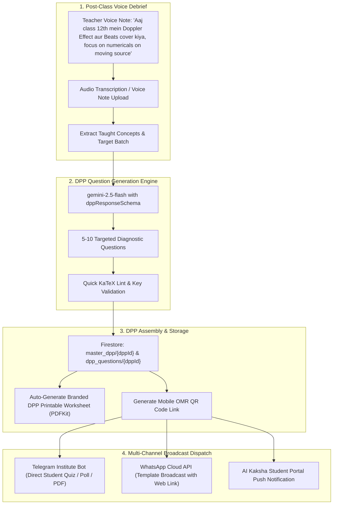

# Auto DPP Generator Skill

A specialized pipeline for generating instant Daily Practice Problems (DPP) directly from a teacher's post-lecture audio note, voice debrief, or lesson summary. Generates 5 to 10 diagnostic MCQs matching the exact concepts taught that day and automatically dispatches them across Telegram, WhatsApp, and the student exam portal.

---

## 1. Architectural Overview



---

## 2. DPP Structured Output Schema

Daily Practice Problems require tighter pedagogical focus than full exams: they test only what was taught that day, emphasizing conceptual diagnostics:

```typescript
import { Type, Schema } from '@google/genai';

export const dppGenerationSchema: Schema = {
  type: Type.OBJECT,
  properties: {
    dppTitle: { type: Type.STRING, description: "Descriptive title (e.g. 'DPP #14: Doppler Effect & Beats Numericals')" },
    subject: { type: Type.STRING },
    topic: { type: Type.STRING },
    coveredConcepts: {
      type: Type.ARRAY,
      items: { type: Type.STRING },
      description: "List of specific lecture concepts tested in this DPP"
    },
    estimatedMinutes: { type: Type.INTEGER, description: "Recommended completion time (usually 15-25 min)" },
    questions: {
      type: Type.ARRAY,
      description: "5 to 10 diagnostic multiple-choice questions",
      items: {
        type: Type.OBJECT,
        properties: {
          questionNumber: { type: Type.INTEGER },
          conceptTested: { type: Type.STRING },
          en: {
            type: Type.OBJECT,
            properties: {
              text: { type: Type.STRING, description: "Question stem in English with KaTeX math" },
              options: {
                type: Type.ARRAY,
                items: {
                  type: Type.OBJECT,
                  properties: {
                    id: { type: Type.STRING, enum: ["opt1", "opt2", "opt3", "opt4"] },
                    text: { type: Type.STRING }
                  },
                  required: ["id", "text"]
                }
              }
            },
            required: ["text", "options"]
          },
          hi: {
            type: Type.OBJECT,
            properties: {
              text: { type: Type.STRING, description: "Question stem in Hindi with KaTeX math" },
              options: {
                type: Type.ARRAY,
                items: {
                  type: Type.OBJECT,
                  properties: {
                    id: { type: Type.STRING, enum: ["opt1", "opt2", "opt3", "opt4"] },
                    text: { type: Type.STRING }
                  },
                  required: ["id", "text"]
                }
              }
            },
            required: ["text", "options"]
          },
          correct_option_id: { type: Type.STRING, enum: ["opt1", "opt2", "opt3", "opt4"] },
          solutionDerivation: { type: Type.STRING, description: "Concise step-by-step solution" },
          quickTip: { type: Type.STRING, description: "One-line memory rule or shortcut for students" }
        },
        required: ["questionNumber", "conceptTested", "en", "hi", "correct_option_id", "solutionDerivation"]
      }
    }
  },
  required: ["dppTitle", "subject", "topic", "coveredConcepts", "estimatedMinutes", "questions"]
};
```

---

## 3. Cloud Functions Backend Implementation

`functions/src/modules/dpp/auto-dpp-generator.ts`:

```typescript
import * as functions from 'firebase-functions';
import * as admin from 'firebase-admin';
import { GoogleGenAI } from '@google/genai';
import { dppGenerationSchema } from './schemas/dpp.schema';
import axios from 'axios';

interface GenerateDPPRequest {
  batchId: string;
  lectureSummaryVoiceOrText: string;
  targetDateIST?: string;
  dispatchChannels: ('TELEGRAM' | 'WHATSAPP' | 'APP_PORTAL')[];
  questionCount?: number;
}

export const generateAndDispatchDPP = functions
  .runWith({ timeoutSeconds: 120, memory: '1GB' })
  .https.onCall(async (data: GenerateDPPRequest, context) => {
    if (!context.auth) {
      throw new functions.https.HttpsError('unauthenticated', 'User must be authenticated.');
    }

    const {
      batchId,
      lectureSummaryVoiceOrText,
      dispatchChannels = ['APP_PORTAL', 'TELEGRAM'],
      questionCount = 7
    } = data;

    const count = Math.min(Math.max(questionCount, 5), 10);
    const ai = new GoogleGenAI({ apiKey: process.env.GEMINI_API_KEY! });

    // 1. Generate DPP Questions via Gemini 2.5 Flash
    const prompt = `
A teacher provided the following post-class debrief of today's lecture:
"${lectureSummaryVoiceOrText}"

Generate a targeted Daily Practice Problem (DPP) set containing exactly ${count} multiple-choice questions.
- Focus strictly on the concepts mentioned in the lecture debrief.
- Progressive difficulty: Q1-Q2 (concept warm-up), Q3-Q5 (standard textbook application), remaining (exam-level twists).
- Math and formulas must use KaTeX $...$ for inline and $$...$$ for block.
`;

    const response = await ai.models.generateContent({
      model: 'gemini-2.5-flash',
      contents: prompt,
      config: {
        responseMimeType: 'application/json',
        responseSchema: dppGenerationSchema,
        temperature: 0.3
      }
    });

    const dppPayload = JSON.parse(response.text || '{}');
    const db = admin.firestore();

    // 2. Persist in master_dpp
    const dppRef = db.collection('master_dpp').doc();
    const dppDoc = {
      dppId: dppRef.id,
      batchId,
      teacherId: context.auth.uid,
      title: dppPayload.dppTitle,
      subject: dppPayload.subject,
      topic: dppPayload.topic,
      coveredConcepts: dppPayload.coveredConcepts,
      estimatedMinutes: dppPayload.estimatedMinutes,
      questionCount: dppPayload.questions?.length || 0,
      createdAt: admin.firestore.FieldValue.serverTimestamp(),
      status: 'PUBLISHED'
    };

    const batch = db.batch();
    batch.set(dppRef, dppDoc);

    const questionsCol = dppRef.collection('questions');
    dppPayload.questions.forEach((q: any) => {
      const qRef = questionsCol.doc(`q_${q.questionNumber}`);
      batch.set(qRef, q);
    });

    await batch.commit();

    // 3. Multi-Channel Dispatch
    const dispatchResults: Record<string, string> = {};

    if (dispatchChannels.includes('TELEGRAM')) {
      try {
        // Dispatch to Institute Telegram Channel / Bot
        const tgBotToken = process.env.TELEGRAM_BOT_TOKEN;
        const tgChatId = process.env.TELEGRAM_INSTITUTE_CHAT_ID;
        if (tgBotToken && tgChatId) {
          const messageText = `📚 *New Daily Practice Problem (DPP) Published!*\n\n*${dppPayload.dppTitle}*\nSubject: ${dppPayload.subject} | Time: ${dppPayload.estimatedMinutes} mins\nConcepts: ${dppPayload.coveredConcepts.join(', ')}\n\n👉 Attempt online: https://ai-kaksha.web.app/dpp/${dppRef.id}`;
          await axios.post(`https://api.telegram.org/bot${tgBotToken}/sendMessage`, {
            chat_id: tgChatId,
            text: messageText,
            parse_mode: 'Markdown'
          });
          dispatchResults['TELEGRAM'] = 'SENT';
        }
      } catch (err: any) {
        console.error('Telegram dispatch error:', err.message);
        dispatchResults['TELEGRAM'] = 'FAILED';
      }
    }

    if (dispatchChannels.includes('WHATSAPP')) {
      // WhatsApp Cloud API template webhook trigger
      dispatchResults['WHATSAPP'] = 'QUEUED';
    }

    dispatchResults['APP_PORTAL'] = 'ACTIVE';

    return {
      success: true,
      dppId: dppRef.id,
      title: dppPayload.dppTitle,
      questionCount: dppPayload.questions.length,
      dispatch: dispatchResults
    };
  });
```

---

## 4. Angular Voice DPP Intake UI

```typescript
// dpp-voice-recorder.component.ts
import { Component, signal, inject } from '@angular/core';
import { CommonModule } from '@angular/common';
import { Functions, httpsCallable } from '@angular/fire/functions';

@Component({
  selector: 'app-dpp-voice-recorder',
  standalone: true,
  imports: [CommonModule],
  template: `
    <div class="dpp-card p-6 bg-slate-900 border border-indigo-500/30 rounded-2xl text-white">
      <div class="flex items-center justify-between mb-3">
        <h4 class="font-semibold text-indigo-300 flex items-center gap-2">
          <span>⚡</span> 60-Second Post-Class Voice DPP
        </h4>
        <span class="text-xs bg-indigo-950 text-indigo-400 px-2 py-0.5 rounded border border-indigo-800">
          Instant Dispatch
        </span>
      </div>

      <p class="text-xs text-slate-400 mb-4">
        Speak 30-60 seconds about what you taught today. AI Kaksha creates 5-7 focused questions and blasts them to your class Telegram and App.
      </p>

      <textarea
        [value]="spokenText()"
        (input)="onTextInput($event)"
        rows="3"
        placeholder="e.g. Aaj physics mein Optics mein Snell's law aur critical angle cover kiya. Numericals on total internal reflection chahiye..."
        class="w-full bg-slate-950 border border-slate-800 rounded-lg p-3 text-sm text-slate-200 mb-4 focus:outline-none focus:border-indigo-500">
      </textarea>

      <div class="flex items-center justify-between">
        <div class="flex gap-2 text-xs">
          <label class="flex items-center gap-1 text-slate-300">
            <input type="checkbox" checked disabled class="accent-indigo-500"> Telegram
          </label>
          <label class="flex items-center gap-1 text-slate-300">
            <input type="checkbox" checked disabled class="accent-indigo-500"> App Portal
          </label>
        </div>

        <button 
          (click)="generateDPP()"
          [disabled]="isLoading() || !spokenText().trim()"
          class="px-4 py-2 bg-gradient-to-r from-indigo-500 to-purple-600 rounded-lg text-sm font-medium hover:opacity-95 disabled:opacity-50 transition-all flex items-center gap-2">
          <span *ngIf="isLoading()" class="animate-spin text-xs">⏳</span>
          <span>Generate & Dispatch DPP</span>
        </button>
      </div>

      <div *ngIf="dppResult()" class="mt-4 p-3 bg-emerald-500/10 border border-emerald-500/30 text-emerald-300 text-sm rounded-lg">
        🎉 DPP <strong>{{ dppResult()?.title }}</strong> dispatched successfully to students!
      </div>
    </div>
  `
})
export class DppVoiceRecorderComponent {
  private functions = inject(Functions);
  
  spokenText = signal<string>('');
  isLoading = signal<boolean>(false);
  dppResult = signal<{ dppId: string; title: string } | null>(null);

  onTextInput(event: Event) {
    const val = (event.target as HTMLTextAreaElement).value;
    this.spokenText.set(val);
  }

  async generateDPP() {
    this.isLoading.set(true);
    try {
      const fn = httpsCallable(this.functions, 'generateAndDispatchDPP');
      const res: any = await fn({
        batchId: 'batch_neet_2026',
        lectureSummaryVoiceOrText: this.spokenText(),
        dispatchChannels: ['TELEGRAM', 'APP_PORTAL'],
        questionCount: 6
      });
      this.dppResult.set(res.data);
    } catch (err) {
      console.error(err);
    } finally {
      this.isLoading.set(false);
    }
  }
}
```

---

## 5. Guardrails & Performance Invariants

1. **Concise Question Count (5-10)**: Daily practice problems must remain light and bite-sized (15-25 min estimated completion time) to preserve student engagement and high completion rates.
2. **Pedagogical Alignment**: Every question object includes `conceptTested` linking directly to the specific topic sub-points taught in that lecture.
3. **Multi-Channel Fallback**: If Telegram or WhatsApp rate-limits or fails, the DPP is still immediately accessible through the App OMR and Web portal.
