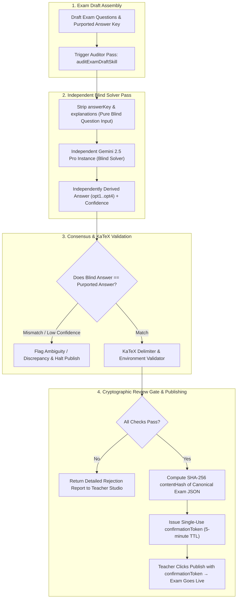

# Blind Solver Auditor Skill

A quality assurance engine and cryptographic review gate for AI Kaksha exams. Guarantees that no erroneous questions, hallucinated answer keys, ambiguous choices, or malformed LaTeX formulas ever reach students.

---

## 1. Architectural Overview



---

## 2. Blind Solver Verification Philosophy

Traditional LLM evaluation suffers from confirmation bias: if a model is given the question and the intended answer key, it will rationalize why the provided key is correct even if flawed.

The **Blind Solver Invariant**:
1. The solver LLM is provided ONLY the question stem and the 4 options (`opt1`, `opt2`, `opt3`, `opt4`).
2. The intended `correct_option_id` and `explanation` are strictly stripped from the input payload.
3. The solver must independently solve the problem and determine the unique correct option.
4. If the Blind Solver's derived option does not match the generator's claimed answer, the question is marked `DISCREPANCY_DETECTED` and publish is blocked.

---

## 3. Strict Auditor Response Schema

```typescript
import { Type, Schema } from '@google/genai';

export const blindAuditSchema: Schema = {
  type: Type.OBJECT,
  properties: {
    questionId: { type: Type.STRING },
    independentlySolvedOptionId: { 
      type: Type.STRING, 
      enum: ["opt1", "opt2", "opt3", "opt4"],
      description: "Option independently determined to be correct by the auditor"
    },
    solverConfidence: { 
      type: Type.NUMBER, 
      description: "Confidence in the derived answer (0.0 to 1.0)" 
    },
    mathematicalDerivation: { 
      type: Type.STRING, 
      description: "Independent step-by-step mathematical proof or factual citation" 
    },
    isAmbiguous: { 
      type: Type.BOOLEAN, 
      description: "True if multiple options could be defended as correct or stem lacks necessary parameters" 
    },
    ambiguityReasoning: { 
      type: Type.STRING, 
      description: "Explanation if question is flagged as ambiguous or flawed" 
    },
    katexSyntaxErrors: {
      type: Type.ARRAY,
      items: { type: Type.STRING },
      description: "List of unparseable LaTeX commands or unescaped symbols"
    }
  },
  required: [
    "questionId",
    "independentlySolvedOptionId",
    "solverConfidence",
    "mathematicalDerivation",
    "isAmbiguous",
    "katexSyntaxErrors"
  ]
};
```

---

## 4. KaTeX & LaTeX Formula Linter

Before math questions reach mobile screens, equations must pass automated AST/regex validation to avoid client-side rendering crashes:

```typescript
export interface KaTeXLintResult {
  isValid: boolean;
  errors: string[];
}

export function lintKaTeXString(text: string): KaTeXLintResult {
  const errors: string[] = [];

  // Check 1: Forbidden environments that crash KaTeX
  const illegalEnvironments = [
    /\\begin\{align\}/i,
    /\\begin\{eqnarray\}/i,
    /\\begin\{equation\*\}/i,
    /\\linebreak/i,
    /\\usepackage/i
  ];

  for (const envRegex of illegalEnvironments) {
    if (envRegex.test(text)) {
      errors.push(`Forbidden LaTeX environment detected: ${envRegex.source}. Use standard KaTeX aligned or inline math.`);
    }
  }

  // Check 2: Balanced math delimiters ($ and $$)
  const singleDollarCount = (text.match(/(?<!\$)\$(?!\$)/g) || []).length;
  if (singleDollarCount % 2 !== 0) {
    errors.push(`Unbalanced inline math delimiters ($): found ${singleDollarCount} single dollar signs.`);
  }

  const doubleDollarCount = (text.match(/\$\$/g) || []).length;
  if (doubleDollarCount % 2 !== 0) {
    errors.push(`Unbalanced block math delimiters ($$): found ${doubleDollarCount} double dollar tags.`);
  }

  return {
    isValid: errors.length === 0,
    errors
  };
}
```

---

## 5. Cloud Function Implementation & Cryptographic Token

`functions/src/modules/audit/blind-solver.ts`:

```typescript
import * as functions from 'firebase-functions';
import * as admin from 'firebase-admin';
import * as crypto from 'crypto';
import { GoogleGenAI } from '@google/genai';
import { blindAuditSchema } from './schemas/blind-audit.schema';
import { lintKaTeXString } from './utils/latex-linter';

export const auditAndIssuePublishToken = functions
  .runWith({ timeoutSeconds: 180, memory: '1GB' })
  .https.onCall(async (data: { examId: string }, context) => {
    if (!context.auth) {
      throw new functions.https.HttpsError('unauthenticated', 'User must be authenticated.');
    }

    const { examId } = data;
    const db = admin.firestore();

    // 1. Fetch Draft Exam & Questions
    const examDoc = await db.collection('master_exams').doc(examId).get();
    if (!examDoc.exists) {
      throw new functions.https.HttpsError('not-found', 'Exam draft not found.');
    }
    const examData = examDoc.data()!;
    if (examData.status === 'PUBLISHED') {
      throw new functions.https.HttpsError('failed-precondition', 'Exam is already published.');
    }

    const questionsSnap = await db.collection('master_exams').doc(examId).collection('draft_questions').get();
    if (questionsSnap.empty) {
      throw new functions.https.HttpsError('failed-precondition', 'Cannot audit empty exam.');
    }

    const ai = new GoogleGenAI({ apiKey: process.env.GEMINI_API_KEY! });
    const auditDiscrepancies: any[] = [];
    const auditedQuestionsPayload: any[] = [];

    // 2. Iterate each question in Blind Mode
    for (const doc of questionsSnap.docs) {
      const q = doc.data();
      const claimedCorrectId = q.correct_option_id;

      // Lint KaTeX first
      const lintEn = lintKaTeXString(q.en.text);
      if (!lintEn.isValid) {
        auditDiscrepancies.push({
          questionId: doc.id,
          issue: 'INVALID_KATEX_SYNTAX',
          details: lintEn.errors
        });
      }

      // Blind Solver Prompt (NO answer key provided)
      const blindPrompt = `
Solve the following multiple-choice problem independently from scratch.
Question (${q.subject} - ${q.topic}):
${q.en.text}

Options:
opt1: ${q.en.options.find((o: any) => o.id === 'opt1')?.text}
opt2: ${q.en.options.find((o: any) => o.id === 'opt2')?.text}
opt3: ${q.en.options.find((o: any) => o.id === 'opt3')?.text}
opt4: ${q.en.options.find((o: any) => o.id === 'opt4')?.text}

Select the single correct option id and provide mathematical proof.
`;

      const auditResponse = await ai.models.generateContent({
        model: 'gemini-2.5-flash',
        contents: blindPrompt,
        config: {
          responseMimeType: 'application/json',
          responseSchema: blindAuditSchema,
          temperature: 0.1
        }
      });

      const auditResult = JSON.parse(auditResponse.text || '{}');

      // Check consensus
      if (auditResult.independentlySolvedOptionId !== claimedCorrectId) {
        auditDiscrepancies.push({
          questionId: doc.id,
          issue: 'ANSWER_KEY_DISCREPANCY',
          claimedOption: claimedCorrectId,
          blindSolvedOption: auditResult.independentlySolvedOptionId,
          derivation: auditResult.mathematicalDerivation
        });
      }

      auditedQuestionsPayload.push({
        id: doc.id,
        stem: q.en.text,
        options: q.en.options,
        correct_option_id: claimedCorrectId
      });
    }

    // 3. Evaluate Pass / Fail
    if (auditDiscrepancies.length > 0) {
      return {
        passed: false,
        issuesCount: auditDiscrepancies.length,
        discrepancies: auditDiscrepancies,
        message: 'Blind Solver audit detected discrepancies or malformed formulas. Review required.'
      };
    }

    // 4. Compute SHA-256 Content Hash
    const canonicalString = JSON.stringify(auditedQuestionsPayload, Object.keys(auditedQuestionsPayload).sort());
    const contentHash = crypto.createHash('sha256').update(canonicalString).digest('hex');

    // 5. Generate Single-Use confirmationToken with 5-min TTL
    const confirmationToken = crypto.randomBytes(32).toString('hex');
    const tokenExpiresAt = Date.now() + 5 * 60 * 1000;

    await db.collection('master_exams').doc(examId).update({
      auditStatus: 'VERIFIED_PASSED',
      contentHash,
      publishConfirmationToken: confirmationToken,
      publishConfirmationTokenExpiresAt: tokenExpiresAt,
      auditedAt: admin.firestore.FieldValue.serverTimestamp()
    });

    return {
      passed: true,
      contentHash,
      confirmationToken,
      expiresInSeconds: 300,
      message: 'Blind Solver verified 100% consensus. Token generated for final publication.'
    };
  });
```

---

## 6. Verification & Security Invariants

1. **Answer Stripping**: The Blind Solver must NEVER receive `correct_option_id`, `distractor_rationales`, or `explanation` in its prompt context.
2. **Deterministic Content Hash**: The `contentHash` covers all questions and option orders. Any modification to a question after audit invalidates the token.
3. **Single-Use Token**: Upon publishing, `publish_exam(examId, confirmationToken)` consumes and deletes the token atomically, preventing replay attacks.
