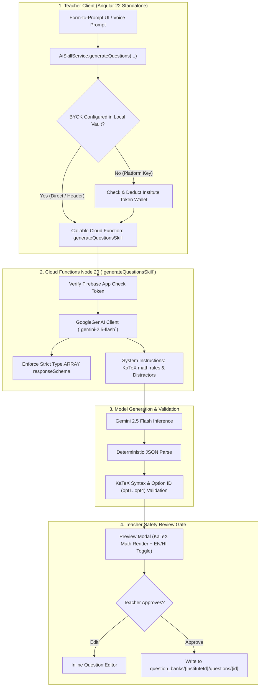

# Gemini Question Generator Skill

A production-grade specification and runbook for generating bilingual (English and Hindi) competitive examination questions (JEE, NEET, UPSC, SSC, CBSE) using Google GenAI SDK (`@google/genai`) and `gemini-2.5-flash` with mathematically enforced structured JSON schema (`responseSchema`).

---

## 1. Architectural Overview



---

## 2. Strict JSON Schema Specification

The model output is constrained mathematically at the token generation level using `responseSchema`:

```typescript
import { Type, Schema } from '@google/genai';

export const questionBankSchema: Schema = {
  type: Type.ARRAY,
  description: "List of generated bilingual multiple-choice questions matching Indian exam standards",
  items: {
    type: Type.OBJECT,
    properties: {
      subject: { type: Type.STRING, description: "Standard academic subject (e.g. Physics, Chemistry, Mathematics, Biology)" },
      topic: { type: Type.STRING, description: "Specific syllabus topic or chapter" },
      subtopic: { type: Type.STRING, description: "Target concept or formula tested" },
      difficulty: { 
        type: Type.STRING, 
        enum: ["Easy", "Medium", "Hard"],
        description: "Bloom's taxonomy difficulty level: Easy (Recall/Understanding), Medium (Application/Analysis), Hard (Evaluation/Multi-concept synthesis)" 
      },
      en: {
        type: Type.OBJECT,
        properties: {
          text: { type: Type.STRING, description: "Question stem in English with strict KaTeX LaTeX" },
          options: {
            type: Type.ARRAY,
            items: {
              type: Type.OBJECT,
              properties: {
                id: { type: Type.STRING, enum: ["opt1", "opt2", "opt3", "opt4"] },
                text: { type: Type.STRING, description: "Option text in English with inline math" }
              },
              required: ["id", "text"]
            }
          }
        },
        required: ["text", "options"]
      },
      hi: {
        type: Type.OBJECT,
        properties: {
          text: { type: Type.STRING, description: "Natural Hindi translation (shuddh Hindi technical terms) with KaTeX LaTeX" },
          options: {
            type: Type.ARRAY,
            items: {
              type: Type.OBJECT,
              properties: {
                id: { type: Type.STRING, enum: ["opt1", "opt2", "opt3", "opt4"] },
                text: { type: Type.STRING, description: "Option text in Hindi" }
              },
              required: ["id", "text"]
            }
          }
        },
        required: ["text", "options"]
      },
      correct_option_id: { 
        type: Type.STRING, 
        enum: ["opt1", "opt2", "opt3", "opt4"],
        description: "Must point to the exact same correct answer in both EN and HI" 
      },
      explanation: {
        type: Type.OBJECT,
        properties: {
          en: { type: Type.STRING, description: "Step-by-step mathematical or conceptual derivation in English" },
          hi: { type: Type.STRING, description: "Step-by-step derivation in Hindi" }
        },
        required: ["en", "hi"]
      },
      distractor_rationales: {
        type: Type.OBJECT,
        properties: {
          opt1: { type: Type.STRING, description: "Diagnostic misconception or computational slip for Option 1" },
          opt2: { type: Type.STRING, description: "Diagnostic misconception or computational slip for Option 2" },
          opt3: { type: Type.STRING, description: "Diagnostic misconception or computational slip for Option 3" },
          opt4: { type: Type.STRING, description: "Diagnostic misconception or computational slip for Option 4" }
        },
        required: ["opt1", "opt2", "opt3", "opt4"]
      }
    },
    required: [
      "subject",
      "topic",
      "subtopic",
      "difficulty",
      "en",
      "hi",
      "correct_option_id",
      "explanation",
      "distractor_rationales"
    ]
  }
};
```

---

## 3. System Instructions & KaTeX Math Guardrails

```typescript
export const GEMINI_QUESTION_SYSTEM_INSTRUCTION = `
You are an elite Chief Examiner for prestigious Indian competitive exams (JEE Main/Advanced, NEET-UG, UPSC CSE, CBSE Board).
Your objective is to generate conceptually rigorous, original, bilingual multiple-choice questions (MCQs) strictly conforming to the requested subject, topic, and difficulty.

CRITICAL FORMATTING & LATEX INVARIANTS:
1. LATEX DELIMITERS:
   - Use '$...$' for inline mathematical and chemical expressions (e.g., $E = mc^2$, $\\vec{B}$, $H_2SO_4$).
   - Use '$$...$$' for display/block equations.
   - NEVER use unsupported environments such as \\begin{align}, \\begin{eqnarray}, \\begin{equation*}, or \\linebreak. Use standard KaTeX matrices \\begin{pmatrix}...\\end{pmatrix} or aligned nested environments.
   - Escape slashes cleanly so JSON remains standard.

2. BILINGUAL PARITY:
   - English ('en') and Hindi ('hi') versions MUST test identical scientific and mathematical facts.
   - Options 'opt1', 'opt2', 'opt3', 'opt4' must correspond one-to-one in meaning between 'en' and 'hi'.
   - 'correct_option_id' MUST identify the correct choice across both languages.
   - Hindi technical nomenclature must follow standard NCERT Hindi textbooks (e.g., 'वैद्युत क्षेत्र' for electric field, 'अवमंदित दोलन' for damped oscillations).

3. BLOOM'S TAXONOMY & DIFFICULTY CALIBRATION:
   - Easy: Direct conceptual recall, single-formula substitution, definitional checks.
   - Medium: Two-step calculations, concept bridging (e.g., kinematics + energy conservation).
   - Hard: Multi-variable synthesis, non-intuitive boundary conditions, graphical analysis.

4. DIAGNOSTIC DISTRACTOR RATIONALES:
   - Each incorrect option (distractor) MUST reflect a common pedagogical student misconception (e.g., missing factor of 1/2, inverted sign, forgetting vector dot product direction, wrong unit conversion).
`;
```

---

## 4. Cloud Functions Backend Implementation

`functions/src/modules/ai/question-generator.ts`:

```typescript
import * as functions from 'firebase-functions';
import * as admin from 'firebase-admin';
import { GoogleGenAI } from '@google/genai';
import { questionBankSchema, GEMINI_QUESTION_SYSTEM_INSTRUCTION } from './schemas/question-bank.schema';

interface QuestionGenRequest {
  subject: string;
  topic: string;
  subtopic?: string;
  difficulty: 'Easy' | 'Medium' | 'Hard';
  count: number;
  customContext?: string;
  byokApiKey?: string;
  targetExam?: 'JEE' | 'NEET' | 'CBSE' | 'FOUNDATION';
}

const COST_PER_QUESTION_TOKENS = 10; // Token economy units

export const generateQuestionsSkill = functions
  .runWith({ timeoutSeconds: 120, memory: '1GB' })
  .https.onCall(async (data: QuestionGenRequest, context) => {
    // 1. Auth & App Check enforcement
    if (!context.auth) {
      throw new functions.https.HttpsError('unauthenticated', 'User must be authenticated.');
    }
    const teacherId = context.auth.uid;
    const instituteId = (context.auth.token as any).instituteId || 'default_institute';

    const {
      subject,
      topic,
      subtopic = '',
      difficulty = 'Medium',
      count = 5,
      customContext = '',
      byokApiKey,
      targetExam = 'NEET'
    } = data;

    // Guardrail: Max 15 questions per request batch to prevent cloud timeout
    const safeCount = Math.min(Math.max(count, 1), 15);

    // 2. BYOK vs Token Economy Billing
    const effectiveApiKey = byokApiKey || process.env.GEMINI_API_KEY;
    if (!effectiveApiKey) {
      throw new functions.https.HttpsError('failed-precondition', 'Gemini API key is not configured.');
    }

    if (!byokApiKey) {
      const db = admin.firestore();
      const walletRef = db.collection('institute_wallets').doc(instituteId);
      const totalTokenCost = safeCount * COST_PER_QUESTION_TOKENS;

      await db.runTransaction(async (tx) => {
        const walletDoc = await tx.get(walletRef);
        const currentBalance = walletDoc.exists ? (walletDoc.data()?.tokenBalance ?? 0) : 0;
        if (currentBalance < totalTokenCost) {
          throw new functions.https.HttpsError(
            'resource-exhausted',
            `Insufficient AI question generation tokens (${currentBalance} available, ${totalTokenCost} required). Please recharge or use BYOK.`
          );
        }
        tx.update(walletRef, {
          tokenBalance: admin.firestore.FieldValue.increment(-totalTokenCost),
          updatedAt: admin.firestore.FieldValue.serverTimestamp()
        });
      });
    }

    // 3. Google GenAI Invocation with Structured Output
    const ai = new GoogleGenAI({ apiKey: effectiveApiKey });
    const userPrompt = `
Generate ${safeCount} high-quality ${targetExam} multiple-choice questions.
Target Subject: ${subject}
Topic: ${topic}
${subtopic ? `Subtopic: ${subtopic}` : ''}
Difficulty Level: ${difficulty}
${customContext ? `Syllabus / Context Constraints:\n${customContext}` : ''}
`;

    try {
      const response = await ai.models.generateContent({
        model: 'gemini-2.5-flash',
        contents: userPrompt,
        config: {
          systemInstruction: GEMINI_QUESTION_SYSTEM_INSTRUCTION,
          responseMimeType: 'application/json',
          responseSchema: questionBankSchema,
          temperature: 0.35 // Suppresses mathematical hallucinations while preserving creative distractor variety
        }
      });

      const rawJson = response.text || '[]';
      const parsedQuestions = JSON.parse(rawJson);

      // 4. Sanity Audit on parsed output
      const validatedQuestions = parsedQuestions.map((q: any, idx: number) => ({
        ...q,
        id: `gen_q_${Date.now()}_${idx}`,
        generatedAt: Date.now(),
        creatorUid: teacherId,
        reviewStatus: 'PENDING_APPROVAL'
      }));

      return {
        success: true,
        count: validatedQuestions.length,
        questions: validatedQuestions
      };
    } catch (err: any) {
      console.error('[GeminiQuestionSkill] Generation error:', err);
      throw new functions.https.HttpsError('internal', `Generation failed: ${err.message || 'Unknown error'}`);
    }
  });
```

---

## 5. Angular Frontend Integration (Review Gate)

### 5.1 Service (`ai-question-generator.service.ts`)

```typescript
import { Injectable, inject } from '@angular/core';
import { Functions, httpsCallable } from '@angular/fire/functions';

export interface GeneratedQuestionItem {
  id: string;
  subject: string;
  topic: string;
  subtopic: string;
  difficulty: 'Easy' | 'Medium' | 'Hard';
  en: { text: string; options: { id: string; text: string }[] };
  hi: { text: string; options: { id: string; text: string }[] };
  correct_option_id: 'opt1' | 'opt2' | 'opt3' | 'opt4';
  explanation: { en: string; hi: string };
  distractor_rationales: Record<string, string>;
  reviewStatus: 'PENDING_APPROVAL' | 'APPROVED' | 'REJECTED';
}

@Injectable({ providedIn: 'root' })
export class AiQuestionGeneratorService {
  private functions = inject(Functions);

  async generate(payload: {
    subject: string;
    topic: string;
    subtopic?: string;
    difficulty: 'Easy' | 'Medium' | 'Hard';
    count: number;
    customContext?: string;
    byokApiKey?: string;
    targetExam?: 'JEE' | 'NEET' | 'CBSE' | 'FOUNDATION';
  }): Promise<GeneratedQuestionItem[]> {
    const fn = httpsCallable(this.functions, 'generateQuestionsSkill');
    const result = await fn(payload);
    const data = result.data as { success: boolean; questions: GeneratedQuestionItem[] };
    return data.questions;
  }
}
```

### 5.2 Teacher Review Gate Component Pattern

Teachers must never be forced to copy-paste blindly. The preview screen renders:
1. **Interactive Language Toggle (`EN` / `HI`)** with KaTeX formula parsing.
2. **Correct Answer Highlight & Distractor Explanations** (revealing the pedagogical reason why each distractor is incorrect).
3. **Approve / Regenerate / Inline Edit** buttons before committing to Firestore `question_banks` or the active exam draft.

---

## 6. Verification & Quality Guardrails

1. **Option ID Invariant**: Every question must contain exactly 4 options labeled `opt1`, `opt2`, `opt3`, `opt4`.
2. **Single Ground Truth**: The correct answer index in `hi.options` must match `en.options` verbatim in scientific validity.
3. **KaTeX Linting**: Questions containing illegal environments (`\begin{align}`) are caught by client-side regex and sanitized or re-prompted.
4. **Token Rate Limit**: Maximum 15 questions per batch invocation to prevent Cloud Function timeout and HTTP 504 gateway errors.
