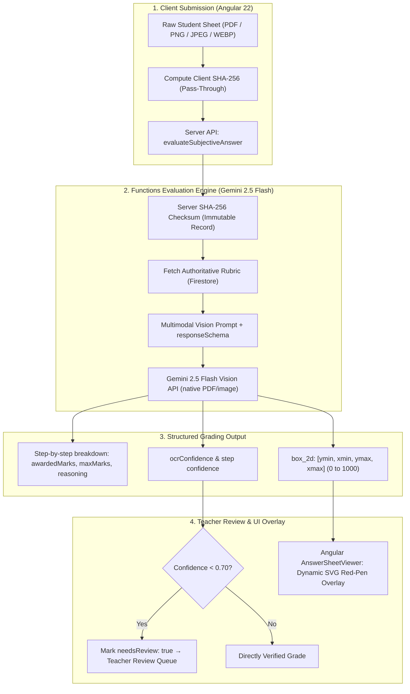

# Subjective Vision Evaluator Skill

A comprehensive runbook and architecture specification for evaluating handwritten student exam sheets using Google GenAI (`@google/genai`), Gemini 2.5 Flash / Pro Multimodal Vision, and structured schema extraction.

---

## 1. System Architecture



---

## 2. Key Pedagogical Vision Directives

When tuning vision prompts for handwritten Indian school and competitive exam papers (CBSE, NEET, IIT-JEE):

1. **Native Multimodal PDF/Image Ingestion**:
   - Never rasterize PDFs in Node.js (which frequently fails or segfaults in minimal container environments). Send the raw base64 buffer directly with `application/pdf` or `image/jpeg` MIME types to Gemini 2.5.
2. **Partial Marking Rubric Enforcement**:
   - Indian entrance exams award granular credit for intermediate conceptual steps:
     - Formula statement and variable definition: $+1$
     - Free-Body Diagram / Geometric figure: $+1$
     - Substitution of boundary values: $+1$
     - Final algebraic simplification with units: $+1$
   - Gemini evaluates each rubric step independently. Even if a numerical calculation fails at the end, previous steps retain their earned marks.
3. **Indian Handwriting OCR Tuning**:
   - Handle cursive lettering, varied pen pressures, subscript/superscript ambiguities ($V_0$ vs $V_O$, $a_c$ vs $a_t$), and crossed-out/scratched-out lines.
   - Instruct the vision model to explicitly ignore struck-through equations.
4. **Normalized 2D Bounding Box (`box_2d`)**:
   - Coordinate specification: `[ymin, xmin, ymax, xmax]` normalized to an integer scale of `0` to `1000`.
   - Scale invariant: Easily maps to client-side SVG viewport `viewBox="0 0 1000 1000"`.
   - Angular overlays `<rect>` with `#EF4444` stroke and a tooltip badge showing marks awarded and step reasoning.

---

## 3. Structured Output Schema (`subjectiveVisionSchema`)

```typescript
import { Type } from '@google/genai';

export const subjectiveVisionSchema = {
  type: Type.OBJECT,
  properties: {
    totalMarksAwarded: { type: Type.NUMBER },
    ocrConfidence: { type: Type.NUMBER },
    steps: {
      type: Type.ARRAY,
      items: {
        type: Type.OBJECT,
        properties: {
          stepId: { type: Type.STRING },
          stepTitle: { type: Type.STRING },
          awardedMarks: { type: Type.NUMBER },
          maxMarks: { type: Type.NUMBER },
          reasoning: { type: Type.STRING },
          confidence: { type: Type.NUMBER },
          pageNumber: { type: Type.INTEGER },
          box_2d: {
            type: Type.ARRAY,
            items: { type: Type.INTEGER } // [ymin, xmin, ymax, xmax] 0-1000
          },
          studentDerivationSnippets: { type: Type.STRING }
        },
        required: ['stepId', 'stepTitle', 'awardedMarks', 'maxMarks', 'reasoning', 'confidence', 'pageNumber', 'box_2d']
      }
    },
    overallPedagogicalFeedback: { type: Type.STRING }
  },
  required: ['totalMarksAwarded', 'ocrConfidence', 'steps', 'overallPedagogicalFeedback']
};
```

---

## 4. Confidence Thresholding & Review Runbook

1. **Threshold Specification**:
   - `CONFIDENCE_REVIEW_THRESHOLD = 0.70`
   - If `ocrConfidence < 0.70` OR any step's `confidence < 0.70`, the system automatically flags `needsReview: true`.
2. **Review Queue State Machine**:
   - Submissions with `needsReview: true` appear in the teacher's Evaluation Cockpit review queue with a high-priority yellow/red status badge.
   - Teachers can inspect the SVG red-pen overlay, click on any step box, edit awarded marks or feedback, and click "Confirm Grade" to sign off.
3. **Data Integrity Guarantee**:
   - Original upload bytes are hashed with SHA-256 upon intake (`computeSha256Checksum()`).
   - The checksum is permanently attached to `submissions/{submissionId}/evaluations/{questionId}` to guarantee non-repudiation and proof that student submissions are never mutated.

---

## 5. Angular SVG Red-Pen Overlay Example

In the Angular client (`answer-sheet-viewer.component.ts`):

```html
<div class="relative inline-block w-full">
  <!-- Student Answer Sheet Image -->
  

  <!-- SVG Annotation Layer -->
  <svg class="absolute inset-0 w-full h-full pointer-events-none" viewBox="0 0 1000 1000" preserveAspectRatio="none">
    <g *ngFor="let step of evaluationSteps" class="pointer-events-auto cursor-pointer">
      <!-- Red Pen Bounding Box -->
      <rect
        [attr.x]="step.box_2d[1]"
        [attr.y]="step.box_2d[0]"
        [attr.width]="step.box_2d[3] - step.box_2d[1]"
        [attr.height]="step.box_2d[2] - step.box_2d[0]"
        fill="rgba(239, 68, 68, 0.12)"
        stroke="#DC2626"
        stroke-width="3"
        stroke-dasharray="6,3"
        rx="8"
      />
      <!-- Marks Callout Badge -->
      <rect
        [attr.x]="step.box_2d[1] + 4"
        [attr.y]="step.box_2d[0] - 22"
        width="90"
        height="20"
        fill="#DC2626"
        rx="4"
      />
      <text
        [attr.x]="step.box_2d[1] + 8"
        [attr.y]="step.box_2d[0] - 8"
        fill="#FFFFFF"
        font-size="12"
        font-weight="bold"
      >
        +{{ step.awardedMarks }}/{{ step.maxMarks }}
      </text>
    </g>
  </svg>
</div>
```
