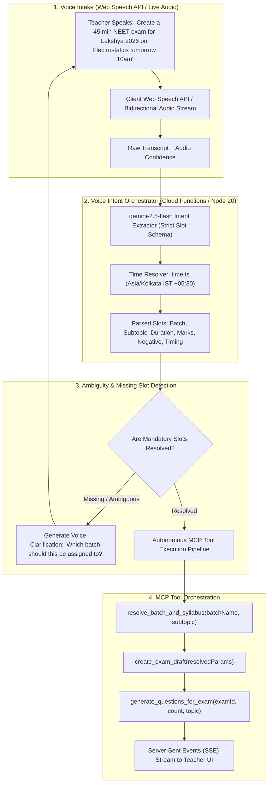

# Voice Intent Exam Orchestrator Skill

A comprehensive architecture, parameter schema, and implementation guide for voice-driven conversational exam orchestration in AI Kaksha. Enables teachers to speak in natural Hinglish or English to configure, parameterize, generate, and publish full exams through an autonomous MCP (Model Context Protocol) tool pipeline.

---

## 1. Architectural Overview



---

## 2. Intent & Slot Extraction Schema

Using Gemini's structured output capability (`responseSchema`), transcripts are parsed into strict type-safe parameter envelopes:

```typescript
import { Type, Schema } from '@google/genai';

export const voiceExamIntentSchema: Schema = {
  type: Type.OBJECT,
  properties: {
    intent: {
      type: Type.STRING,
      enum: [
        "CREATE_EXAM",
        "ADD_QUESTIONS",
        "MODIFY_SCHEDULE",
        "TRIGGER_DPP",
        "CLARIFICATION_RESPONSE",
        "UNKNOWN"
      ],
      description: "Primary detected action from the teacher's statement"
    },
    confidence: { type: Type.NUMBER, description: "Confidence score between 0.0 and 1.0" },
    slots: {
      type: Type.OBJECT,
      properties: {
        batchName: { type: Type.STRING, description: "Spoken name of target batch (e.g. Lakshya 2026, Udaan 11th)" },
        subject: { type: Type.STRING, description: "Academic subject (Physics, Chemistry, Math, Biology)" },
        topic: { type: Type.STRING, description: "Primary syllabus chapter or topic (e.g. Electrostatics)" },
        subtopic: { type: Type.STRING, description: "Granular concept (e.g. Coulomb's Law, Electric Dipole)" },
        questionCount: { type: Type.INTEGER, description: "Total requested questions (default: 15)" },
        durationMinutes: { type: Type.INTEGER, description: "Test duration in minutes (e.g. 45)" },
        marksPerQuestion: { type: Type.NUMBER, description: "Positive marks for each correct question (default: 4)" },
        negativeMarkRule: { 
          type: Type.STRING, 
          enum: ["STANDARD_QUARTER", "ZERO", "HALF", "ONE_MARK"],
          description: "Negative deduction rule. STANDARD_QUARTER = -1 mark for 4-mark question" 
        },
        difficulty: { type: Type.STRING, enum: ["Easy", "Medium", "Hard", "Mixed"] },
        spokenDateExpression: { type: Type.STRING, description: "Raw spoken temporal expression (e.g. 'tomorrow at 10 AM', 'this Saturday 4 PM')" },
        languagePreference: { type: Type.STRING, enum: ["BILINGUAL", "ENGLISH", "HINDI"] }
      },
      required: ["batchName", "topic"]
    },
    missingSlots: {
      type: Type.ARRAY,
      items: { type: Type.STRING },
      description: "List of critical missing fields preventing execution (e.g. ['batchName', 'durationMinutes'])"
    },
    suggestedTeacherClarification: {
      type: Type.STRING,
      description: "Natural conversational follow-up prompt to speak back to the teacher if fields are missing"
    }
  },
  required: ["intent", "confidence", "slots", "missingSlots"]
};
```

---

## 3. Time Resolution Invariant (`time.ts` - Asia/Kolkata)

Voice requests in Indian classrooms frequently use relative terms like *"kal subah 10 baje"* or *"this coming Monday at 3:30 PM"*. Because server instances typically execute on UTC runtime clocks, all date-time resolutions must strictly normalize against `Asia/Kolkata` (IST, UTC+05:30).

```typescript
import { DateTime } from 'luxon';

export interface ResolvedExamSchedule {
  startTimestampMs: number;
  endTimestampMs: number;
  formattedIST: string;
}

export function resolveSpokenSchedule(
  spokenExpression: string, 
  durationMinutes: number = 45, 
  nowReference: DateTime = DateTime.now().setZone('Asia/Kolkata')
): ResolvedExamSchedule {
  const expr = spokenExpression.toLowerCase().trim();
  let baseDate = nowReference;

  if (expr.includes('tomorrow') || expr.includes('kal')) {
    baseDate = baseDate.plus({ days: 1 });
  }

  // Regex pattern for time: "10:00 AM", "10 am", "4:30 pm", "subah 10 baje"
  const timeMatch = expr.match(/(\d{1,2})(?::(\d{2}))?\s*(am|pm|subah|shaam|dopahar)?/i);
  let hour = 10;
  let minute = 0;

  if (timeMatch) {
    let rawHour = parseInt(timeMatch[1], 10);
    const rawMin = timeMatch[2] ? parseInt(timeMatch[2], 10) : 0;
    const meridian = timeMatch[3]?.toLowerCase();

    if ((meridian === 'pm' || meridian === 'shaam' || meridian === 'dopahar') && rawHour < 12) {
      rawHour += 12;
    } else if (meridian === 'am' && rawHour === 12) {
      rawHour = 0;
    }
    hour = rawHour;
    minute = rawMin;
  }

  const startDateTime = baseDate.set({ hour, minute, second: 0, millisecond: 0 });
  const endDateTime = startDateTime.plus({ minutes: durationMinutes });

  return {
    startTimestampMs: startDateTime.toMillis(),
    endTimestampMs: endDateTime.toMillis(),
    formattedIST: `${startDateTime.toFormat('dd LLL yyyy, hh:mm a')} to ${endDateTime.toFormat('hh:mm a')} IST`
  };
}
```

---

## 4. MCP Tool Execution Pipeline & Telemetry

When an exam creation intent is verified, the orchestrator triggers sequential MCP tools, streaming live telemetry to the teacher's browser via Server-Sent Events (SSE):

```typescript
// Telemetry Event Structure
export interface OrchestratorTelemetryEvent {
  step: 'TRANSCRIPTION' | 'INTENT_EXTRACTED' | 'BATCH_RESOLVED' | 'DRAFT_CREATED' | 'QUESTIONS_GENERATING' | 'READY_FOR_REVIEW';
  status: 'IN_PROGRESS' | 'COMPLETED' | 'FAILED';
  message: string;
  payload?: any;
}
```

### Callable Cloud Function Orchestrator

```typescript
import * as functions from 'firebase-functions';
import * as admin from 'firebase-admin';
import { GoogleGenAI } from '@google/genai';
import { voiceExamIntentSchema } from './schemas/voice-intent.schema';
import { resolveSpokenSchedule } from './utils/time';

export const processVoiceExamIntent = functions
  .runWith({ timeoutSeconds: 60, memory: '1GB' })
  .https.onCall(async (data: { transcript: string; instituteId: string }, context) => {
    if (!context.auth) {
      throw new functions.https.HttpsError('unauthenticated', 'User must be authenticated.');
    }

    const { transcript, instituteId } = data;
    const ai = new GoogleGenAI({ apiKey: process.env.GEMINI_API_KEY! });

    // 1. Extract Structured Intent & Slots
    const prompt = `
Analyze the teacher's spoken instructions for creating or managing an exam:
"${transcript}"
Current reference time in IST: ${new Date().toLocaleString('en-IN', { timeZone: 'Asia/Kolkata' })}
Extract all required slots and identify any ambiguity.
`;

    const response = await ai.models.generateContent({
      model: 'gemini-2.5-flash',
      contents: prompt,
      config: {
        responseMimeType: 'application/json',
        responseSchema: voiceExamIntentSchema,
        temperature: 0.1
      }
    });

    const parsed = JSON.parse(response.text || '{}');

    // 2. Resolve missing slots or prompt voice clarification
    if (parsed.missingSlots && parsed.missingSlots.length > 0) {
      return {
        success: false,
        requiresClarification: true,
        clarificationSpeech: parsed.suggestedTeacherClarification || 'Please specify the target batch and topic for this exam.',
        partialSlots: parsed.slots
      };
    }

    // 3. Resolve Timestamps in Asia/Kolkata
    const schedule = resolveSpokenSchedule(
      parsed.slots.spokenDateExpression || 'tomorrow 10 AM',
      parsed.slots.durationMinutes || 45
    );

    // 4. Resolve Target Batch in Firestore
    const db = admin.firestore();
    const batchSnap = await db.collection('institutes').doc(instituteId).collection('batches')
      .where('name', '==', parsed.slots.batchName)
      .limit(1)
      .get();

    let resolvedBatchId = 'batch_general';
    if (!batchSnap.empty) {
      resolvedBatchId = batchSnap.docs[0].id;
    }

    // 5. Initialize Draft in master_exams
    const examRef = db.collection('master_exams').doc();
    const examDraft = {
      examId: examRef.id,
      instituteId,
      batchId: resolvedBatchId,
      batchName: parsed.slots.batchName,
      title: `${parsed.slots.topic} Practice Exam`,
      subject: parsed.slots.subject || 'General',
      topic: parsed.slots.topic,
      subtopic: parsed.slots.subtopic || '',
      questionCount: parsed.slots.questionCount || 15,
      durationMinutes: parsed.slots.durationMinutes || 45,
      marksPerQuestion: parsed.slots.marksPerQuestion || 4,
      negativeMarkRule: parsed.slots.negativeMarkRule || 'STANDARD_QUARTER',
      startTimestampMs: schedule.startTimestampMs,
      endTimestampMs: schedule.endTimestampMs,
      status: 'DRAFT',
      createdBy: context.auth.uid,
      createdAt: admin.firestore.FieldValue.serverTimestamp()
    };

    await examRef.set(examDraft);

    return {
      success: true,
      requiresClarification: false,
      examId: examRef.id,
      scheduleNotice: schedule.formattedIST,
      draft: examDraft
    };
  });
```

---

## 5. Angular Client-Side Voice Component & Waveform

```typescript
// voice-intake.component.ts
import { Component, signal, output, inject } from '@angular/core';
import { CommonModule } from '@angular/common';
import { Functions, httpsCallable } from '@angular/fire/functions';

@Component({
  selector: 'app-voice-intake',
  standalone: true,
  imports: [CommonModule],
  template: `
    <div class="voice-card p-6 rounded-2xl bg-slate-900 border border-slate-800 text-white shadow-xl">
      <div class="flex items-center justify-between mb-4">
        <h3 class="text-lg font-semibold flex items-center gap-2">
          <span class="w-3 h-3 rounded-full bg-emerald-500 animate-pulse"></span>
          AI Voice Exam Architect
        </h3>
        <span class="text-xs px-2.5 py-1 rounded-full bg-slate-800 text-slate-300 font-mono">
          IST Asia/Kolkata
        </span>
      </div>

      <div class="transcript-box min-h-[72px] bg-slate-950/80 rounded-xl p-4 text-sm font-sans mb-4 border border-slate-800/80">
        {{ currentTranscript() || 'Tap the microphone and speak: "Create 45-min NEET exam for Lakshya 2026 on Electrostatics tomorrow at 10 AM..."' }}
      </div>

      <div class="flex items-center justify-center gap-4">
        <button 
          (click)="toggleListening()"
          [class.bg-rose-600]="isListening()"
          [class.bg-indigo-600]="!isListening()"
          class="px-6 py-3 rounded-full font-medium flex items-center gap-2 hover:opacity-90 transition-all shadow-lg shadow-indigo-500/20">
          <svg *ngIf="!isListening()" class="w-5 h-5" fill="none" stroke="currentColor" viewBox="0 0 24 24">
            <path stroke-linecap="round" stroke-linejoin="round" stroke-width="2" d="M19 11a7 7 0 01-7 7m0 0a7 7 0 01-7-7m7 7v4m0 0H8m4 0h4m-4-8a3 3 0 01-3-3V5a3 3 0 116 0v6a3 3 0 01-3 3z"/>
          </svg>
          <span *ngIf="!isListening()">Speak Exam Prompt</span>
          <span *ngIf="isListening()">Listening... Tap to Process</span>
        </button>
      </div>

      <div *ngIf="clarificationPrompt()" class="mt-4 p-3 rounded-lg bg-amber-500/10 border border-amber-500/30 text-amber-200 text-sm">
        <strong>Clarification needed:</strong> {{ clarificationPrompt() }}
      </div>
    </div>
  `
})
export class VoiceIntakeComponent {
  private functions = inject(Functions);
  
  isListening = signal<boolean>(false);
  currentTranscript = signal<string>('');
  clarificationPrompt = signal<string | null>(null);
  examCreated = output<string>();

  private recognition: any;

  constructor() {
    this.initSpeechRecognition();
  }

  private initSpeechRecognition() {
    const SpeechRecognition = (window as any).SpeechRecognition || (window as any).webkitSpeechRecognition;
    if (SpeechRecognition) {
      this.recognition = new SpeechRecognition();
      this.recognition.continuous = false;
      this.recognition.interimResults = true;
      this.recognition.lang = 'en-IN'; // Indian English / Hinglish speech recognition

      this.recognition.onresult = (event: any) => {
        const text = Array.from(event.results)
          .map((r: any) => r[0].transcript)
          .join('');
        this.currentTranscript.set(text);
      };

      this.recognition.onend = () => {
        this.isListening.set(false);
        if (this.currentTranscript().trim()) {
          this.submitVoicePrompt(this.currentTranscript());
        }
      };
    }
  }

  toggleListening() {
    if (!this.recognition) return;
    if (this.isListening()) {
      this.recognition.stop();
      this.isListening.set(false);
    } else {
      this.currentTranscript.set('');
      this.clarificationPrompt.set(null);
      this.recognition.start();
      this.isListening.set(true);
    }
  }

  async submitVoicePrompt(transcript: string) {
    const fn = httpsCallable(this.functions, 'processVoiceExamIntent');
    const res: any = await fn({ transcript, instituteId: 'inst_alpha' });
    if (res.data.requiresClarification) {
      this.clarificationPrompt.set(res.data.clarificationSpeech);
    } else {
      this.examCreated.emit(res.data.examId);
    }
  }
}
```

---

## 6. Guardrails & Safety Invariants

1. **Negative Time Prevention**: An exam's `endTimestampMs` must strictly exceed `startTimestampMs` by at least 5 minutes.
2. **Past Schedule Rejection**: Any resolved start time in the past triggers a voice clarification prompt: *"The scheduled time is in the past. Did you mean tomorrow at that time?"*
3. **Teacher-in-the-Loop Confirmation**: The autonomous workflow populates drafts in `master_exams` but NEVER publishes without explicit teacher confirmation or single-use verification token.
