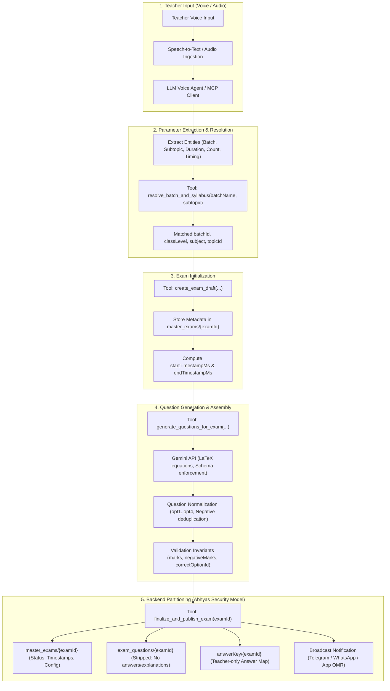
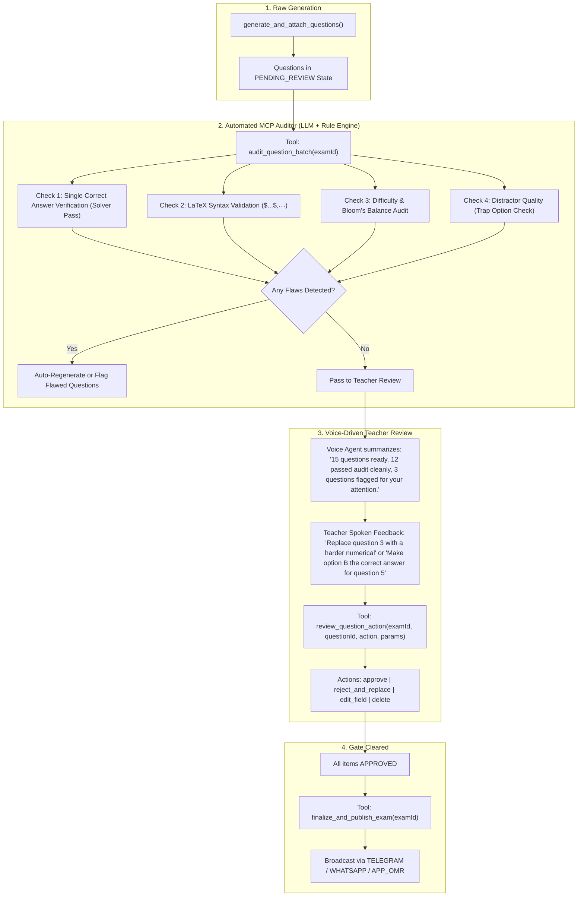

# Abhyas Autonomous Voice & Agent Workflow Specification

> **Document Purpose**: Technical architecture and parameter specification for transitioning the Abhyas Exam and Question creation pipeline into an autonomous, voice-driven Agent / MCP (Model Context Protocol) workflow.

---

## 1. Executive Summary & Vision

In this Proof-of-Concept (PoC), teachers will be able to speak naturally to an AI voice agent:
> *"Create a 45-minute NEET practice exam for Batch 'Lakshya 2026' on Electrostatics, with 15 moderate MCQs, 4 marks each and standard 1/4 negative marking, scheduled for tomorrow from 10:00 AM to 10:45 AM."*

The autonomous workflow orchestrates:
1. **Speech-to-Intent Extraction & Parameter Normalization**
2. **Context Resolution** (resolving batch name to `batchId`, verifying syllabus/subtopic, subject, and class level)
3. **Exam Initialization** (draft creation with time-locks and anti-cheat timestamps)
4. **Autonomous AI Question Generation & Deduplication** (generating LaTeX-formatted MCQs matching constraints)
5. **Security Partitioning & Publishing** (splitting metadata into `master_exams`, questions into `exam_questions`, and answers into `answerKey`)

---

## 2. End-to-End System Flow Diagram



---

## 3. Exam Creation Parameters & Schema

### 3.1 Field Specifications

| Parameter | Type | Required | Default | Validation & Rules | Voice Intent Mapping |
| :--- | :--- | :--- | :--- | :--- | :--- |
| `title` | `string` | **Yes** | Auto-generated | Non-empty string | *"NEET Electrostatics Quiz"* |
| `batchId` | `string` | **Yes** | None | Must match a valid teacher `batchId` | Spoken batch name (e.g., *"Batch A"*, *"Lakshya 2026"*) resolved via fuzzy match |
| `duration` | `number` | **Yes** | `60` | Integer $> 0$ (minutes) | Spoken minutes or hours (*"45 minutes"*, *"1 hour"*) |
| `targetQuestions` | `number` | **Yes** | `10` | Integer $> 0$ | *"15 questions"* |
| `defaultMarks` | `number` | **Yes** | `4` | Range: `1` to `20` | *"4 marks per question"* |
| `negativeRule` | `string` | No | `'none'` | `'none'`, `'1/2'`, `'1/3'`, `'1/4'` | Spoken: *"one-fourth negative"*, *"no negative marks"* |
| `defaultNegativeMarks` | `number` | Computed | `0` | Calculated: $\text{marks} \times \text{rule}$ | For 4 marks with 1/4 rule $\rightarrow$ `1.0` |
| `allowedAttempts` | `number` | No | `1` | Integer $\ge 1$ | *"1 attempt"* |
| `date` / `endDate` | `string` | **Yes** | Today (YYYY-MM-DD) | Valid ISO date strings | Spoken: *"tomorrow"*, *"today"*, *"25th Nov"* |
| `startTime` / `endTime` | `string` | **Yes** | `'00:00'`, `'23:59'` | Format `HH:mm` (24-hour) | *"from 10 AM to 11 AM"* |
| `startTimestampMs` | `number` | Computed | - | Derived Unix epoch (ms) | Strict start barrier for student device clock check |
| `endTimestampMs` | `number` | Computed | - | Derived Unix epoch (ms) | Strict submission barrier in Firebase RTDB security rules |
| `languages` | `string[]` | **Yes** | `['en']` | At least 1 language (`['en']`, `['hi']`) | *"in Hindi and English"*, *"English only"* |
| `primaryLanguage` | `string` | **Yes** | `'en'` | Must exist in `languages` | Language used for main question labels |
| `subject` | `string` | **Yes** | From batch | Auto-filled from selected batch | *"Physics"*, *"Chemistry"* |
| `classLevel` | `string` | No | From batch | Auto-filled from selected batch | *"Class 12"*, *"Dropper"* |
| `examPattern` | `string` | No | `'CBSE'` | `'NEET'`, `'JEE'`, `'CBSE'`, `'ICSE'`, etc. | Pattern/curriculum target |
| `shuffleQuestions` | `boolean` | No | `true` | Boolean flag | Randomize question sequence per student |
| `shuffleOptions` | `boolean` | No | `true` | Boolean flag | Randomize option sequence per student |
| `hasSections` | `boolean` | No | `false` | Enable multi-section structure | *"Section A 10 questions, Section B 5 questions"* |
| `omrConfig` | `object` | No | `omrMode: 'standard'` | Preset: `'standard'`, `'bpsc'`, or `'custom'` | Options count (4/5), Option E Opt-Out, blank penalty |
| `status` | `string` | **Yes** | `'draft'` | `'draft'`, `'upcoming'`, `'live'`, `'open'` | Set to `'upcoming'` or `'live'` after questions populated |

---

## 4. Question Creation & AI Generation Parameters

### 4.1 Question Types Supported
- **MCQ** (Single Correct Multiple Choice): Most common, 4 or 5 options.
- **Numeric**: Integer or decimal answer (`0` is valid).
- **Short Text**: Concise string response.
- **Subjective**: Descriptive multi-line answers with step-by-step LaTeX solution.

### 4.2 Single Question Data Contract (`IExamQuestion`)
```typescript
interface IExamQuestion {
  id: string;                      // e.g. "q_1732066800000_1"
  type: "MCQ" | "Numeric" | "Short Text" | "Subjective";
  marks: number;                   // 1 to 20
  negativeMarks: number;           // 0 <= negativeMarks <= marks
  subject: string;                 // e.g. "Physics"
  topic: string;                   // e.g. "Electrostatics"
  subtopic?: string;               // e.g. "Coulomb's Law and Electric Field"
  difficulty: "easy" | "medium" | "hard";
  classLevel?: string;             // e.g. "Class 12"
  examPattern?: string;            // e.g. "NEET"
  
  // Multilingual content blocks
  en?: {
    text: string;                  // Question statement (with $LaTeX$)
    options?: [
      { id: "opt1"; text: string },
      { id: "opt2"; text: string },
      { id: "opt3"; text: string },
      { id: "opt4"; text: string }
    ];
  };
  hi?: {
    text: string;
    options?: [ { id: "opt1"; text: string }, ... ];
  };
  
  correctOptionId?: string;        // "opt1" | "opt2" | "opt3" | "opt4" (MCQ only)
  answer?: string | number;        // (Numeric or Short Text)
  explanation?: {
    en?: string;                   // Detailed solution with LaTeX
    hi?: string;
  };
}
```

### 4.3 AI Generation Flow & Parameters (Gemini API)

- **Endpoint**: `https://generativelanguage.googleapis.com/v1beta/models/{model}:generateContent`
- **Default Model**: `gemini-2.5-flash`
- **Key Resolution Hierarchy**:
  1. Teacher user document (`users/{uid}.geminiApiKey`)
  2. Platform system config fallback (`app_config/admin_ai.geminiApiKey`)

#### Input Parameters to AI Generator:
1. `topic` & `subtopic`: Exact syllabus unit.
2. `count`: Batch size (1 to 15 questions per call).
3. `difficulty`: `'easy'`, `'medium'`, or `'hard'`.
4. `examPattern`: Curriculum context (`'NEET'`, `'JEE'`, `'CBSE'`).
5. `languages`: Target languages (`['en']`, `['hi']`, or both).
6. `excludeQuestions`: List of existing question prompts to enforce negative constraints and prevent repetition.
7. `promptGuideline`: Custom teacher voice instructions (e.g., *"Focus on numerical problems with dielectric slabs"*).

#### Output Schema Enforcement:
The LLM response must return a JSON array adhering strictly to:
```json
[
  {
    "en": {
      "text": "Two charges $q_1 = +2\\mu\\text{C}$ and $q_2 = -8\\mu\\text{C}$ are placed at distance $r$...",
      "options": [
        { "id": "A", "text": "$F/2$ Attractive" },
        { "id": "B", "text": "$4F$ Repulsive" },
        { "id": "C", "text": "$2F$ Attractive" },
        { "id": "D", "text": "$F$ Repulsive" }
      ]
    },
    "correctOption": "A",
    "explanation": {
      "en": "Using Coulomb's law: $F = k \\frac{|q_1 q_2|}{r^2}$..."
    },
    "difficulty": "medium",
    "topic": "Electrostatics"
  }
]
```
*Normalization Layer automatically converts `A, B, C, D` to `opt1, opt2, opt3, opt4`.*

---

## 5. Architectural Security Model (Abhyas Backend)

When finalizing an exam, the system **never** stores answers alongside public questions. The agent must respect the three-way partition:

1. **`master_exams/{examId}`**:
   - Contains: metadata, batchId, duration, timestamps, OMR rules, section definitions.
   - Questions array stored here is empty or omitted.
2. **`exam_questions/{examId}`**:
   - Contains: Question statements, options, and images.
   - **Stripped fields**: `correctOptionId`, `answer`, `explanation` are explicitly erased so students cannot inspect client payloads.
3. **`answerKey/{examId}`**:
   - Contains: Map of `questionId -> { correctOptionId, answer, explanation, marks, negativeMarks }`.
   - Protected by Firebase Security Rules; readable only by teachers and the auto-grading cloud function.

---

## 6. Proposed MCP Server Tool Definitions for Autonomous Flow

For an autonomous voice agent or MCP server, the following atomic tools should be exposed:

### Tool 1: `resolve_teacher_context`
- **Purpose**: Get current teacher's batches, subjects, and recent syllabus topics to resolve ambiguous speech.
- **Inputs**: None (`teacherId` injected from auth session).
- **Outputs**: List of batches (`{ id, name, subject, classLevel }`), recent exams.

### Tool 2: `create_exam`
- **Purpose**: Initialize an exam document with schedule, duration, and marking scheme.
- **Inputs**:
  ```json
  {
    "title": "string",
    "batchId": "string",
    "duration": 45,
    "targetQuestions": 15,
    "defaultMarks": 4,
    "negativeRule": "1/4",
    "date": "2026-11-21",
    "startTime": "10:00",
    "endTime": "11:00",
    "languages": ["en"],
    "isSubjective": false
  }
  ```
- **Outputs**: `{ "examId": "exam_xyz789", "status": "draft" }`

### Tool 3: `generate_and_attach_questions`
- **Purpose**: Trigger AI generation for a given topic/subtopic and attach questions to the draft exam.
- **Inputs**:
  ```json
  {
    "examId": "exam_xyz789",
    "subject": "Physics",
    "topic": "Electrostatics",
    "subtopic": "Capacitance and Dielectrics",
    "count": 15,
    "difficulty": "medium",
    "languages": ["en"],
    "guidelines": "Focus on formula applications and numericals"
  }
  ```
- **Outputs**: `{ "generatedCount": 15, "questions": [...] }`

### Tool 4: `finalize_and_publish_exam`
- **Purpose**: Run invariant validations, partition questions into `exam_questions` and `answerKey`, and set status to `upcoming`.
- **Inputs**: `{ "examId": "exam_xyz789", "status": "upcoming" }`
- **Outputs**: `{ "success": true, "examUrl": "https://abhyas.app/exam/exam_xyz789" }`

---

---

## 8. Interactive Question & Answer Review Gate Architecture (MCP & Voice)

To guarantee high pedagogical quality and prevent hallucinated answers or malformed mathematical expressions, the autonomous workflow requires an interactive **Review Gate** between generation and publishing.



### 8.1 Additional MCP Tools for Review & QA

1. **`audit_question_batch`**:
   - **Inputs**: `{ "examId": "exam_123" }`
   - **Behavior**: Runs an independent solver pass to verify whether the AI's designated `correctOptionId` mathematically matches the question statement. Checks for broken LaTeX delimiters (`$`, `\frac{}`) and ambiguous wording.
   - **Outputs**: Audit report with pass/warn/fail status per question.

2. **`review_question_action`**:
   - **Inputs**:
     ```json
     {
       "examId": "exam_123",
       "questionId": "q_456",
       "action": "replace | edit | approve | delete",
       "edits": {
         "correctOptionId": "opt2",
         "difficulty": "hard",
         "customPrompt": "Generate a Coulomb's law question with dielectric medium"
       }
     }
     ```
   - **Voice Agent Usage**: When the teacher hears the question preview and says: *"Change the correct answer of question 4 to B"*, or *"Replace question 7 with a question on Gauss's Law"*, the agent calls this tool.

3. **`preview_exam_summary_voice`**:
   - **Inputs**: `{ "examId": "exam_123" }`
   - **Outputs**: Clean textual digest designed for text-to-speech (TTS), summarizing topics covered, difficulty split (e.g. 5 Easy, 7 Medium, 3 Hard), and total marks.

4. **`broadcast_assignment`**:
   - **Inputs**: `{ "examId": "exam_123", "channels": ["TELEGRAM", "WHATSAPP", "APP_OMR"] }`
   - **Behavior**: Uses Abhyas's Telegram bot integration (`TelegramTwaService`) and WhatsApp notification hooks to broadcast test links directly into student batch channels upon final approval.

