# AI Kaksha (Abhyas) — 5-Person Team Implementation Plan · v2

> **Scope**: **Workflow A** (Voice Exam → Review Gate → Publish, plus Auto DPP) and **Workflow B** (handwritten answer-sheet grading with an Angular red-pen overlay). Firestore 3-way partition sealed by deny-all security rules. Server on **Cloud Run**, frontend on **Firebase Hosting**.
>
> Technical details (file contents, prompts, endpoints, security invariants) are in **`docs/IMPLEMENTATION_PLAN.md` v2**. This document covers **who does what, and when**.

---

## 📝 What Changed from v1

| Change | Why |
|---|---|
| **RTDB time lock removed** → Hitesh builds a server-clock submission check (`Date.now() <= endTimestampMs`) instead | Express already knows the real time; a second database adds setup for nothing |
| **PDF-to-image conversion removed** → PDFs go straight to Gemini | Gemini reads PDFs natively; conversion libraries break inside Alpine Docker |
| **Server SVG renderer removed** → Gemini returns `box_2d` coordinates and **Aditya builds the overlay in Angular** | Simpler, no file storage, teacher overrides re-render instantly |
| **Aditya now owns Workflow B front to back** (server + Evaluation Cockpit UI) | v1 gave Paritosh every frontend screen, making Paritosh the bottleneck |
| Tools are typed functions run by a **server-side pipeline with SSE progress**; a real MCP endpoint is Sandeep's stretch goal | v1 called REST endpoints "MCP" and didn't say who orchestrates the chain |
| `@google/genai` (not the deprecated `@google/generative-ai`) with `responseSchema` | Reliable JSON, current SDK |
| **Server issues `contentHash` + `confirmationToken` at audit time** | v1 never said who issues the token |
| **Dates resolved on the server**, not by Gemini | LLMs miscompute "tomorrow 10 AM" |
| **Hour-0 contract handshake** (first 20 min, everyone) | Prevents integration pain at hour 3:30 |
| Auth described honestly as a **demo token** | v1 claimed forged-token rejection while hardcoding the teacher |
| **`firestore.rules` deny-all** + a student endpoint that proves answers are stripped | Makes the partition claim demonstrable |
| Demo script reordered and latency claims made realistic | v1 promised "<2 s" and "15 s" for multi-call Gemini flows |
| Accessibility checks added for Paritosh and Aditya | CLAUDE.md requires AXE + WCAG AA |

---

## 👥 1. Team Roster

| Member | Role | Owns |
|---|---|---|
| **Sandeep** | Backend & Pipeline Lead | Express server, demo-token auth, tool functions, workflow pipeline + **SSE**, confirmation token/hash, idempotency, student endpoint. *Stretch*: real `/mcp` endpoint via `@modelcontextprotocol/sdk` |
| **Sakshi** | AI & Prompt Engineer | `@google/genai` provider (structured output, backoff, thinking budget), intent prompt + server date resolution, question generation (parallel batches), blind solver audit, Auto DPP prompt |
| **Aditya** | Workflow B Owner (full-stack) | Upload endpoint (multer 2, checksum, rubric from Firestore), multimodal grading prompt with `box_2d`, review flag, **Evaluation Cockpit UI + SVG overlay + Signal Forms overrides** |
| **Paritosh** | Frontend & Signals Lead (Workflow A UI) | `McpClientService` (mock + live), `ExamOrchestratorService`, routes with params, Voice Copilot (speech + waveform + telemetry), Exam Studio (KaTeX), Review Gate, toasts |
| **Hitesh** | DevOps, Data & QA Lead | Firebase Admin setup, seed data, `firestore.rules`, server-clock submission check, Dockerfile, Cloud Run + Secret Manager, Firebase Hosting, Vitest tests, smoke-test script, accessibility audit, demo runbook |

---

## 🕒 2. Timeline (0:00 – 6:30)

```mermaid
gantt
    title 5-Person Parallel Delivery Schedule v2
    dateFormat X
    axisFormat %d
    section All
    Contract Handshake                 :c0, 0, 20
    section Sandeep (Backend/Pipeline)
    Express + Auth + Tool Skeletons    :m1_1, 20, 90
    Pipeline + SSE + Firestore Writes  :m1_2, 90, 210
    Token/Hash + Publish + Student API :m1_3, 210, 300
    E2E Integration (Stretch: /mcp)    :m1_4, 300, 360
    section Sakshi (AI / Prompts)
    genai Provider + Intent + Dates    :m2_1, 20, 90
    Question Gen (parallel batches)    :m2_2, 90, 210
    Blind Solver Audit + Auto DPP      :m2_3, 210, 300
    Backoff, Latency Tuning, Golden Run:m2_4, 300, 360
    section Aditya (Workflow B)
    Upload + Checksum + Rubric Seed    :m3_1, 20, 90
    Grading Prompt with box_2d         :m3_2, 90, 210
    Cockpit UI + SVG Overlay           :m3_3, 210, 300
    Overrides + Review Flag + a11y     :m3_4, 300, 360
    section Paritosh (Workflow A UI)
    Mock Client + Orchestrator + Routes:m4_1, 20, 90
    Voice Copilot + SSE Telemetry      :m4_2, 90, 210
    Exam Studio KaTeX + Review Gate    :m4_3, 210, 300
    Toasts, Polish, a11y Fixes         :m4_4, 300, 360
    section Hitesh (DevOps/Data/QA)
    Firebase + Seed + Rules            :m5_1, 20, 90
    Tests + Deploy Pipelines (early)   :m5_2, 90, 210
    Submit Check + Smoke Script        :m5_3, 210, 300
    Prod Deploy + AXE Audit + Runbook  :m5_4, 300, 360
    section All
    Two Full Dry Runs + Backup Video   :d0, 360, 390
```



> **Deploy early.** Hitesh deploys a "hello world" server to Cloud Run and the empty Angular shell to Firebase Hosting **before hour 3:30**. IAM, secrets, and CORS problems are much cheaper to find early than at hour 6.

---

## 📂 3. Workstreams & Files

### 🤝 Everyone — 0:00 to 0:20: Contract Handshake
- Write `api.contracts.ts` together and commit identical copies to `server/src/contracts.ts` and `src/app/shared/models/api.contracts.ts`.
- It covers request/response types for every endpoint, the SSE `RunEvent` union, and the `IEvalResponse` shape with `box_2d`.
- From then on, Paritosh and Aditya's UI work runs against `mcp.mode: 'mock'` until the live endpoints are ready.

---

### 🛠️ Sandeep: Backend & Pipeline Lead
**Goal**: A reliable server that runs the tool chain and streams its progress live.

- `server/src/index.ts`: bootstrap, CORS allow-list (`localhost:4200` + Hosting origin from env), route mounting.
- `server/src/auth/middleware.ts`: **demo token** (`Bearer` header or `?token=` for SSE). Sets `req.auth`. Wrong or missing token → `401`.
- `server/src/tools/*.ts`: `resolve_teacher_context`, `create_exam`, `generate_and_attach_questions` (idempotent on `requestId`), `audit_question_batch` (returns `contentHash` + one-time `confirmationToken`), `finalize_and_publish_exam` (second call → `409 IDEMPOTENCY_CONFLICT`), `create_auto_dpp`.
- `server/src/utils/strip.ts` + `canonical-json.ts`: answer stripping and stable hashing.
- `server/src/workflows/routes.ts`: `POST /api/workflows/create-exam` / `auto-dpp` → `{ runId }`. `GET /api/workflows/runs/:runId/events` → SSE.
- `server/src/student/routes.ts`: `GET /api/student/exams/:examId` → stripped questions only.
- *Stretch*: `server/src/mcp/server.ts`, a Streamable HTTP MCP endpoint registering the same tool functions, demoed with MCP Inspector.

### 🧠 Sakshi: AI & Prompt Engineer
**Goal**: Fast, valid, mathematically correct Gemini output.

- `server/src/providers/gemini.provider.ts`: `@google/genai`, `gemini-2.5-flash`, `responseSchema` + zod validation, 429/503 backoff, `thinkingBudget` tuned per call.
- `server/src/prompts/intent-extraction.prompt.ts`: receives the current date and `Asia/Kolkata` timezone and returns relative date text + times.
- `server/src/utils/time.ts`: converts those to epoch ms (with a unit test).
- `server/src/prompts/question-generation.prompt.ts`: ≤5 questions per call, 3 parallel calls for 15 questions with a distinct sub-topic each. LaTeX, `opt1–opt4`, misconception-based distractors, explanations. Hindi is Stretch.
- `server/src/prompts/solver-audit.prompt.ts`: **blind** solver. It never sees the key, and the server compares its answers to the key. *Stretch*: `gemini-2.5-pro`.
- `server/src/prompts/auto-dpp.prompt.ts`: topic sentence → fixed intent (10 questions, syllabus-aligned) → the same pipeline.
- **Golden run**: save one known-good intent + question set as the mock-mode fixture, for the demo safety net.

### 👁️ Aditya: Workflow B Owner (full-stack)
**Goal**: Upload a handwritten sheet, grade it, and draw red-pen marks on it.

*Server*
- `server/src/evaluation/routes.ts`: `POST /api/evaluation/grade` (multipart `file`, `rubricId`). Uses multer 2 with memory storage, a 10 MB limit, and a MIME allow-list (PDF/PNG/JPEG/WEBP). Stores the SHA-256 checksum on `evaluations/{id}`. Loads the rubric from Firestore. Sends the file **as-is** to Gemini.
- `server/src/prompts/evaluation-multimodal.prompt.ts`: per rubric step it returns `awarded`, `max`, `reasoning`, `confidence`, `page`, and **`box_2d: [ymin, xmin, ymax, xmax]` (0–1000)**.
- Review flag: any step with confidence < 0.70 → `needsReview: true`.

*Frontend*
- `src/app/features/evaluation/evaluation-cockpit.component.ts` (split into small child components):
  - File drop zone wrapping a real `<input type="file">` (keyboard accessible).
  - Progress steps: Uploading → Reading handwriting → Grading → Done.
  - **Overlay**: `` + absolutely positioned `<svg viewBox="0 0 1000 1000" preserveAspectRatio="none">`, one box + callout per step. **✓ / ✗ icons and text, not colour alone.**
  - **Signal Forms** rubric overrides with a `computed()` live total that also re-renders the overlay.
  - "Needs review" banner and a "Confirm Marks" button.

### 💻 Paritosh: Frontend & Signals Lead (Workflow A UI)
**Goal**: The voice-to-published-exam experience.

- `src/environments/*`: `serverUrl` → `/api` base, prod Cloud Run URL, `demoToken`. **Remove the Gemini key from the frontend.**
- `src/app/core/services/mcp-client.service.ts`: `@Service()`, mock + live modes, `runEvents(runId)` wrapping `EventSource`.
- `src/app/core/services/exam-orchestrator.service.ts`: `@Service()`, a signal state machine (`idle → listening → extracted → drafting → generating → auditing → review → published | failed`), and it stores `publishCredentials` from the `run_completed` event.
- `src/app/app.routes.ts`: add `:examId` params plus `withComponentInputBinding()`.
- `src/app/app.html`: toast container with `aria-live`.
- `voice-copilot.component.ts`: `SpeechRecognition` (`en-IN`, Chrome/Edge) with a **typed fallback always visible**. Waveform from a separate `getUserMedia` → `AnalyserNode` (static under `prefers-reduced-motion`). Preset buttons. Slot chips. SSE telemetry list.
- `exam-studio.component.ts`: KaTeX (`output: 'htmlAndMathml'`), audit badge, flagged questions marked with an icon and text.
- `review-gate.component.ts`: shows the **server's** hash. Real labelled checkboxes. Approve is disabled until all are checked. Sends the token + hash on publish.

### 🚀 Hitesh: DevOps, Data & QA Lead
**Goal**: Everything deployed, sealed, tested, and rehearsed.

- `server/src/services/firebase.service.ts`: Admin SDK with ADC. **Firestore only.**
- `scripts/seed-demo-data.ts`: `teacher-sharma-101`, `batch-lakshya-2026`, `rubrics/capacitance-derivation`, sample answer-sheet image.
- `firestore.rules`: **deny all client reads/writes**. `firebase.json`: Hosting (SPA rewrite) + rules.
- `server/src/student/submit.ts`: `POST /api/student/exams/:examId/submit` → `403 WINDOW_CLOSED` if `Date.now() > endTimestampMs` (**replaces the RTDB time lock**).
- `server/Dockerfile` + `.dockerignore`; commit `server/package-lock.json`.
- `server/deploy.sh`: `gcloud run deploy --source`, region `asia-south1`, `--set-secrets` for `GEMINI_API_KEY` and `DEMO_TOKEN`. Grant the service account `roles/datastore.user` + `roles/secretmanager.secretAccessor`.
- Restrict the Firebase web API key to your domains in Google Cloud Console.
- Tests (Vitest): `strip.spec.ts`, `canonical-json.spec.ts`, `time.spec.ts`.
- `scripts/e2e-smoke-test.sh`: against the prod URL, checks `401` without a token, that the student view has no answer fields, that a second publish returns `409`, and that a late submit returns `403`.
- **AXE audit** of all 4 pages at 5:00, with the findings handed to Aditya and Paritosh.

---

## 🔄 4. Integration Checkpoints

| Time | Gate | Criteria to proceed | If it fails |
|---|---|---|---|
| **0:20** | Contracts | `api.contracts.ts` committed in both places | Don't split up until it is |
| **1:30** | Handshake | Angular calls `resolve_teacher_context` on `localhost:3000` with the demo token. Firestore is seeded. Hello-world is on Cloud Run | Sandeep + Hitesh pair on it |
| **3:30** | **Workflow A cleared** | Voice/typed prompt → 15 LaTeX questions → audit → publish in `live` mode. Student endpoint shows no answers | **Freeze new features**; everyone helps until it passes |
| **5:15** | **Workflow B cleared** | Upload → grade → overlay → override works live | Demo Workflow B in mock mode with the golden fixture |
| **6:00** | Production | Both prod URLs work; smoke script passes | Demo from localhost |
| **6:00–6:30** | Dry runs | 2 full runs of the script below; record a backup video | — |

---

## 🏆 5. Jury Demo Script

1. **Voice intake (Paritosh)**: press the mic and speak the NEET exam prompt. If the room is noisy, click the preset. Slot chips fill in a few seconds.
2. **Live tool pipeline (Sandeep + Sakshi)**: the telemetry panel streams `resolve_teacher_context → create_exam → generate_and_attach_questions → audit_question_batch` with durations (~20–40 s). Narrate that the solver audit is **blind**: it never sees the key.
3. **Exam Studio (Paritosh)**: 15 questions with rendered formulas and the "Solver pass: 15/15 agree" badge.
4. **Security proof (Hitesh)**: open the student endpoint in DevTools → Network and show there are no answer fields. Show `firestore.rules` (deny-all).
5. **Review Gate (Paritosh)**: show the server-issued SHA-256 hash, tick the checklist, Approve. Status → `upcoming`. Optionally show that a second publish is rejected (`409`).
6. **Auto DPP (Sakshi)**: *"Taught projectile motion at an angle — Class 12 JEE"* → 10 questions drafted through the same pipeline.
7. **Red-pen evaluation (Aditya)**: upload the handwritten derivation → provisional 18/20 with ✓/✗ marks drawn on the sheet → override step 2 from 2 to 1, and the total and overlay update live → Confirm.
8. *(Stretch, Sandeep)*: drive the same tools from MCP Inspector to show the real MCP endpoint.

---

## 🤖 6. AI Agent Briefs (paste into your own agent)

### How to use these
1. Give your agent **three things**: this file, `docs/IMPLEMENTATION_PLAN.md` (especially **"Shared Reference for AI Coding Agents"** and the components listed in your brief), and the repo's `CLAUDE.md`.
2. Then paste **your brief below** as the task.
3. Your agent should **only edit files listed under "You own"**. If it needs a change elsewhere, it should tell you, and you ask the owner.

### Shared building blocks (who provides what, and by when)
Others depend on these, so ship a minimal version early even if it's rough:

| Provided by | What | Needed by | Deadline |
|---|---|---|---|
| Sandeep (with Paritosh reviewing) | `server/src/contracts.ts` + `src/app/shared/models/api.contracts.ts`, and the model changes listed in the Shared Reference | Everyone | **0:20** |
| Hitesh | `server/src/services/firebase.service.ts` exporting `db` (Firestore) + seed script | Sandeep, Aditya | **0:45** |
| Sakshi | `server/src/providers/gemini.provider.ts` exporting a generic `generateJson<T>({ model, systemInstruction, parts, responseSchema, zodSchema, thinkingBudget })` with backoff | Aditya (grading), Sakshi's own prompts | **1:00** |
| Sandeep | `server/src/index.ts` + auth middleware, with a router mount point for each team | Aditya, Hitesh | **1:00** |
| Paritosh | `McpClientService` with mock mode + `environment.mcp.demoToken` | Aditya (cockpit UI) | **1:30** |

Until a dependency lands, **stub it** behind the same function signature. Don't wait.

---

### 🛠️ Sandeep: Backend & Pipeline
```text
You are building the Express server and the exam-creation tool pipeline for AI Kaksha.

Read first: docs/IMPLEMENTATION_PLAN.md → "What Changed", "Shared Reference for AI Coding Agents",
Component 0 (contracts), Component 1 (server & auth), Component 3 (tools & pipeline).

You own (may edit): server/package.json, server/tsconfig.json, server/src/index.ts,
server/src/contracts.ts, src/app/shared/models/api.contracts.ts (and the model changes listed in
the Shared Reference), server/src/auth/**, server/src/tools/**, server/src/workflows/**,
server/src/student/routes.ts, server/src/utils/strip.ts, server/src/utils/canonical-json.ts,
server/.env.example. Stretch: server/src/mcp/**.

Do not edit: prompts/ and providers/ (Sakshi), evaluation/ (Aditya), services/firebase.service.ts,
Dockerfile, deploy scripts, tests (Hitesh), anything under src/app except the contract/model files.

You depend on: Sakshi's functions extractIntent(), resolveSchedule(), generateQuestions(),
auditQuestions(), buildAutoDppIntent() and Hitesh's `db`. Stub them with the same signatures
until they land.

Done when:
- All endpoints work with curl using the demo token; requests without it get 401.
- POST /api/workflows/create-exam returns { runId }; GET .../runs/:runId/events streams every
  RunEvent ending in run_completed with contentHash + confirmationToken.
- exam_questions has no correctOptionId/answer/explanation; answer_keys has them.
- Repeating generate with the same requestId does not duplicate questions.
- A second publish returns 409 IDEMPOTENCY_CONFLICT.
- GET /api/student/exams/:examId returns only stripped questions.
```

### 🧠 Sakshi: AI & Prompts
```text
You are building every Gemini call for exam creation in AI Kaksha.

Read first: docs/IMPLEMENTATION_PLAN.md → "What Changed", "Shared Reference for AI Coding Agents",
Component 2 (Gemini integration & prompts), and the create_auto_dpp row in Component 3.

You own: server/src/providers/gemini.provider.ts, server/src/prompts/intent-extraction.prompt.ts,
question-generation.prompt.ts, solver-audit.prompt.ts, auto-dpp.prompt.ts, server/src/utils/time.ts,
server/src/utils/time.spec.ts, and the mock-mode golden fixture
(src/app/core/mocks/golden-run.json, handed to Paritosh).

Do not edit: tools/, workflows/, index.ts (Sandeep), evaluation/ (Aditya), Angular components.

Export these exact functions:
- generateJson<T>(opts): the generic helper with backoff, also used by Aditya. Deliver by 1:00.
- extractIntent(transcript: string, nowIso: string, timezone: string): Promise<IVoiceIntent>
- resolveSchedule(intent: IVoiceIntent, nowIso: string, tz: string):
    { date, startTime, endTime, startTimestampMs, endTimestampMs }
- generateQuestions(params: { subject, topic, subtopics: string[], count: number, difficulty,
    marks, negativeMarks, examPattern }): Promise<IExamQuestion[]>
  (internally splits into parallel batches of ≤5)
- auditQuestions(questions: IExamQuestion[] /* already stripped */):
    Promise<{ questionId: string; solverOptionId: string; issues: string[] }[]>
- buildAutoDppIntent(topicSentence: string, batchId: string): Promise<IVoiceIntent>

Use @google/genai, model gemini-2.5-flash, responseMimeType application/json + responseSchema,
then validate with zod. Never put the API key in Angular.

Done when:
- The NEET demo sentence produces an intent with all slots filled and correct epoch timestamps
  for "tomorrow 10:00–10:45" in Asia/Kolkata (unit-tested in time.spec.ts).
- 15 questions generate in parallel in under ~30 s, all with valid LaTeX and opt1–opt4.
- The audit never receives answer fields and catches a deliberately wrong key in a manual test.
- 429 errors retry with backoff instead of failing the run.
```

### 👁️ Aditya: Workflow B (answer-sheet grading, full-stack)
```text
You are building the handwritten answer-sheet evaluation feature end to end: upload API,
Gemini handwriting reading + rubric grading, and the Angular Evaluation Cockpit with a
red-pen overlay.

Read first: docs/IMPLEMENTATION_PLAN.md → "What Changed", "Shared Reference for AI Coding Agents",
Component 2 (evaluation-multimodal prompt), Component 4, Component 6 (evaluation-cockpit section
+ accessibility checklist). Also CLAUDE.md for Angular rules.

You own: server/src/evaluation/**, server/src/prompts/evaluation-multimodal.prompt.ts,
src/app/features/evaluation/** (split into small child components),
public/samples/capacitance-derivation.png (handwrite a 3-step capacitance derivation with one
deliberate mistake in step 2, then photograph it).

Do not edit: other prompts/providers (Sakshi; call her generateJson helper), index.ts (ask
Sandeep to mount your router at /api/evaluation), firebase.service.ts (use Hitesh's `db`),
Workflow A UI (Paritosh).

Server: POST /api/evaluation/grade (multipart file + rubricId), multer 2 memory storage, 10 MB,
MIME allow-list PDF/PNG/JPEG/WEBP, SHA-256 checksum, rubric loaded from Firestore, file sent to
Gemini as-is (no PDF-to-image conversion). Response is IEvalResponse with
box_2d [ymin, xmin, ymax, xmax] scaled 0–1000. needsReview = any step confidence < 0.70.

Frontend: drop zone wrapping a real <input type="file">; progress steps;  + absolutely
positioned <svg viewBox="0 0 1000 1000" preserveAspectRatio="none"> drawing one box + callout
per step with ✓/✗ icons and text (never colour alone); Signal Forms override inputs (0..max)
with a computed() total that re-renders the overlay; needs-review banner; Confirm Marks button.
Add a mock IEvalResponse so the UI works before the server does.

Done when:
- Uploading the sample sheet returns marks for all 3 steps with boxes on the right lines.
- Overriding a step updates the total and the callout instantly.
- 2–3 more handwriting samples tested by hour 2:00 and the prompt tuned.
- axe DevTools reports no violations on /evaluation.
```

### 💻 Paritosh: Workflow A UI (Angular)
```text
You are building the Angular screens for voice-driven exam creation (Voice Copilot, Exam Studio,
Review Gate) plus the shared client and state services.

Read first: docs/IMPLEMENTATION_PLAN.md → "What Changed", "Shared Reference for AI Coding Agents",
Component 0 (contracts/RunEvent), Component 5, Component 6 (all except evaluation),
accessibility checklist. CLAUDE.md rules are mandatory (signals, @Service(), input()/output(),
native control flow, no ngClass/ngStyle, AXE + WCAG AA).

You own: src/environments/**, src/app/core/services/mcp-client.service.ts,
src/app/core/services/exam-orchestrator.service.ts, src/app/core/services/notification.service.ts,
src/app/core/mocks/** (except golden-run.json from Sakshi), src/app/app.routes.ts,
src/app/app.config.ts, src/app/app.html, src/app/app.ts, src/app/features/voice-copilot/**,
src/app/features/exam-studio/**. You review Sandeep's contract file.

Do not edit: src/app/features/evaluation/** (Aditya), anything under server/.

Key points:
- Remove gemini.apiKey from the environments; add mcp.demoToken;
  serverUrl = http://localhost:3000/api.
- McpClientService works in 'mock' mode (golden fixture, realistic delays) and 'live' mode.
  runEvents(runId) wraps EventSource with ?token=.
- Routes: exam-studio/:examId and review-gate/:examId with withComponentInputBinding().
- Voice: SpeechRecognition en-IN (Chrome/Edge) with typed input always visible; waveform from a
  separate getUserMedia → AnalyserNode; static under prefers-reduced-motion.
- KaTeX with output 'htmlAndMathml'. Review Gate displays the server's contentHash (never
  computes its own) and sends confirmationToken + contentHash to publish.
- Toast container with aria-live.

Done when:
- The full flow works in mock mode by 1:30 and in live mode by 3:30.
- Telemetry shows each tool with its duration as SSE events arrive.
- axe DevTools reports no violations on the three pages.
```

### 🚀 Hitesh: DevOps, Data & QA
```text
You are responsible for Firebase, deployment, tests, and the final demo checklist for AI Kaksha.

Read first: docs/IMPLEMENTATION_PLAN.md → "What Changed", "Shared Reference for AI Coding Agents"
(Firestore documents, env vars, local setup), Component 1 (firebase.service, firestore.rules),
Component 7, "Security Invariants", "Tests".

You own: server/src/services/firebase.service.ts, scripts/seed-demo-data.ts, firestore.rules,
firebase.json, .firebaserc, server/Dockerfile, server/.dockerignore, server/deploy.sh,
server/src/student/submit.ts (Sandeep mounts it), server/src/utils/strip.spec.ts,
server/src/utils/canonical-json.spec.ts, scripts/e2e-smoke-test.sh.

Do not edit: business logic in tools/, prompts/, evaluation/, or Angular components.
Report bugs to the owner instead.

Order of work:
1. 0:20–0:45: firebase.service.ts exporting `db` (Admin SDK + ADC), Firestore created in
   asia-south1, seed script (teacher, batch-lakshya-2026, rubrics/capacitance-derivation).
   Tell the team when done.
2. firestore.rules deny-all; deploy it.
3. Before 3:30: hello-world server on Cloud Run (deploy --source, Secret Manager for
   GEMINI_API_KEY + DEMO_TOKEN, service account roles datastore.user +
   secretmanager.secretAccessor) and the Angular shell on Firebase Hosting. Give Sandeep the
   Hosting URL for ALLOWED_ORIGINS and Paritosh the Cloud Run URL for environment.prod.ts.
4. Vitest: strip.spec.ts, canonical-json.spec.ts (and run Sakshi's time.spec.ts).
5. submit.ts: POST /api/student/exams/:examId/submit → 403 WINDOW_CLOSED when
   Date.now() > endTimestampMs.
6. e2e-smoke-test.sh against prod: 401 without token, student view has no answer fields,
   second publish 409, late submit 403.
7. 5:00: axe DevTools audit of all 4 pages; send findings to Paritosh and Aditya.
8. 6:00: run the demo script twice; record a backup video.

Done when: both prod URLs work, the smoke test passes, and the rules are deployed.
```
