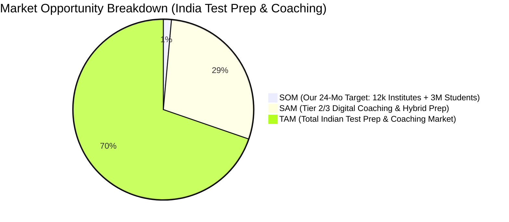
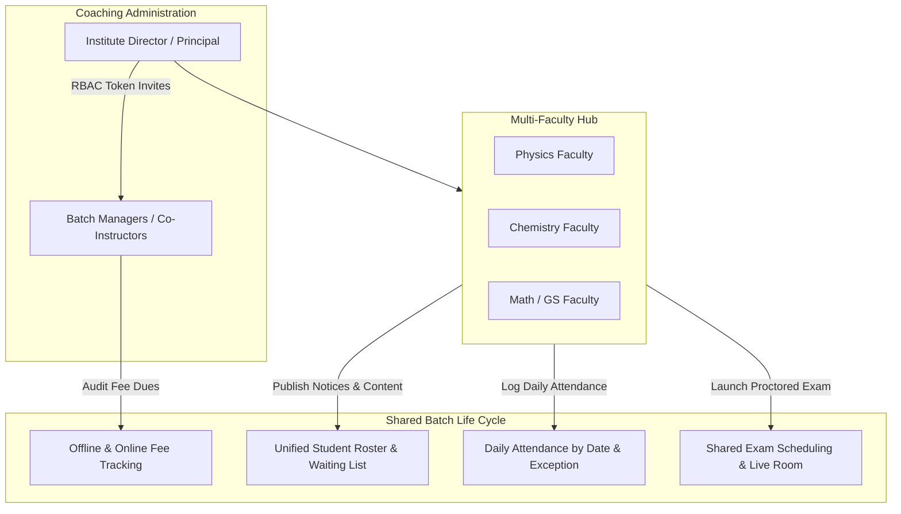
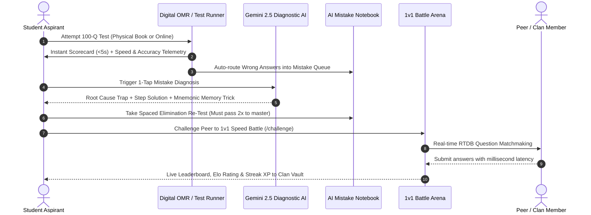
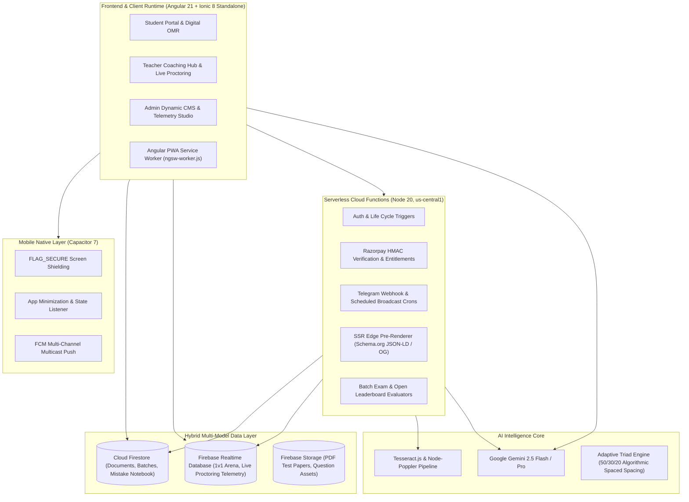

# 🌐 AI Kaksha (Abhyas) — The Complete Education Operating System (Education OS)
> **Master Dossier: Founder Vision, Real-World Market Research, Business Model, Unit Economics & Product Architecture**  
> *Crafted for Hackathon Evaluation, Jury Briefings, Venture Pitches & Engineering Alignment*

---

## 🧭 1. The Founder's Story & Core Philosophy

### "We Don't Need Another LMS or App. We Need an Education Operating System."
Most software in education is built from the outside looking in. Silicon Valley and metro tech hubs build apps to bypass teachers or replace them with pre-recorded video catalogues. Enterprise SaaS vendors build monolithic software with prohibitive price tags that digitize bureaucracy instead of solving teaching fatigue.

**AI Kaksha (Abhyas)** was not conceived in a boardroom. It was born out of lived reality.

```
                  ┌─────────────────────────────────────────────────────────┐
                  │                 THE VICIOUS CYCLE                       │
                  │                                                         │
                  │     Teacher Drowned in Admin/Prep/Grading Chores        │
                  │                          ↓                              │
                  │     Cognitive Exhaustion & Diminished Class Energy      │
                  │                          ↓                              │
                  │      Compromised Quality in the Classroom               │
                  │                          ↓                              │
                  │     Weakened Educational Foundation for Students        │
                  │                          ↓                              │
                  │   National Potential & Last-Mile Human Capital Stunted  │
                  └─────────────────────────────────────────────────────────┘
```

> *"I come from a joint family with two full generations of teachers. My grandfather was a teacher; my father, my mother, and my uncles are all teachers. Growing up, I witnessed a silent tragedy every single day: the work that consumes a teacher’s spirit is rarely teaching.*
>
> *It is the crushing burden of administrative overhead, manual registers, typing test questions, crafting answer keys, manually checking OMR sheets, fee chasing, and endless paperwork. By the time a teacher stands before a classroom of eager minds, their cognitive energy is drained.*
>
> *Teachers are the foundational architects of a child's intellect, character, and ultimately the nation itself. When a teacher's energy is compromised by trivial administrative toil, we compromise the very building block of our civilization.*
>
> *While tech has transformed healthcare, finance, logistics, and commerce, the root-level educator—especially in Tier 2, Tier 3, and rural India—has been systematically excluded. They are neither trained nor empowered with tools that actually respect their workflow. AI Kaksha was built to lift that burden. We cannot change administrative mandates, but we can eradicate teaching prep toil, grading exhaustion, and administrative chaos through intuitive, zero-friction AI.*
>
> *When we empower the teacher, the student automatically catches that spark. Quality, consistency, and inclusivity reach the very last mile."*
>
> — **Founder, AI Kaksha (Abhyas)**

---

## 📈 2. Market Research, Industry Data & TAM-SAM-SOM Analysis

### A. The Indian Test Preparation & Coaching Landscape (2024–2030)
Data synthesized from leading research firms (Redseer Strategy Consultants, IMARC Group, Technavio, and UDISE+ government metrics) reveals the sheer scale of the Indian exam preparation and tutoring sector:

- **Total Indian Test Prep & Coaching Market**: Valued at **$11.6 Billion to $14.8 Billion (~₹96,000 Cr to ₹1,22,000 Cr)** in 2024–2025.
- **FY2030 Market Forecast**: Projected to reach **$23.0 Billion to $26.0 Billion (~₹1,90,000 Cr to ₹2,15,000 Cr)** growing at a **CAGR of 9.5%–10%**.
- **The Private Tuition Reality**: According to UDISE+ and National Education Datasets, **over 27% of all school students in India rely on private tuition/coaching**, climbing past **30% in urban areas**.
- **Coaching Density**: Over **1,000,000+ independent coaching institutes, tuition centers, and private tutors** operate in India. The vast majority (92%) are unorganized neighborhood academies with 20 to 250 students.

### B. Massive Aspirant Numbers (The Demand Influx)
Unlike Western markets where standardized testing is optional or single-session, Indian competitive testing is a life-defining economic gateway:
- **Railway Recruitment (RRB NTPC)**: **~1.21 Crore (12.1 Million)** applicants registered for 11,558 posts in the 2024 cycle alone.
- **SSC CGL & CHSL**: Over **34.8 Lakh (3.48 Million)** registered candidates in 2024.
- **NEET UG (Medical Entrance)**: **24.06 Lakh (2.4 Million)** registered aspirants in 2024.
- **JEE Main (Engineering)**: **14.1 Lakh (1.41 Million)** unique candidates in 2024.
- **State PSCs, Police Constable, Banking (IBPS/SBI), Defence, and CTET**: Aggregating over **35 Million additional aspirants annually**.
- **Total Annual Aspirant Cohort**: **~75,000,000 to 80,000,000 students** actively preparing for competitive or school entrance examinations every year.

### C. The TAM - SAM - SOM Sizing



1. **TAM (Total Addressable Market) — $11.6B to $14.8B (~₹96,000 Cr to ₹1,22,000 Cr)**:
   - The entire offline, hybrid, and online test preparation, competitive entrance, and private coaching market in India across K-12, undergraduate, and government recruitment.
2. **SAM (Serviceable Addressable Market) — $4.5B to $6.0B (~₹37,000 Cr to ₹50,000 Cr)**:
   - Digitally reachable Tier-2, Tier-3, and Tier-4 private coaching institutes, local tuition centres, and smartphone-equipped competitive exam aspirants (SSC, Railway, Banking, Teaching, State PSC, JEE/NEET).
3. **SOM (Serviceable Obtainable Market - 24-Month Horizon) — ₹19.32 Cr to ₹48 Cr ARR ($2.3M to $5.8M)**:
   - Capturing **12,000 paid coaching institutes** (just 1.2% of India's 1M+ centers) and **3,000,000 registered students** (180,000 B2C paid Pro subscribers).

---

## 🥊 3. Competitive Landscape & Our Market Wedge

Existing educational technology is bifurcated into two failing extremes:

```
┌────────────────────────────────────────────────────────────────────────────────────────┐
│                              COMPETITIVE LANDSCAPE MATRIX                              │
├──────────────────────┬────────────────────────────┬────────────────────────────────────┤
│ Category             │ Incumbents & Players       │ Structural Flaw / Fatal Gap        │
├──────────────────────┼────────────────────────────┼────────────────────────────────────┤
│ Closed Proprietary   │ Testbook, Adda247,         │ • Walled garden: Forces students   │
│ B2C Apps             │ Unacademy, PhysicsWallah   │   to abandon their physical books. │
│                      │                            │ • Prohibitive cost (₹2k-₹4k/exam). │
│                      │                            │ • No multi-teacher coaching tools. │
├──────────────────────┼────────────────────────────┼────────────────────────────────────┤
│ White-Label B2B      │ Classplus, Teachmint       │ • Prohibitive lock-in retainers    │
│ SaaS Platforms       │                            │   (₹29,999 to ₹60,000/yr upfront). │
│                      │                            │ • Excludes 90% of local tutors.    │
│                      │                            │ • Generic video apps; no OMR loop. │
├──────────────────────┼────────────────────────────┼────────────────────────────────────┤
│ Physical Exam Books  │ Kiran, Pinnacle, Youth     │ • 500-page paper books sold cheap. │
│ & Telegram PDFs      │ Competition Times          │ • ZERO analytics, no timer, no     │
│                      │                            │   negative marks, errors lost.     │
├──────────────────────┼────────────────────────────┼────────────────────────────────────┤
│ AI KAKSHA            │ The Complete Education OS  │ • ₹499/mo zero-friction SaaS.      │
│ (ABHYAS)             │ (Multi-Teacher + Student   │ • Phygital OMR digitizes ANY book. │
│                      │  Arena + Creator Engine)   │ • Gemini AI Mistake Diagnostics.   │
│                      │                            │ • Blended cost: 3.3 paise / user.  │
└──────────────────────┴────────────────────────────┴────────────────────────────────────┘
```

### Our Core Unfair Advantage: The "Phygital" Market Wedge
- **We Don't Fight Physical Books — We Digitize Them**: Millions of Tier 2/3 aspirants spend ₹500 on physical books (*Pinnacle 6500 SSC Math, Kiran Previous Years*). We don't ask them to stop buying books. With **Abhyas Digital OMR**, they solve questions from their physical books while bubbling on their phone screen.
- **Instant Value Hook**: In under 5 seconds, they receive speed telemetry, net negative deductions, and auto-export of errors into the **AI Mistake Notebook**.
- **Bottom-Up Trojan Horse**: When students use the Digital OMR and viral 9:16 scorecards, their coaching teachers take notice. The teacher signs up for the ₹499/mo Coaching OS to manage batches, attendance, and live proctored tests for the same students.

---

## 🏛️ 4. Defining the Paradigm: The Triad Education OS

AI Kaksha rejects narrow categorizations. It is neither just an LMS, nor just a student learning app, nor just an open test marketplace. **It is all three, fused into a single unified Education OS**:

```
                       ┌──────────────────────────────────────────────┐
                       │           AI KAKSHA: EDUCATION OS            │
                       └──────────────────────┬───────────────────────┘
                                              │
         ┌────────────────────────────────────┼────────────────────────────────────┐
         │                                    │                                    │
         ▼                                    ▼                                    ▼
┌──────────────────┐               ┌──────────────────┐               ┌──────────────────┐
│   PILLAR 1:      │               │   PILLAR 2:      │               │   PILLAR 3:      │
│  INSTITUTE &     │               │  STUDENT & PEER  │               │   OPEN CREATOR   │
│  MULTI-TEACHER OS│◄─────────────►│  ARENA & GRIND   │◄─────────────►│  MARKETPLACE &   │
│                  │               │                  │               │  PHYGITAL OMR    │
├──────────────────┤               ├──────────────────┤               ├──────────────────┤
│• Multi-Faculty   │               │• Phygital OMR    │               │• Creator Test    │
│  Batch Engine    │               │  (<5s analytics) │  Revenue      │  Series Store    │
│• Live Anti-Cheat │   Personal    │• 1v1 Live Arena  │  Flywheel     │• Subjective Exam │
│  Proctoring Room │   Mastery &   │• Tapasya Focus   │               │  PDF Publisher   │
│• NEP 2020 Matrix │   Diagnostic  │  Room & Streaks  │               │• BYO Test Engine │
│• Auto-Fee & Daily│   Telemetry   │• AI Mistake Book │               │  (Digital OMR on │
│  Attendance Log  │               │  & Spaced Retest │               │  Telegram/Books) │
└──────────────────┘               └──────────────────┘               └──────────────────┘
```

1. **The Institute & Multi-Teacher Operating System**: Multi-faculty coordination, cohort admissions, batch schedules, attendance registers, fee management, live proctored examination rooms, and automated WhatsApp parent communication.
2. **The Open Student Mastery & Gamified Arena**: Completely democratized practice tools open to any student in the country. Digital OMR self-checking, 1v1 Battle Arena, peer clans, focus timers, and Gemini-powered mistake diagnosis.
3. **The Phygital Practice Engine & Creator Marketplace**: Bridges physical study books (*Pinnacle, Kiran, Youth Competition*) and Telegram PDFs into digital analytics, while giving independent teachers an open storefront to monetize crash courses and test series with an 80/20 revenue split.

---

## 🧱 5. The Three Pillars in Detail

### Pillar 1: The Multi-Teacher Coaching & Institute OS
Coaching institutes operate as collaborative teams where multiple subject specialists (Physics, Chemistry, Math, Reasoning, General Studies) share the same cohorts.



- **Collaborative Faculty RBAC**: Tokenized invite system (`generateBatchManagerInvite`, `acceptBatchManagerInvite`) allowing directors to assign co-instructors without exposing root credentials.
- **Attendance & Operations by Exception**: Eliminates 20 minutes of roll calling. Teachers mark attendance with 1-tap presets (Present, Absent, Late) with date history saved in `BatchService`.
- **Live Proctoring Mission Control (`/teacher/exam-management/live-proctoring`)**: Real-time monitor powered by Firebase RTDB tracking student status, screen focus, tab-switches, and app minimizations.
- **Subjective & Objective Test Publisher**: Digital CBT creation with LaTeX support side-by-side with a Subjective Question Paper generator that outputs formatted, printable PDF examination papers complete with institute watermarks.
- **Automated Fee & Parent Transparency**: Fee ledger tracking partial, pending, and cleared student dues with 1-click WhatsApp payment reminders.

---

### Pillar 2: The Student Experience, Gamified Arena & Mastery Loop



- **Universal Digital OMR (`/abhyas/digital-omr`)**: 48px responsive touch bubbles. Allows students to grade an entire 100-question test in under 5 seconds with net negative marking.
- **AI Mistake Notebook (`/student/mistake-book`)**: Solves repeated errors. Snap photos of textbook problems via camera OCR (`ocr-scanner-modal`). Gemini 2.5 breaks errors into: **Conceptual Trap**, **Step Solution**, and **Mnemonic Trick**.
- **Real-Time Multiplayer Battle Arena (`/abhyas/battle`)**: 1v1 and squad battles over Firebase RTDB with millisecond question sync and Elo ratings.
- **Tapasya Focus Engine (`/abhyas/focus`)**: Fullscreen Pomodoro focus room with ambient audio and hourly presence prompts.
- **Study Squads & Clans (`/abhyas/clans`)**: 5-to-30 member study clans contributing daily study XP to an "Amrit Kalash" communal pool.
- **Viral 9:16 Result Celebration Scorecards**: Dynamic canvas graphics for WhatsApp Status and Instagram Stories, including a specialized "Study Grind Card" for low scorers.

---

### Pillar 3: Open Creator Marketplace & Phygital Ecosystem
- **Zero-Friction Test Series Marketplace (`/marketplace`)**: Teachers and creators publish test series directly to students nationwide with an 80/20 revenue split.
- **Telegram Bot & Web App Gateway (`@AbhyasExamBot`)**: Connects to the 50M+ competitive aspirants on Telegram. Automates channel subscription gatekeeping, daily morning tests, and evening leaderboards via Telegram Web Apps (TWA).
- **"Bring Your Own AI" (BYO) Hacker Tier**: Any student or educator can enter their personal Google Gemini API key to receive unlimited AI mistake diagnostics and test creation at **₹0 cost to the platform and user**.

---

## 💰 6. Business Model, Unit Economics & 24-Month Financial Projections

### A. Dual-Engine Revenue Catalog
```
┌────────────────────────────────────────────────────────────────────────────────────────┐
│                              REVENUE MODEL & PRICING                                   │
├──────────────────────────┬───────────────────┬─────────────────────────────────────────┤
│ Offering Stream          │ Pricing           │ Value / Entitlement Mechanics           │
├──────────────────────────┼───────────────────┼─────────────────────────────────────────┤
│ B2C Aspirant Free Tier   │ ₹0                │ Unlimited Digital OMR, 3 AI doubts/day, │
│                          │                   │ 7-day test history.                     │
├──────────────────────────┼───────────────────┼─────────────────────────────────────────┤
│ B2C Abhyas Pro Pass      │ ₹49 / month       │ Unlimited Gemini AI diagnostics, OCR    │
│                          │ ₹399 / year       │ textbook scanner, un-watermarked PDFs.  │
├──────────────────────────┼───────────────────┼─────────────────────────────────────────┤
│ "Bring Your Own AI"      │ ₹0 Free Forever   │ Enter custom Google Gemini API key $\to$│
│ Hacker Tier              │                   │ Unlimited AI features at $0 cost to us. │
├──────────────────────────┼───────────────────┼─────────────────────────────────────────┤
│ B2B Starter Coach        │ Free              │ 1 Batch, 25 Students, basic rank list.  │
├──────────────────────────┼───────────────────┼─────────────────────────────────────────┤
│ B2B Pro Educator         │ ₹499 / month      │ 5 Batches (250 Students), Live          │
│                          │ ₹4,499 / year     │ Proctoring, WhatsApp reports, AI tests. │
├──────────────────────────┼───────────────────┼─────────────────────────────────────────┤
│ B2B Institute Pro        │ ₹1,499 / month    │ Unlimited Batches, staff accounts, full │
│                          │ ₹12,999 / year    │ white-label branding, SMS integration.  │
├──────────────────────────┼───────────────────┼─────────────────────────────────────────┤
│ Creator Marketplace      │ 20% Commission    │ Educators monetize crash courses / test │
│                          │ (80% to Creator)  │ series directly to students.            │
└──────────────────────────┴───────────────────┴─────────────────────────────────────────┘
```

### B. Unit Economics (LTV : CAC Ratios)
- **B2C Student Pro Tier (₹399 / Year)**:
  - **Blended CAC**: ₹18 (Driven by viral 9:16 scorecards, peer 1v1 battle invites, and Telegram bot loops).
  - **COGS per Paid User / Year**: ₹38 (Firebase reads/writes ₹8 + Gemini tokens ₹24 + serverless bandwidth ₹6).
  - **Gross Profit**: ₹361 / year (**90.5% Gross Margin**).
  - **Net Contribution Margin**: ₹343 / year (**86.0% Contribution Margin**).
  - **Payback Period**: **< 1 Month**.
- **B2B Educator SaaS Tier (₹499 / Month or ₹4,499 / Year)**:
  - **CAC per Coaching Center**: ₹350 (Digital ads + ground grassroots outreach).
  - **COGS per Coaching Center (150 students)**: ~₹320 / year.
  - **Gross Profit**: ₹4,179 / year (**92.9% Gross Margin**).
  - **LTV (24-month retention)**: ₹8,998.
  - **LTV : CAC Ratio**: **25.7x**.

### C. 24-Month Financial Projections & Profitability Timeline

| Metric / Financial Item | Month 6 (Validation) | Month 12 (Expansion) | Month 18 (Acceleration) | Month 24 (Scale Leader) |
| :--- | :--- | :--- | :--- | :--- |
| **Registered Students** | 150,000 | 500,000 | 1,500,000 | 3,000,000 |
| **Monthly Active Users (MAU)** | 50,000 | 180,000 | 600,000 | 1,200,000 |
| **Paid B2C Pro Subscribers** | 5,000 | 25,000 | 85,000 | 180,000 |
| **Active Paid Coaching Centers** | 250 | 1,500 | 5,000 | 12,000 |
| **Monthly B2C Revenue** | ₹2.25 L | ₹11.25 L | ₹38.25 L | ₹81.00 L |
| **Monthly B2B SaaS Revenue** | ₹1.25 L | ₹7.50 L | ₹25.00 L | ₹60.00 L |
| **Marketplace & Fee Processing** | ₹0.50 L | ₹2.00 L | ₹8.00 L | ₹20.00 L |
| **Total Monthly Revenue** | **₹4.00 Lakhs** | **₹20.75 Lakhs** | **₹71.25 Lakhs** | **₹1.61 Crores** |
| **Annualized Run Rate (ARR)** | **₹48.0 Lakhs** | **₹2.49 Crores** | **₹8.55 Crores** | **₹19.32 Crores** |
| **Cloud & Infrastructure Costs** | ₹45,000 | ₹1.85 L | ₹5.50 L | ₹11.20 L |
| **Marketing & Acquisition Spend** | ₹90,000 | ₹3.50 L | ₹9.00 L | ₹18.00 L |
| **Net Operating Profit (EBITDA)** | **₹1.85 L (46%)** | **₹12.40 L (60%)** | **₹47.75 L (67%)** | **₹1.15 Cr (71%)** |

### D. Single-Digit Paise Cost Defensibility (`server-cost.md`)
- **Zero Read/Write Penalty for High-Frequency State**: Live proctoring alerts, 1v1 battle matchmaking, and focus presence ticks use **Firebase Realtime Database (RTDB)**. RTDB does not charge per document read/write (only ~$1/GB bandwidth), preventing catastrophic cloud billing spikes during simultaneous exams.
- **Blended Cloud Cost**:
  - **10,000 MAU**: **₹0.00 / month** (100% within free tier).
  - **100,000 MAU**: **₹3,330 / month (~3.3 paise per user)**.
  - **1,000,000 MAU**: **₹78,900 / month (~7.8 paise per user)**.

---

## 🏗️ 7. Technical Architecture & Living Codebase



---

## 📊 8. Status Matrix: What Is Done vs Planned

| Module / Domain | Feature Capability | Status | Primary Source Reference | Strategy Reference |
| :--- | :--- | :--- | :--- | :--- |
| **Student Practice** | Digital OMR Bubble Grid & Instant Evaluation | ✅ **Done** | `src/app/public/abhyas/digital-omr/` | Doc 11 |
| **Student Practice** | 9:16 Viral Scorecard & WhatsApp Share | ✅ **Done** | `src/app/shared/components/shareable-scorecard/` | Doc 11 |
| **Student Practice** | AI Mistake Notebook & Elimination Loop | ✅ **Done** | `src/app/pages/student/mistake-book/` | Doc 12 |
| **Student Practice** | Online Timed Exam Runner & KaTeX Math | ✅ **Done** | `src/app/pages/exam/exam-view/` | Doc 22, 24 |
| **Student Practice** | Multiplayer Quiz 1v1 Battle Arena | ✅ **Done** | `src/app/public/abhyas/battle/` | Doc 20 |
| **Student Practice** | Tapasya Focus Room & Daily Streaks | ✅ **Done** | `src/app/public/abhyas/focus-room/` | Doc 22 |
| **Student Practice** | Study Squads & Communal Clans | ✅ **Done** | `src/app/public/abhyas/clan/` | Doc 23 |
| **Student Practice** | Adaptive Daily Practice (50/30/20 Triad Engine) | 🟡 **In Progress** | `src/app/services/learning/adaptive-practice-engine.service.ts` | Doc 42, 45 |
| **Student Practice** | Universal Dynamic Assessment Widgets | 🔵 **Planned** | `docs/strategy/46-universal-assessment-schema-and-multi-type-form-model-spec.md` | Doc 46, 49 |
| **Student Practice** | Multi-Media Course & Lecture Player | 🔵 **Planned** | `docs/strategy/31-student-learning-player-and-integrated-assessment-runner-spec.md` | Doc 31 |
| **Teacher & Batch** | Multi-Teacher Batch Roster & Admissions | ✅ **Done** | `src/app/pages/teacher/batch/` | Tasks / Doc 32 |
| **Teacher & Batch** | Daily Batch Attendance Ledger | ✅ **Done** | `src/app/pages/teacher/batch/attendance/` | Tasks / Spec 04 |
| **Teacher & Batch** | Offline & Online Student Fee Tracking | ✅ **Done** | `src/app/pages/teacher/payments/` | Doc 15 |
| **Teacher & Batch** | Subjective Question Paper PDF Generator | ✅ **Done** | `src/app/pages/teacher/question-management/subjective-questions/` | Spec 35 |
| **Teacher & Batch** | Live Proctoring Dashboard (Active Telemetry) | ✅ **Done** | `src/app/pages/teacher/exam-management/live-proctoring/` | Doc 28 |
| **Teacher & Batch** | Autonomous Teaching Copilot (Voice / Log) | 🔵 **Planned** | `docs/strategy/29-autonomous-teaching-copilot-and-post-class-automation-spec.md` | Doc 29, 34 |
| **Teacher & Batch** | AI Slide Studio & Smartboard Present Mode | 🔵 **Planned** | `docs/strategy/38-ai-slide-studio-architecture-and-multi-tier-rendering-spec.md` | Doc 38, 39, 40 |
| **Teacher & Batch** | Batch-to-Course Conversion Flywheel | 🔵 **Planned** | `docs/strategy/32-batch-to-course-conversion-and-monetization-flywheel-spec.md` | Doc 32 |
| **School ERP** | School Profiles & Join Requests | ✅ **Done** | `src/app/pages/school/` | Tasks / Spec 01 |
| **School ERP** | Principal Pulse, Timetable & NEP 2020 Cards | 🔵 **Planned** | `tasks/school-manager/` | Specs 00–16 |
| **Anti-Cheat** | Tab-Switch & Blur Detection | ✅ **Done** | `src/app/pages/exam/exam-view/exam-view.page.ts` | Doc 24 |
| **Anti-Cheat** | Fullscreen Exit Locks & App Minimize Watcher | ✅ **Done** | `src/app/pages/exam/exam-view/exam-view.page.ts` | Doc 25, 27 |
| **Anti-Cheat** | DOM AI Extension MutationObserver Sentinel | 🔵 **Planned** | `docs/strategy/26-dom-sanity-and-anti-ai-extension-guard-spec.md` | Doc 26 |
| **Cloud Backend** | Role Claims & Cascading Deletion Triggers | ✅ **Done** | `functions/src/auth/` | Backend Spec |
| **Cloud Backend** | Razorpay Order & Webhook Signature Verification| ✅ **Done** | `functions/src/modules/payments/` | Doc 05, 15 |
| **Cloud Backend** | Telegram Webhook & Automated Scheduler Crons | ✅ **Done** | `functions/src/modules/telegram/` | Doc 14, 33 |
| **Cloud Backend** | Multicast Push Dispatcher (Capacitor + FCM) | ✅ **Done** | `functions/src/modules/push/` | Doc 51 |
| **Cloud Backend** | Bulk Email Campaign & OTP Engine | ✅ **Done** | `functions/src/modules/email/` | Doc 50 |
| **Cloud Backend** | Edge SSR Pre-Rendering for SEO | ✅ **Done** | `functions/src/modules/seo/renderPublicSeoPage.ts` | Doc 52 |
| **Platform & AI** | Dynamic CMS Studio & Route Synthesizer | ✅ **Done** | `src/app/pages/admin/manage-content/` | Doc 53 |
| **Platform & AI** | Gemini 2.5 Flash / Pro AI Key Switcher | ✅ **Done** | `src/app/services/ai/gemini.service.ts` | Doc 12 |
| **Platform & AI** | Cross-Platform PWA & Capacitor Android App | ✅ **Done** | `capacitor.config.ts`, `ngsw-config.json` | Cross-Platform |
| **Platform & AI** | AI Token Credit Metering Ledger | 🔵 **Planned** | `docs/strategy/41-ai-credit-metering-token-monitoring-and-freemium-entitlement-spec.md` | Doc 41 |

---

## 🔮 9. Strategic Execution Horizons: What We Plan to Do

### Horizon 1: Immediate Hackathon Delivery (Next 24–48 Hours)
1. **Adaptive Practice Student Runner (Doc 45)**:
   - Wire the completed mathematical engine ([`adaptive-practice-engine.service.ts`](file:///home/iam5k/projects/abhyas/src/app/services/learning/adaptive-practice-engine.service.ts)) to an interactive full-screen card runner supporting the 50% current / 30% spaced revision / 20% weak recovery Triad.
2. **Automated Batch-to-Telegram Trigger (Doc 33)**:
   - Connect teacher test creation to automated Telegram bot channel notifications with deep link previews.
3. **Advanced Proctoring Actions (Doc 28)**:
   - Implement teacher remote action buttons: `+5 min Extra Time` and `Force Submit Attempt`.

### Horizon 2: Q1 Post-Hackathon — The AI Teaching Copilot
1. **15-Second Post-Class Autonomous Teaching Copilot (Doc 29)**:
   - Eliminates post-lecture prep fatigue. The teacher speaks or writes a single summary sentence (e.g., *"Taught projectile motion at an angle to JEE batch"*). Gemini matches it to syllabus chapters, marks topics completed in the teaching register, and generates a 5-question bilingual DPP.
2. **AI Slide Studio & Smartboard Present Mode (Docs 38–40)**:
   - Browser-based presentation generation via `pptxgenjs` with fullscreen Smartboard drawing and timer tools.
3. **Universal Assessment Widgets (Docs 46 & 49)**:
   - Rich interactive question types: Numerical Tolerance, Fill-in-the-Blanks, and Match-Pairs.

### Horizon 3: Q2–Q3 — Institutional Expansion & Last-Mile Reach
1. **School Manager ERP Suite (`tasks/school-manager/`)**:
   - Comprehensive multi-tenant school operations: Principal Pulse overview, rapid attendance-by-exception, and NEP 2020 holistic report cards.
2. **Physical Book QR Partnerships**:
   - Pre-printed QR codes inside leading competitive exam practice books (*Pinnacle, Kiran, Youth Competition*), launching students directly into the Digital OMR sheet for that specific mock test.
3. **Vernacular Multi-Lingual Expansion**:
   - Localization into 7 Indian languages (Hindi, Marathi, Bengali, Tamil, Telugu, Odia, Gujarati) to bring true technological inclusivity to the grassroots level.

---

## 🏆 10. The Hackathon & Venture Winning Edge: Why AI Kaksha Wins

1. **Authentic Founder Story & Mission-Driven Foundation**: Built from the lived experience of a two-generation teaching family, targeting real cognitive exhaustion rather than superficial feature bloat.
2. **A Massive, Non-Discretionary Market**: Directly addresses India's **$11.6B+ test prep market** with **75M+ annual aspirants** (1.21 Cr in Railway RRB alone, 34.8L in SSC, 24L in NEET) and **1,000,000+ underserved local coaching institutes**.
3. **Disruptive "Phygital" Trojan Horse**: Does not force students to abandon physical books. Bridges cheap physical books to digital analytics via Digital OMR, naturally driving grassroots B2B coaching adoption.
4. **Hyper-Efficient Unit Economics (3.3 paise / user)**: Achieved via hybrid RTDB/Firestore architecture, producing **86%–90% contribution margins** and a **25.7x LTV:CAC ratio**.
5. **Over 100,000+ Lines of Battle-Tested Code**: Production-grade Angular 21, Capacitor, and Firebase Cloud Functions ready for immediate institutional rollout.
