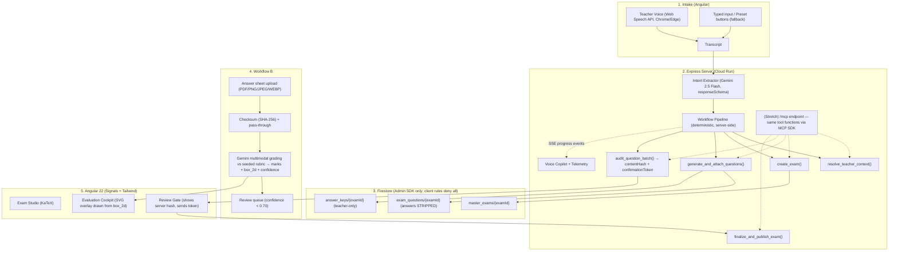

# AI Kaksha (Abhyas) — 7-Hour Implementation Plan (5-Person Team) · v2

> **Execution Directive**: Ship a demo that works end-to-end at every checkpoint. **Workflow A** (Voice Exam → Review Gate → Publish) is the must-have. **Workflow B** (handwritten answer-sheet grading with red-pen overlay) and **Auto DPP** come next. Anything that doesn't change what the judges see is cut or deferred.

---

## 📝 What Changed from v1

| # | Change | Why |
|---|---|---|
| 1 | Added **Must / Should / Stretch** scope tiers | v1 had no slack; one blocker would sink the demo |
| 2 | Tools are plain typed functions, run by a **server-side pipeline** that streams progress over **SSE**. A real MCP endpoint (official SDK) is a stretch goal on top of the same functions | v1 called REST endpoints "MCP tools", and nothing defined who orchestrates the tool chain |
| 3 | `@google/generative-ai` → **`@google/genai`**, with `responseSchema` structured output on every call | Old SDK is deprecated; avoids fragile JSON parsing |
| 4 | **`audit_question_batch` returns `contentHash` + `confirmationToken`**, computed on the server | v1 never said who issues the token; client and server hashing could disagree |
| 5 | **Dropped PDF rasterization**: PDFs go straight to Gemini as `application/pdf` | Gemini reads PDFs natively; PDF-to-image in Node breaks inside Alpine Docker |
| 6 | **Red-pen overlay moved to Angular**: Gemini returns `box_2d` coordinates and Angular draws `<svg>` over the sheet image | Removes the server SVG engine and Firebase Storage; teacher overrides re-render instantly |
| 7 | **Dropped RTDB time lock** in favor of a server-clock check | No student side exists to demo it; Express already knows the real time |
| 8 | Auth is an honest **static demo token**; `verifyIdToken` is a stretch goal | v1 hardcoded a teacher yet claimed to reject forged tokens |
| 9 | Added `firestore.rules` (deny all client access) | The answer-key partition is only secure if clients can't read it |
| 10 | Dates resolved **on the server** (Asia/Kolkata), not by the LLM | LLMs miscompute "tomorrow 10 AM" |
| 11 | Parallel generation batches, `thinkingBudget`, request-ID idempotency | 15 questions + audit could take 30–60 s; retries could duplicate questions |
| 12 | Hour-0 **API contract handshake**; frontend builds against `mcp.mode: 'mock'` | Server can't import Angular models; avoids painful integration at hour 3:30 |
| 13 | Deployment owned by **Hitesh**, who deploys early (before 3:30); deploy via `--source` + Secret Manager; **frontend on Firebase Hosting** | v1 had backwards ownership, deprecated `gcr.io`, no API-key wiring, and no frontend hosting |
| 14 | Added an accessibility checklist and minimal Vitest tests | CLAUDE.md requires AXE/WCAG AA; answer stripping is the headline security claim |

---

## 🎯 Scope Tiers

| Tier | Items |
|---|---|
| **Must** (demo fails without it) | Voice/typed intake → intent extraction → create exam → generate questions → solver audit → Exam Studio (KaTeX) → Review Gate → publish. Mock-mode fallback for every call. Cloud Run + Firebase Hosting deploy. |
| **Should** | Workflow B with one seeded rubric + Angular red-pen overlay + teacher overrides. Auto DPP (reuses the Workflow A pipeline with a fixed intent). Student view endpoint proving answers are stripped. |
| **Stretch** | Real MCP endpoint via `@modelcontextprotocol/sdk`. Firebase Auth `verifyIdToken`. Hindi (`hi`) question translations. Server-clock submission lock. Audit with `gemini-2.5-pro`. |
| **Cut** | RTDB time lock, PDF rasterization, server-side SVG renderer, Firebase Storage for derived images. |

---

## 🏗️ Architecture



---

## 👥 Team & Ownership (5 people)

The hour-by-hour schedule, dependency deadlines, and each person's copy-paste AI agent brief are in **`five-person-plan.md`**. This file holds the technical detail. Each component below is tagged with its owner.

| Member | Role | Components owned in this file |
|---|---|---|
| **Sandeep** | Backend & Pipeline Lead | 0 (contracts, with Paritosh reviewing), 1 (server, auth), 3 (tools, pipeline, SSE, student view). *Stretch*: `/mcp` endpoint |
| **Sakshi** | AI & Prompt Engineer | 2 (Gemini provider + intent, generation, audit, Auto DPP prompts; `time.ts`) |
| **Aditya** | Workflow B Owner (full-stack) | 2 (evaluation prompt only), 4 (upload + grading), 6 (Evaluation Cockpit UI + overlay) |
| **Paritosh** | Frontend & Signals Lead (Workflow A UI) | 5 (environments, client, orchestrator, routes, shell), 6 (Voice Copilot, Exam Studio, Review Gate) |
| **Hitesh** | DevOps, Data & QA Lead | 1 (`firebase.service.ts`, `firestore.rules`, seed), 7 (Docker, Cloud Run, Hosting), tests, smoke script, submission check, AXE audit |

**Integration checkpoints** (details and fallbacks in `five-person-plan.md`)
- **0:20** — Contracts committed (everyone).
- **0:45** — `db` exported + Firestore seeded (Hitesh).
- **1:00** — `generateJson` helper (Sakshi) and server skeleton with auth (Sandeep).
- **1:30** — Angular calls `resolve_teacher_context` on `localhost:3000`; the whole UI works in mock mode.
- **3:30** — Workflow A works end-to-end in `live` mode, with hello-world already on Cloud Run. *If not, freeze new work and everyone helps.*
- **5:15** — Workflow B works end-to-end. *If not, demo Workflow B in mock mode.*
- **6:00** — Production URLs work; 2 dry runs + backup video by 6:30.

---

## 🛠️ Detailed Component & File Plan

### Component 0: Shared API Contracts — *Everyone at hour 0; Sandeep owns the file, Paritosh reviews*

#### [NEW] `server/src/contracts.ts` ⇄ `src/app/shared/models/api.contracts.ts` (identical copies)
- Request/response types for every endpoint below.
- SSE event union:
  ```ts
  type RunEvent =
    | { type: 'tool_started'; tool: string; at: number }
    | { type: 'tool_finished'; tool: string; durationMs: number; summary: string }
    | { type: 'tool_failed'; tool: string; error: string }
    | { type: 'run_completed'; examId: string; contentHash: string; confirmationToken: string };
  ```
- Collection names use snake_case: `master_exams`, `exam_questions`, `answer_keys`, `evaluations`, `rubrics`, `batches`.

---

### Component 1: Server & Auth (`server/`) — *Sandeep (server, auth) · Hitesh (Firebase, rules)*

#### [NEW] `server/package.json`
```json
{
  "name": "aikaksha-server",
  "version": "1.0.0",
  "type": "module",
  "scripts": {
    "dev": "tsx watch src/index.ts",
    "build": "tsc",
    "start": "node dist/index.js",
    "test": "vitest run"
  },
  "dependencies": {
    "@google/genai": "^1.0.0",
    "express": "^5.1.0",
    "cors": "^2.8.5",
    "dotenv": "^16.4.5",
    "firebase-admin": "^13.0.0",
    "multer": "^2.0.0",
    "zod": "^3.23.8"
  },
  "devDependencies": {
    "@types/express": "^5.0.0",
    "@types/cors": "^2.8.17",
    "@types/multer": "^1.4.12",
    "@types/node": "^22.0.0",
    "tsx": "^4.19.0",
    "typescript": "^5.6.0",
    "vitest": "^4.0.8"
  }
}
```
> Commit `server/package-lock.json`. The Docker build's `npm ci` fails without it.
> Stretch: add `@modelcontextprotocol/sdk` for the real `/mcp` endpoint.

#### [NEW] `server/src/index.ts`
- Listens on `process.env.PORT ?? 3000`.
- CORS allow-list: `http://localhost:4200` plus the Firebase Hosting origin (from `ALLOWED_ORIGINS` env var).
- Mounts:
  - `/api/mcp/*` — tool endpoints (auth required)
  - `/api/workflows/*` — pipeline runs + SSE (auth required)
  - `/api/evaluation/*` — uploads (auth required)
  - `/api/student/*` — student-safe views (Should)

#### [NEW] `server/src/auth/middleware.ts`
- **Demo auth, stated honestly**: accepts `Authorization: Bearer <DEMO_TOKEN>` (from env), and also `?token=` for SSE because `EventSource` can't send headers.
- Sets `req.auth = { teacherId: 'teacher-sharma-101', tenantId: 'institute-alpha-delhi' }`.
- Missing or wrong token → `401 UNAUTHENTICATED`.
- *Stretch*: replace with `admin.auth().verifyIdToken()` + Firebase Auth on the frontend.

#### [NEW] `server/src/services/firebase.service.ts` — *Hitesh*
- `firebase-admin` with Application Default Credentials (Cloud Run service account; `gcloud auth application-default login` locally).
- Firestore only. **No RTDB.**
- Seeds on first run (idempotent): `batches/batch-lakshya-2026` (Physics, Class 12, NEET, 45 students) and `rubrics/capacitance-derivation` (3 steps, 20 marks).

#### [NEW] `firestore.rules` (repo root) — *Hitesh*
```
rules_version = '2';
service cloud.firestore {
  match /databases/{db}/documents {
    match /{document=**} { allow read, write: if false; }  // all access via server Admin SDK
  }
}
```
Deploy with `firebase deploy --only firestore:rules`. Show this file in the demo as proof that the answer keys are sealed.

---

### Component 2: Gemini Integration & Prompts — *Sakshi (evaluation prompt: Aditya)*

#### [NEW] `server/src/providers/gemini.provider.ts`
- `@google/genai`, key from `process.env.GEMINI_API_KEY` (Secret Manager in prod). **Never shipped to the browser.**
- Model `gemini-2.5-flash`. Set `thinkingConfig.thinkingBudget` low for intent, moderate for generation and audit.
- Every call uses `responseMimeType: 'application/json'` + `responseSchema`, then validates the result with zod.
- Retries 429/503 with exponential backoff (3 attempts, jitter).
- Methods:
  1. `extractIntent(transcript, nowIso, timezone): Promise<IVoiceIntent>`
  2. `generateQuestions(params): Promise<IExamQuestion[]>` (one batch of ≤5)
  3. `auditQuestions(questionsWithoutKey): Promise<IAuditResult>`
  4. `generateJson<T>(opts)`: the generic structured-output helper with backoff that the methods above use. **Exported for Aditya by hour 1:00**; his `gradeSheet()` lives in `server/src/evaluation/` and calls it.

#### [NEW] `server/src/prompts/intent-extraction.prompt.ts`
- Actions: `CREATE_EXAM`, `AUTO_DPP`.
- The prompt receives the **current date and `Asia/Kolkata` timezone**. Gemini returns `{ dateText: 'tomorrow', startTime: '10:00', endTime: '10:45' }`.
- **`server/src/utils/time.ts`** converts that to `startTimestampMs` / `endTimestampMs`. The LLM never does date math.
- Normalizes marks (+4 / −1) and subject names.

#### [NEW] `server/src/prompts/question-generation.prompt.ts`
- Generates **≤5 questions per call**. A 15-question exam = 3 calls run **in parallel** with `Promise.all`, each given a different sub-topic to avoid duplicates.
- LaTeX in `$...$` / `$$...$$`. Options `opt1…opt4`. Distractors based on common misconceptions. Step-by-step explanation.
- `en` is mandatory. `hi` is Stretch (it doubles tokens and latency).

#### [NEW] `server/src/prompts/solver-audit.prompt.ts`
- **The auditor never sees the answer key.** It receives only the stem and options, solves from scratch, and returns its chosen option per question. The server then compares that against `answer_keys`.
- Also checks LaTeX validity, ambiguity, and double-correct options.
- *Stretch*: use `gemini-2.5-pro` here for a more independent second opinion.

#### [NEW] `server/src/prompts/evaluation-multimodal.prompt.ts` — *Aditya*
- Input: the sheet (PDF or image, sent as-is) + rubric steps.
- Output per rubric step: `awarded`, `max`, `reasoning`, `confidence` (0–1), `page`, and **`box_2d: [ymin, xmin, ymax, xmax]` scaled 0–1000** marking the evidence on the sheet.
- Overall `ocrConfidence`. If any step's confidence is < 0.70, set `needsReview = true`.

---

### Component 3: Tools & Workflow Pipeline — *Sandeep*

#### [NEW] `server/src/tools/*.ts` — one typed function per tool
| Tool | Does |
|---|---|
| `resolve_teacher_context` | Returns batches and subjects for `req.auth.teacherId` |
| `create_exam` | Checks batch ownership, `startTimestampMs < endTimestampMs`, and the marking scheme. Writes `master_exams/{examId}` with `status: 'draft'` |
| `generate_and_attach_questions` | Runs parallel generation, writes **stripped** questions to `exam_questions` and answers + explanations to `answer_keys`. **Idempotent on `requestId`**: a retry with the same ID overwrites instead of appending |
| `audit_question_batch` | Runs the solver pass. Computes `contentHash = sha256(canonicalJson(questions))` and issues a one-time `confirmationToken` bound to that hash (stored on the exam doc). Returns `{ score, flags, contentHash, confirmationToken }` |
| `finalize_and_publish_exam` | Requires the matching `confirmationToken` + `contentHash`. Flips `status → 'upcoming'` and invalidates the token. A second call returns `409 IDEMPOTENCY_CONFLICT` |
| `create_auto_dpp` | Builds a fixed intent (10 questions, topic from the sentence), runs the same pipeline, and writes a `teaching_log` entry |

#### [NEW] `server/src/utils/strip.ts` + `server/src/utils/canonical-json.ts`
- `stripForStudent(q)` removes `correctOptionId`, `answer`, and `explanation`. **This is the security invariant; it has unit tests.**
- `canonicalJson` sorts keys recursively so the hash is stable.

#### [NEW] `server/src/workflows/routes.ts`
- `POST /api/workflows/create-exam` `{ transcript, requestId }` → `{ runId }`. Runs intent → context → create → generate → audit in the background.
- `GET /api/workflows/runs/:runId/events?token=…` → **SSE stream** of `RunEvent`s for the telemetry panel.
- `POST /api/workflows/auto-dpp` `{ topic, batchId, requestId }` → `{ runId }`.

#### [NEW] `server/src/student/routes.ts` — *Should*
- `GET /api/student/exams/:examId` → returns `exam_questions` only. In the demo, open DevTools → Network to show there's no answer key.
- *Should (Hitesh, `server/src/student/submit.ts`; Sandeep mounts it)*: `POST /api/student/exams/:examId/submit` rejects with `403 WINDOW_CLOSED` when `Date.now() > endTimestampMs`. This server-clock check replaces the RTDB time lock.

#### *Stretch* `server/src/mcp/server.ts`
- `@modelcontextprotocol/sdk` with Streamable HTTP transport at `/mcp`, registering the same tool functions. Lets you show an external MCP client (e.g. Claude Desktop / MCP Inspector) driving the tools. ~45 min.

---

### Component 4: Answer-Sheet Evaluation — *Aditya*

#### [NEW] `server/src/evaluation/routes.ts`
- `POST /api/evaluation/grade` (multipart `file`, `rubricId`).
- `multer` memory storage, 10 MB limit, MIME allow-list: `application/pdf`, `image/png`, `image/jpeg`, `image/webp`.
- Computes the SHA-256 of the original bytes and stores it on `evaluations/{submissionId}` with the result. **The original file is never modified.**
- Loads the rubric **from Firestore by `rubricId`**. The client never sends rubric contents.
- Sends the file to Gemini **as-is** (inline base64 with its real MIME type). **No PDF-to-image conversion.**
- Returns `IEvalResponse` (steps with `box_2d`, totals, `needsReview`, `checksum`).

> ❌ Removed: `document-processor.ts` PDF rasterization and `annotation-renderer.ts`. The overlay is drawn in Angular (Component 6).

---

### Component 5: Angular Services & Shell — *Paritosh*

#### [MODIFY] `src/environments/environment.ts` / `environment.prod.ts`
- `mcp.serverUrl`: `http://localhost:3000/api` (dev) and the Cloud Run URL (prod).
- **Remove `gemini.apiKey` from the frontend environment**; only the server holds the key.
- Keep `mcp.mode: 'mock' | 'live'` as the demo safety net.
- Add `mcp.demoToken`.

#### [NEW] `src/app/core/services/mcp-client.service.ts`
- `@Service()` (per CLAUDE.md), `HttpClient`, sends `Authorization: Bearer <demoToken>`.
- In `mock` mode, returns canned responses with a realistic delay.
- Methods:
  - `resolveTeacherContext(): Observable<IBatch[]>`
  - `startCreateExamRun(transcript, requestId): Observable<{ runId: string }>`
  - `startAutoDppRun(topic, batchId, requestId): Observable<{ runId: string }>`
  - `runEvents(runId): Observable<RunEvent>` (wraps `EventSource`)
  - `getExam(examId): Observable<{ exam: IExam; questions: IExamQuestion[] }>`
  - `publishExam(examId, confirmationToken, contentHash): Observable<IPublishResult>`
  - `gradeSheet(file: File, rubricId: string): Observable<IEvalResponse>`

#### [NEW] `src/app/core/services/exam-orchestrator.service.ts`
- `@Service()`. Signals:
  - `currentStep`: `'idle' | 'listening' | 'extracted' | 'drafting' | 'generating' | 'auditing' | 'review' | 'published' | 'failed'`
  - `activeExam`, `questions`, `auditResult`, `toolHistory`, and `publishCredentials` (`{ contentHash, confirmationToken }` from the `run_completed` event)
- Navigates to `/exam-studio/:examId` when the run completes.

#### [MODIFY] `src/app/app.routes.ts`
- Add params: `exam-studio/:examId`, `review-gate/:examId`. Keep the existing lazy `loadComponent` setup. Use `withComponentInputBinding()` so `examId` arrives as an `input()`.

#### [MODIFY] `src/app/app.html`
- Already has the shell (commit 5a6ea42). Add a toast container with **`aria-live="polite"`** (`role="alert"` for errors).

---

### Component 6: UI Features — *Paritosh (Workflow A screens) · Aditya (Evaluation Cockpit)*

#### [MODIFY] `voice-copilot.component.ts`
- `SpeechRecognition` / `webkitSpeechRecognition` in `en-IN`. **Works in Chrome/Edge only, on localhost or HTTPS**, so show the typed input and preset buttons whenever it's unavailable.
- Waveform: a **separate `getUserMedia` stream → `AudioContext` → `AnalyserNode`**, because SpeechRecognition doesn't report audio levels. Static bars under `prefers-reduced-motion`.
- Presets: "Load NEET Prompt" and "Trigger Auto DPP".
- Parameter slot chips filled from `IVoiceIntent`. The telemetry list is driven by SSE `RunEvent`s.

#### [MODIFY] `exam-studio.component.ts`
- KaTeX rendering with **`output: 'htmlAndMathml'`** (screen readers read the MathML). Add the `katex` dependency.
- Audit badge from `auditResult` (e.g. "Solver pass: 15/15 agree"). Flagged questions are highlighted with an icon **and** text.
- "Proceed to Review Gate" → `/review-gate/:examId`.

#### [MODIFY] `review-gate.component.ts`
- **Displays the server's `contentHash`**; the client does not compute it.
- Checklist (real checkboxes with labels). The Approve button is disabled until all are checked.
- "Approve & Commit" → `publishExam(examId, confirmationToken, contentHash)` → success toast, status badge `upcoming`.

#### [MODIFY] `evaluation-cockpit.component.ts` — *Aditya*
- Drop zone that **wraps a real `<input type="file">`**, so it works by keyboard and screen reader.
- Progress steps: Uploading → Reading handwriting → Grading against rubric → Done.
- **Overlay**: `` (object URL; PDFs use the first page via `<embed>` or show steps only) with an absolutely positioned `<svg viewBox="0 0 1000 1000" preserveAspectRatio="none">`. One rect per step from `box_2d`, plus a callout. **✓ / ✗ icons and text labels, not just green/red.**
- Rubric panel built with **Signal Forms**: per-step override inputs (0…max). `computed()` total updates live, and the overlay callouts re-render.
- "Needs review" banner when `needsReview`. "Confirm Marks" button.

#### Accessibility checklist (CLAUDE.md: AXE + WCAG AA)
- [ ] Colour is never the only signal (✓/✗ icons + text)
- [ ] Toasts in an `aria-live` region
- [ ] File drop usable by keyboard
- [ ] `prefers-reduced-motion` respected
- [ ] KaTeX outputs MathML
- [ ] Visible focus rings; focus moves to the page heading after route changes
- [ ] Contrast ≥ 4.5:1 (check the red-pen colours on a white sheet)
- [ ] Run axe DevTools on all 4 pages before 6:15

---

### Component 7: Deployment

#### [NEW] `server/Dockerfile` — *Hitesh*
```dockerfile
FROM node:22-alpine AS builder
WORKDIR /app
COPY package*.json ./
RUN npm ci
COPY . .
RUN npm run build

FROM node:22-alpine AS runner
WORKDIR /app
ENV NODE_ENV=production
COPY package*.json ./
RUN npm ci --omit=dev
COPY --from=builder /app/dist ./dist
CMD ["node", "dist/index.js"]
```
Add `server/.dockerignore` with `node_modules`, `dist`, and `.env`.

#### [NEW] `server/deploy.sh` — *Hitesh*
```bash
#!/usr/bin/env bash
set -euo pipefail
PROJECT_ID=${GOOGLE_CLOUD_PROJECT:-"abhyas-unify"}
REGION="asia-south1"          # Mumbai — closest to users
SERVICE_NAME="ai-kaksha-server"

# One-time: store the key in Secret Manager
#   printf '%s' "$GEMINI_API_KEY" | gcloud secrets create gemini-api-key --data-file=-
# One-time: let the Cloud Run service account read Firestore + the secret
#   (roles/datastore.user, roles/secretmanager.secretAccessor)

gcloud run deploy "$SERVICE_NAME" \
  --project "$PROJECT_ID" \
  --source "$(dirname "$0")" \
  --region "$REGION" \
  --allow-unauthenticated \
  --set-secrets="GEMINI_API_KEY=gemini-api-key:latest,DEMO_TOKEN=demo-token:latest" \
  --set-env-vars="NODE_ENV=production,ALLOWED_ORIGINS=https://abhyas-unify.web.app"
```
> `--allow-unauthenticated` only opens the URL. Every API route still requires the demo token.

#### [NEW] `firebase.json` — *Hitesh*
- Hosting `public: dist/ai-kaksha/browser`, SPA rewrite `** → /index.html`. Also points to `firestore.rules`.
- `ng build && firebase deploy --only hosting,firestore:rules`.

> The Firebase **web** `apiKey` in `environment.ts` is not a secret, but restrict it to your domains in Google Cloud Console → Credentials.

---

## 🔒 Security Invariants (and how each is proven)

| # | Invariant | Enforced by | Proof in demo |
|---|---|---|---|
| 1 | Students never receive answers | `stripForStudent()` before writing `exam_questions`; answers only in `answer_keys` | Vitest test + DevTools Network on `/api/student/exams/:id` |
| 2 | Clients can't read Firestore directly | `firestore.rules` deny-all; server uses Admin SDK | Show the rules file |
| 3 | The teacher approves exactly what was audited | One-time `confirmationToken` bound to `contentHash` | Second publish → `409` |
| 4 | Retries don't duplicate | `requestId` idempotency on generation | Re-send the same request → same question count |
| 5 | Original answer sheets are untouched | SHA-256 checksum stored; overlay is a separate client-side layer | Show the checksum in the cockpit |
| 6 | Gemini key never reaches the browser | Server-only env var / Secret Manager | `environment.ts` has no Gemini key |
| *Stretch* | No late submissions | Server-clock check `Date.now() <= endTimestampMs` | `403 WINDOW_CLOSED` |

---

## 🧪 Tests (minimum)
- `server/src/utils/strip.spec.ts` (Hitesh): a stripped question has no `correctOptionId`, `answer`, or `explanation`.
- `server/src/utils/canonical-json.spec.ts` (Hitesh): the same object with a different key order gives the same hash.
- `server/src/utils/time.spec.ts` (Sakshi): "tomorrow 10:00" in Asia/Kolkata gives the correct epoch ms.

---

## 🤖 Shared Reference for AI Coding Agents

Every team member's agent should read this section, plus `CLAUDE.md` at the repo root (Angular conventions), before writing code.

### Reuse existing types — don't redefine them
These already exist in `src/app/shared/models/` and must be the basis of `api.contracts.ts`:

| Type | File | Required change |
|---|---|---|
| `IVoiceIntent` | `voice-agent.model.ts` | Add `'AUTO_DPP'` to `detectedAction`. Add `dateText?: string` to `extractedSlots` (the server resolves it to `scheduledDate`) |
| `IMCPToolCall` | `voice-agent.model.ts` | Add `'audit_question_batch'` and `'create_auto_dpp'` to `name` |
| `IExam` | `exam.model.ts` | Add `confirmationToken?: string` (server-only; never returned to student routes) |
| `IExamQuestion` | `exam.model.ts` | None. `correctOptionId`, `answer`, and `explanation` are the fields `stripForStudent()` removes |
| `IBatch`, `ISubject` | `batch.model.ts` | None |
| `ExamStatus`, `NegativeMarkingRule`, `QuestionType` | `core/config/app.constants.ts` | None |

New types go in `api.contracts.ts`: `RunEvent`, `IAuditResult`, `IPublishResult`, `IRubric`, `IRubricStep`, `IEvalStepResult`, `IEvalResponse`.

```ts
interface IAuditResult { score: number; total: number; flags: { questionId: string; issue: string }[]; contentHash: string; confirmationToken: string; }
interface IPublishResult { examId: string; status: 'upcoming'; publishedAt: string; }
interface IRubricStep { id: string; description: string; maxMarks: number; }
interface IRubric { id: string; title: string; question: string; steps: IRubricStep[]; totalMarks: number; }
interface IEvalStepResult { stepId: string; awarded: number; max: number; reasoning: string; confidence: number; page: number; box_2d: [number, number, number, number]; }
interface IEvalResponse { submissionId: string; rubricId: string; checksum: string; steps: IEvalStepResult[]; totalAwarded: number; totalMax: number; ocrConfidence: number; needsReview: boolean; }
```

### Firestore documents
| Collection / doc | Shape | Written by |
|---|---|---|
| `batches/{batchId}` | `IBatch` | Seed script |
| `master_exams/{examId}` | `IExam` (+ `confirmationToken`, `lastRequestId`) | `create_exam`, `audit_question_batch`, `finalize_and_publish_exam` |
| `exam_questions/{examId}` | `{ questions: IExamQuestion[] }`, **stripped** | `generate_and_attach_questions` |
| `answer_keys/{examId}` | `{ answers: Record<questionId, { correctOptionId?, answer?, explanation? }> }` | `generate_and_attach_questions` |
| `rubrics/{rubricId}` | `IRubric` | Seed script |
| `evaluations/{submissionId}` | `IEvalResponse` + `fileName`, `mimeType`, `createdAt`, `teacherOverrides?`, `confirmedAt?` | `/api/evaluation/grade` |
| `teaching_log/{autoId}` | `{ teacherId, batchId, topic, examId, createdAt }` | `create_auto_dpp` |

Seeded IDs: teacher `teacher-sharma-101`, tenant `institute-alpha-delhi`, batch `batch-lakshya-2026`, rubric `capacitance-derivation`.

### Environment variables (`server/.env`, never committed)
| Var | Example | Used by |
|---|---|---|
| `PORT` | `3000` | index.ts |
| `GEMINI_API_KEY` | from AI Studio | gemini.provider.ts |
| `DEMO_TOKEN` | any random string; same value in Angular `environment.mcp.demoToken` | auth middleware |
| `ALLOWED_ORIGINS` | `http://localhost:4200` | CORS |
| `GOOGLE_CLOUD_PROJECT` | `abhyas-unify` | firebase-admin |

Commit a `server/.env.example` with these names and no values.

### Local setup (once per machine)
1. Firebase Console → project `abhyas-unify` → create a **Firestore database** (Native mode, `asia-south1`).
2. `gcloud auth application-default login` (gives firebase-admin credentials locally).
3. `cd server && npm install && npm run dev` → `http://localhost:3000`.
4. `npm start` at the repo root → `http://localhost:4200`.
5. `npx tsx scripts/seed-demo-data.ts` (seeds batch + rubric).

### Conventions
- **Server**: TypeScript strict mode, ES modules, zod validation on every request body, no `any`. Errors are returned as `{ error: { code: 'UNAUTHENTICATED' | 'VALIDATION_FAILED' | 'NOT_FOUND' | 'IDEMPOTENCY_CONFLICT' | 'WINDOW_CLOSED' | 'UPSTREAM_ERROR', message } }`.
- **Angular**: follow `CLAUDE.md` (signals, `input()`/`output()`, `@Service()`, native control flow, no `ngClass`/`ngStyle`, AXE + WCAG AA).
- **Git**: one branch per person (`feat/<name>-<topic>`), small PRs into `main`, merged at every checkpoint. **Only edit files you own**; for anything shared (contracts, models, `app.routes.ts`), ask the owner.

---

## 🎬 Demo Runbook

**Before going on stage**: production URLs open, `live` mode confirmed, a backup video recorded, and the mock-mode toggle ready if Gemini rate-limits.

### Step 1: Voice Exam Creation (Workflow A)
1. Open `/voice-copilot` in Chrome.
2. Speak (or click **Load NEET Prompt**):
   > *"Create a 45-minute NEET practice exam for Batch Lakshya 2026 on Electrostatics, with 15 moderate MCQs, 4 marks each and 1/4 negative marking, scheduled for tomorrow from 10:00 AM to 10:45 AM."*
3. Slot chips fill (target: a few seconds).
4. The telemetry panel streams `resolve_teacher_context → create_exam → generate_and_attach_questions → audit_question_batch` with durations (expect roughly 20–40 s total).
5. Exam Studio shows 15 questions with rendered LaTeX and the audit badge.
6. Review Gate: show the server hash, tick the checklist, **Approve & Commit**. Status → `upcoming`.
7. *(Should)* Open `/api/student/exams/:id` in the Network tab and show there's no answer key. Show `firestore.rules`.

### Step 2: Auto DPP
1. Click **Trigger Auto DPP**: *"Taught projectile motion at an angle — Class 12 JEE"*.
2. Telemetry shows the same pipeline. 10 questions are drafted and a teaching-log entry is written.

### Step 3: Answer-Sheet Evaluation (Workflow B)
1. Go to `/evaluation` and upload `capacitance-derivation.png`.
2. The provisional score appears (e.g. 18/20) with ✓/✗ callouts drawn on the sheet.
3. Override step 2 from 2 → 1. The total updates live and the callout changes.
4. Click **Confirm Marks**.
