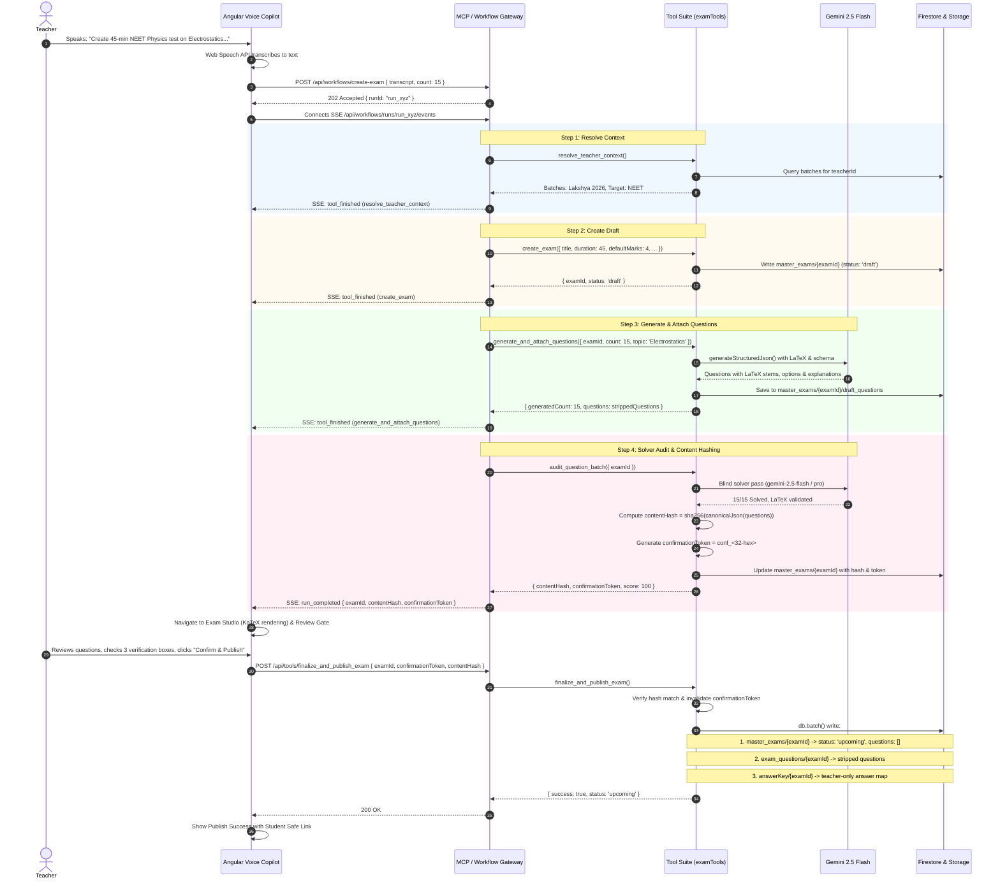

# AI Kaksha — MCP & Gemini Connector Master Architecture & Implementation Plan

> **Status**: Comprehensive Engineering Plan & Specification  
> **Authors**: Senior AI Engineer, Senior Firebase Engineer, Senior Angular Engineer, Parent Coordinator  
> **Location**: `docs/MCP_GEMINI_CONNECTOR_MASTER_PLAN.md`

---

## 1. Executive Summary & Vision

AI Kaksha is an AI-powered education operating system designed to eradicate teacher prep toil, grading fatigue, and administrative chaos for educators in Tier-2/3/4 Indian coaching institutes and schools.

This master plan establishes the end-to-end technical specifications for:
1. **The MCP (Model Context Protocol) Server & Gemini Connector**: Connecting AI agents (Antigravity, Claude, external MCP clients) and Gemini 2.5 Flash to authenticated education operations.
2. **Dual-Interface Strategy**: Real MCP protocol endpoints (`/mcp` via `@modelcontextprotocol/sdk`) alongside direct HTTP & SSE streaming endpoints (`/api/workflows/*`) for real-time frontend telemetry.
3. **5-Tool Autonomous Pipeline**: Deterministic state transitions from voice intake to tamper-proof publication.
4. **Three-Way Security Partition**: Physical isolation of metadata (`master_exams`), sanitized student questions (`exam_questions`), and teacher-only keys (`answerKey`).
5. **Workflow B Multimodal Grading**: Gemini 2.5 Flash Vision evaluation with normalized `box_2d` [0–1000] bounding boxes rendered non-destructively as SVG overlays in modern Angular 22.

---

## 2. System Architecture & Dual-Interface Pattern

```
                       ┌──────────────────────────────┐
                       │  Teacher Voice / Typed UI    │
                       │     (Angular 22 Client)      │
                       └──────────────┬───────────────┘
                                      │
                                      ▼
                   HTTP / SSE Gateway (/api/workflows/*)
                                      │
┌─────────────────────────┐           │           ┌─────────────────────────┐
│ External AI Agents      │           │           │ MCP Inspector / CLI     │
│ (Antigravity, Claude)   │           │           │ (Claude Desktop, etc.)  │
└────────────┬────────────┘           │           └────────────┬────────────┘
             │                        │                        │
             └────────► Remote MCP Transport (/mcp) ◄──────────┘
                        - SSEServerTransport
                        - JSON-RPC 2.0
                                      │
                                      ▼
             ┌──────────────────────────────────────────────────┐
             │       AI Kaksha Core Tool Suite (Pure TS)        │
             │   1. resolve_teacher_context                     │
             │   2. create_exam                                 │
             │   3. generate_and_attach_questions               │
             │   4. audit_question_batch                        │
             │   5. finalize_and_publish_exam                   │
             │   6. create_auto_dpp                             │
             └────────────────┬─────────────────────────────────┘
                              │
               ┌──────────────┴──────────────┐
               ▼                             ▼
 ┌───────────────────────────┐ ┌───────────────────────────┐
 │   Gemini Provider Engine  │ │  Firestore 3-Way Store    │
 │   - @google/genai         │ │  1. master_exams/ (meta)  │
 │   - Structured JSON       │ │  2. exam_questions/ (raw)│
 │   - LaTeX Formatting      │ │  3. answer_keys/ (secret) │
 │   - Vision box_2d [0-1000]│ │  Cloud Storage (Sheets)   │
 └───────────────────────────┘ └───────────────────────────┘
```

### Protocol Comparison

| Dimension | Remote MCP (`/mcp`) | SSE Workflow (`/api/workflows/create-exam`) |
| :--- | :--- | :--- |
| **Standard** | Model Context Protocol JSON-RPC 2.0 | HTTP REST + W3C Server-Sent Events (`EventSource`) |
| **Transport** | `SSEServerTransport` (`GET /mcp/sse`, `POST /mcp/messages`) | HTTP POST initial dispatch + `GET /runs/:runId/events` |
| **Clients** | Antigravity IDE, Claude Desktop, Vertex AI Agent MCP | Angular 22 Web App, PWA, Mobile Web |
| **Telemetry** | MCP Notifications (`notifications/message`) | SSE events (`tool_started`, `tool_finished`, `run_completed`) |
| **Authentication**| Bearer Token in SSE query param or HTTP header | Bearer Token in HTTP header or `?token=` query param |

---

## 3. Required MCP Flows & Configurations

### 3.1 Flow A: Conversational Exam Creation (Workflow A)



---

## 4. Atomic Tool Specifications & Schemas

| # | Tool Name | Description | Key Inputs | Key Outputs | Security / Invariant Boundary |
|---|---|---|---|---|---|
| **1** | `resolve_teacher_context` | Resolves teacher profile, authorized batches, recent exams, and subject catalog. | *(None)* | `{ teacherId, batches, subjects, recentExams }` | Identity extracted strictly from verified token (`req.user.uid`). |
| **2** | `create_exam` | Validates schedule and invariants; creates master draft document. | `{ title, subject, duration, batchId?, targetQuestions, defaultMarks, defaultNegativeMarks }` | `{ examId, status: 'draft', exam }` | Validates batch ownership; schedule start < end; marks 1–20. |
| **3** | `generate_and_attach_questions` | Generates LaTeX questions via Gemini and writes to draft staging. | `{ examId, subject, topic, count, difficulty, requestId? }` | `{ examId, generatedCount, questions: strippedQuestions }` | Enforces chunking ($\le 5$ per batch); idempotent via `requestId`; answers stripped from tool output. |
| **4** | `audit_question_batch` | Blind solver pass, LaTeX validator, canonical SHA-256 calculation, and token issuance. | `{ examId }` | `{ examId, score, passed, flags, contentHash, confirmationToken }` | Independent AI validation; generates single-use cryptographically bound confirmation token. |
| **5** | `finalize_and_publish_exam` | Verifies teacher confirmation token and commits atomic 3-way partition. | `{ examId, confirmationToken, contentHash, status? }` | `{ success: true, examId, status: 'upcoming' \| 'live', publishedAt }` | Token invalidated immediately; recalculates SHA-256; 409 conflict on reuse; 3-way partition write. |
| **6** | `create_auto_dpp` | Autonomous Daily Practice Problem creation pipeline. | `{ topic, batchId?, subject?, count? }` | `{ dppId, title, questionCount, status, previewUrl }` | Pre-configured autonomous pipeline executing steps 1–5 in sequence. |

---

## 5. Gemini Connector Architecture (`@google/genai`)

### 5.1 Configuration Parameters

```typescript
{
  model: "gemini-2.5-flash",         // Fast TTFT, highly cost-effective
  auditModel: "gemini-2.5-pro",      // Reserved for high-stakes IIT-JEE derivations
  temperature: {
    intentExtraction: 0.10,          // Deterministic slot capture
    questionGeneration: 0.30,        // Creative distractor design with mathematical rigor
    solverAudit: 0.10,               // High determinism for mathematical derivations
    multimodalVision: 0.15           // Strict adherence to rubric criteria
  },
  thinkingBudget: {
    questionGeneration: 1024,        // Multi-step physical derivations
    solverAudit: 2048,               // Independent verification
    multimodalVision: 1536           // Step-by-step handwriting reasoning
  },
  retryPolicy: {
    maxRetries: 3,
    backoffBaseMs: 1000,
    jitterMs: 500
  }
}
```

### 5.2 Structured Output Schema Enforcement
All model calls utilize `@google/genai` `responseSchema` with strict `Type` definitions:
- No raw string parsing or regex extraction.
- Guaranteed valid JSON conforming to TypeScript interfaces.
- Dates are passed as verbatim strings and converted to UTC/Asia:Kolkata epoch milliseconds on the server via `resolveKolkataTimeWindow()`.

### 5.3 LaTeX Math Enforcement
Stems, options, and explanations enforce KaTeX-compatible delimiters:
- Inline: `$E = mc^2$`
- Display: `$$V = \frac{1}{4\pi\varepsilon_0}\frac{q}{r}$$`
- Greek symbols must use LaTeX commands (`\alpha`, `\beta`, `\lambda`) rather than Unicode approximations.

---

## 6. Workflow B: Multimodal Answer Sheet Evaluation

### 6.1 Native Multimodal Ingestion Pipeline
1. **Zero PDF Rasterization**: Eliminates heavy C/Cairo dependencies (`pdf-poppler`, `canvas`). PDFs and images (`application/pdf`, `image/jpeg`, `image/png`) are streamed directly to Gemini 2.5 Flash via `inlineData`.
2. **Immutable Upload Hashing**: Uploaded bytes are hashed on intake via `computeSha256Checksum` and stored in Firestore to guarantee non-repudiation.

### 6.2 Normalized Coordinate Bounding Boxes (`box_2d`)
Gemini returns step evaluations with normalized bounding boxes:
- Coordinates: `[ymin, xmin, ymax, xmax]` normalized to integer scale `0..1000`.
- Scale-invariant across DPI and mobile/tablet camera aspect ratios.

### 6.3 Angular Non-Destructive SVG Overlay
The student's original image remains untouched. Angular renders an absolute SVG layer:
```html
<div class="relative inline-block w-full">
  
  <svg viewBox="0 0 1000 1000" class="absolute inset-0 w-full h-full pointer-events-none">
    @for (step of evaluation().steps; track step.stepNumber) {
      <g class="pointer-events-auto cursor-pointer" (click)="selectStep(step)">
        <rect
          [attr.x]="step.box_2d[1]"
          [attr.y]="step.box_2d[0]"
          [attr.width]="step.box_2d[3] - step.box_2d[1]"
          [attr.height]="step.box_2d[2] - step.box_2d[0]"
          class="stroke-red-600 fill-red-500/10 stroke-2"
          rx="6"
        />
        <text
          [attr.x]="step.box_2d[1] + 8"
          [attr.y]="step.box_2d[0] - 8"
          class="fill-red-700 font-bold text-xs"
        >
          +{{ step.awardedMarks }}/{{ step.maxMarks }} (Step {{ step.stepNumber }})
        </text>
      </g>
    }
  </svg>
</div>
```

---

## 7. Phased Implementation Roadmap

### Phase 1: Frontend Infrastructure & Dependencies
- **Task 1.1**: Install KaTeX dependencies (`npm i katex && npm i -D @types/katex`).
- **Task 1.2**: Update `src/app/app.config.ts` to include `provideHttpClient(withFetch())` and `withComponentInputBinding()`.
- **Task 1.3**: Implement `McpClientService` (`src/app/core/services/mcp-client.service.ts`) with live/mock toggle and SSE subscription handling.
- **Task 1.4**: Implement `ExamOrchestratorService` (`src/app/core/services/exam-orchestrator.service.ts`) with modern Angular signals (`signal`, `computed`, `linkedSignal`).

### Phase 2: Workflow A Frontend Wiring
- **Task 2.1**: Enhance `VoiceCopilotComponent` with Web Speech API audio transcription and live parameter slot preview.
- **Task 2.2**: Bind `TranscriptFeedComponent` to live SSE telemetry events (`tool_started`, `tool_finished`, `run_completed`).
- **Task 2.3**: Upgrade `ExamStudioComponent` with KaTeX math rendering (`output: 'htmlAndMathml'`) and question stem/distractor editing.
- **Task 2.4**: Connect `ReviewGateComponent` to display server-computed `contentHash` and execute publication with `confirmationToken`.

### Phase 3: Workflow B Frontend Wiring
- **Task 3.1**: Upgrade `AnswerSheetViewerComponent` to render `<svg viewBox="0 0 1000 1000">` consuming Gemini `box_2d` coordinates.
- **Task 3.2**: Connect `EvaluationCockpitComponent` to multipart upload endpoint and bind teacher override inputs to dynamically update total score and SVG badges.

### Phase 4: Remote MCP Protocol Server Mounting
- **Task 4.1**: Mount `@modelcontextprotocol/sdk` `SSEServerTransport` at `/mcp` in `functions/src/index.ts` connecting to the exact same `examTools.ts` logic.
- **Task 4.2**: Verify tool discovery (`tools/list`) and tool calling (`tools/call`) using MCP Inspector.

### Phase 5: Verification & End-to-End Testing
- **Task 5.1**: Run AXE accessibility audit across all routes (`VoiceCopilot`, `ExamStudio`, `ReviewGate`, `EvaluationCockpit`).
- **Task 5.2**: Verify clean Angular build (`npm run build`) and Cloud Functions build (`npm --prefix functions run build`).
- **Task 5.3**: Execute end-to-end smoke test validating the 3-way partition in Firestore.
