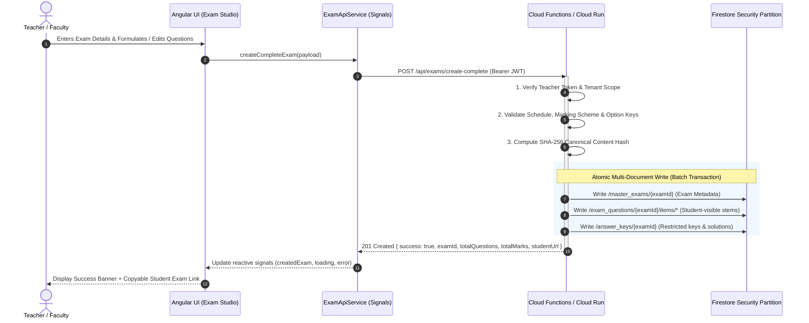

# AI Kaksha — UI Integration Guide: Single-Payload Exam Creation Endpoint

> **Audience**: Frontend Engineers, Full-Stack Developers, UI Designers  
> **Target Framework**: Angular 22+ (Signals, Standalone Components, KaTeX)  
> **API Version**: `v1` (Express Cloud Functions / Cloud Run Backend)  
> **File Artifact**: [`docs/UI_EXAM_CREATION_INTEGRATION_GUIDE.md`](file:///run/media/iam5k/WDBlack/mwd/Unifive%20Technology/aikaksha-hackathon/docs/UI_EXAM_CREATION_INTEGRATION_GUIDE.md)  
> **Status**: Authoritative Integration Specification

---

## 1. Overview & Architecture

The AI Kaksha UI architecture supports two distinct operational flows for creating exams:
1. **Multi-Turn Conversational Stream (Voice Copilot)**: An agentic loop where teacher voice instructions trigger multi-step SSE events (`resolve_teacher_context` $\rightarrow$ `create_exam` $\rightarrow$ `generate_and_attach_questions` $\rightarrow$ `audit_question_batch`).
2. **Single-Shot Complete Creation (Exam Studio & Quick Draft)**: A high-speed, atomic endpoint designed for direct form submissions, pre-structured JSON import, template cloning, or finalized Voice Copilot drafts. Instead of orchestrating 4–5 sequential network calls, the UI dispatches a single atomic JSON payload containing both the exam metadata (`examParams`) and the complete question bank (`questions`).



### Key Architectural Safeguards
- **Zero-Trust Role Enforcement**: Caller identity (`teacherId` and `tenantId`) is resolved strictly from the verified Firebase ID Token (`req.auth`). The client cannot spoof another teacher or tenant.
- **3-Way Security Partition**: Stems and options are persisted in `/exam_questions`, while correct answers and explanations are stored in `/answer_keys` (accessible only to teachers and server evaluators).
- **Atomic Rollback**: If any single question fails validation (e.g., negative marks exceeding positive marks, malformed option ID), the entire transaction aborts.

---

## 2. Endpoint Specifications

### 2.1 Primary REST Endpoint

```http
POST /api/exams/create-complete
```

- **Base URL (Local Emulator)**: `http://localhost:5001/ai-kaksha-poc/us-central1/api`
- **Base URL (Cloud Run Production)**: `https://api-kaksha-poc.a.run.app`

### 2.2 MCP Tool Equivalent Endpoint

For LLM Agent orchestrators or MCP client gateways connecting via HTTP:

```http
POST /api/tools/create_complete_exam
```

### 2.3 Required HTTP Request Headers

| Header Name | Type | Required | Description / Example |
| :--- | :--- | :--- | :--- |
| `Content-Type` | `string` | **Yes** | Must be `application/json` |
| `Authorization` | `string` | **Yes** | Bearer JWT token: `Bearer <Firebase_ID_Token>` |
| `X-Request-ID` | `string` | Recommended | UUIDv4 string for request tracing & idempotency |
| `X-Tenant-ID` | `string` | Optional | Tenant scope override (validated against JWT claims) |

> [!IMPORTANT]
> In local development and mock mode, if `environment.production === false`, the API accepts mock bearer tokens formatted as `Bearer mock-token-teacher-sharma-101`.

---

## 3. Complete Request Payload Contract

The endpoint expects a root JSON object containing two top-level keys:
- `examParams`: High-level exam configuration, schedule, duration, and target class/batch.
- `questions`: Array of question definitions, including stems, options, keys, marks, and explanations.

### 3.1 TypeScript Type Definitions

```typescript
// src/app/shared/models/exam-creation.model.ts

export type ExamStatus = 'draft' | 'upcoming' | 'live';
export type QuestionType = 'MCQ' | 'Numeric' | 'Short Text' | 'Subjective';
export type DifficultyLevel = 'easy' | 'medium' | 'hard';
export type NegativeMarkingRule = 'none' | '1/4' | '1/3' | '1/2' | 'full' | 'custom';

export interface IOptionContent {
  id: string; // e.g. 'opt1', 'opt2', 'opt3', 'opt4' (or 'A', 'B', 'C', 'D')
  text: string; // Plain text or LaTeX string ($...$)
  imageUrl?: string; // Optional diagram / figure asset URL
}

export interface ILocalizedContent {
  text: string; // Question statement with inline/block LaTeX
  options?: IOptionContent[]; // Required for MCQ (2 to 5 options)
  explanation?: string; // Teacher solution derivation
  audioUrl?: string; // Optional TTS/Audio prompt URL
}

export interface IQuestionItemPayload {
  id?: string; // Optional client UUID (generated server-side if omitted)
  type: QuestionType; // 'MCQ' | 'Numeric' | 'Short Text' | 'Subjective'
  marks: number; // Positive integer (1 - 20)
  negativeMarks?: number; // Zero or positive (must be <= marks)
  subject: string; // e.g. 'Physics'
  topic: string; // e.g. 'Electrostatics'
  subtopic?: string; // e.g. "Gauss's Law & Electric Flux"
  difficulty: DifficultyLevel; // 'easy' | 'medium' | 'hard'
  classLevel?: string; // e.g. 'Class 12'
  examPattern?: string; // e.g. 'NEET' | 'JEE Advanced' | 'CBSE'
  
  // Localized Content
  en: ILocalizedContent; // Primary English content (Mandatory)
  hi?: ILocalizedContent; // Optional Hindi localized content

  // Authoritative Answer Key (Partitioned to /answer_keys)
  correctOptionId?: string; // Required for MCQ: matches option.id (e.g. 'opt2')
  answer?: string | number; // Required for Numeric / Short Text
  explanation?: string; // Full teacher derivation with LaTeX steps
}

export interface IExamParamsPayload {
  title: string; // Exam title (e.g. 'NEET Physics: Electrostatics Daily Practice Paper')
  batchId: string; // Authorized batch ID (e.g. 'batch-lakshya-neet-2026')
  subject: string; // Academic subject
  duration: number; // Test duration in minutes (e.g. 45)
  targetQuestions: number; // Expected total count
  defaultMarks: number; // Default score per question (e.g. 4)
  defaultNegativeMarks?: number; // Default negative penalty (e.g. 1)
  negativeRule?: NegativeMarkingRule; // '1/4' (standard NEET rule)
  
  // Scheduling & Timing
  date: string; // Exam date in ISO format: 'YYYY-MM-DD'
  startTime: string; // 24-hr format: 'HH:mm' (e.g. '10:00')
  endTime: string; // 24-hr format: 'HH:mm' (e.g. '11:00')
  languages?: string[]; // e.g. ['en', 'hi']
  primaryLanguage?: string; // Default: 'en'
  classLevel?: string; // e.g. 'Class 12'
  examPattern?: string; // 'NEET' | 'JEE Main' | 'Board'
  
  // Behavioral Flags
  shuffleQuestions?: boolean; // Default: true
  shuffleOptions?: boolean; // Default: true
  isSubjective?: boolean; // Default: false
  status?: ExamStatus; // 'draft' (default) or 'upcoming'
}

export interface ICreateCompleteExamRequest {
  examParams: IExamParamsPayload;
  questions: IQuestionItemPayload[];
}
```

---

### 3.2 Field-by-Field Reference Table

#### `examParams`

| Field | Type | Default | Constraints | Description |
| :--- | :--- | :--- | :--- | :--- |
| `title` | `string` | *None* | 5 – 120 chars | Name of the exam displayed on student portal and OMR headers. |
| `batchId` | `string` | *None* | Must match teacher's assigned batches | Target student batch or cohort ID. |
| `subject` | `string` | *None* | Must be non-empty | Subject category (e.g. `Physics`, `Chemistry`, `Biology`). |
| `duration` | `number` | `45` | Positive integer (5 – 360) | Exam duration in minutes. |
| `targetQuestions` | `number` | `questions.length` | Positive integer (1 – 200) | Must equal `questions.length`. |
| `defaultMarks` | `number` | `4` | Number (1 – 20) | Baseline positive marks for questions. |
| `defaultNegativeMarks` | `number` | `1` | Number (0 $\le$ val $\le$ `defaultMarks`) | Penalty marks deducted for incorrect answers. |
| `negativeRule` | `string` | `'1/4'` | `'none' \| '1/4' \| '1/3' \| '1/2'` | Scoring convention label for OMR instructions. |
| `date` | `string` | Current Date | `YYYY-MM-DD` | Calendar date of the scheduled exam. |
| `startTime` | `string` | `'10:00'` | `HH:mm` (24-hr) | Window start time (institute timezone). |
| `endTime` | `string` | Calculated | `HH:mm` (`endTime > startTime`) | Window end time. Window must be $\ge$ `duration`. |
| `languages` | `string[]` | `['en']` | At least 1 language code | Enabled languages for bilingual test takers. |
| `primaryLanguage` | `string` | `'en'` | Must exist in `languages` | Default display language. |
| `classLevel` | `string` | `'Class 12'` | Optional | Academic grade/standard (e.g., `Class 11`, `Class 12`). |
| `examPattern` | `string` | `'NEET'` | Optional | Pattern template (e.g., `NEET`, `JEE Main`, `CBSE`). |
| `shuffleQuestions` | `boolean` | `true` | Boolean | Randomizes question order per student. |
| `shuffleOptions` | `boolean` | `true` | Boolean | Randomizes option order per student. |
| `status` | `string` | `'draft'` | `'draft' \| 'upcoming'` | Initial exam state. Set `'upcoming'` to publish immediately. |

#### `questions[]` (Each Element)

| Field | Type | Default | Constraints | Description |
| :--- | :--- | :--- | :--- | :--- |
| `type` | `string` | `'MCQ'` | `'MCQ' \| 'Numeric' \| 'Short Text'` | Question format. |
| `marks` | `number` | `examParams.defaultMarks` | Positive integer | Marks awarded for correct response. |
| `negativeMarks` | `number` | `examParams.defaultNegativeMarks` | $0 \le \text{negativeMarks} \le \text{marks}$ | Marks deducted for incorrect response. |
| `subject` | `string` | `examParams.subject` | Non-empty | Subject classification. |
| `topic` | `string` | *None* | Non-empty | Specific topic syllabus tag. |
| `subtopic` | `string` | *None* | Optional | Granular chapter subsection. |
| `difficulty` | `string` | `'medium'` | `'easy' \| 'medium' \| 'hard'` | Bloom's taxonomy / difficulty rating. |
| `en.text` | `string` | *None* | Non-empty string (LaTeX supported) | English question problem statement. |
| `en.options` | `IOptionContent[]` | *None* | Required for MCQ (2 to 5 options) | Array of choices with `id` and `text`. |
| `correctOptionId` | `string` | *None* | Required for MCQ | Target `id` of the correct option (e.g. `'opt3'`). |
| `answer` | `string \| number` | *None* | Required for Numeric/Text | Target numeric or text answer. |
| `explanation` | `string` | *None* | Recommended | Comprehensive solution and mathematical derivation. |

---

### 3.3 Realistic Indian Exam Example Payload (NEET Physics — Electrostatics)

Below is an authentic, copy-paste ready JSON payload demonstrating realistic NEET Physics questions with advanced LaTeX formulas in stems, options, and teacher derivations:

```json
{
  "examParams": {
    "title": "NEET 2026 Physics Sprint: Electrostatics & Gauss's Law",
    "batchId": "batch-lakshya-neet-2026",
    "subject": "Physics",
    "duration": 45,
    "targetQuestions": 3,
    "defaultMarks": 4,
    "defaultNegativeMarks": 1,
    "negativeRule": "1/4",
    "date": "2026-11-25",
    "startTime": "09:30",
    "endTime": "10:30",
    "languages": ["en"],
    "primaryLanguage": "en",
    "classLevel": "Class 12",
    "examPattern": "NEET",
    "shuffleQuestions": true,
    "shuffleOptions": true,
    "status": "draft"
  },
  "questions": [
    {
      "type": "MCQ",
      "marks": 4,
      "negativeMarks": 1,
      "subject": "Physics",
      "topic": "Electrostatics",
      "subtopic": "Gauss's Law",
      "difficulty": "medium",
      "classLevel": "Class 12",
      "examPattern": "NEET",
      "en": {
        "text": "A point charge $q = +3.0\\,\\mu\\text{C}$ is placed at the center of a cubical Gaussian surface of edge length $a = 10\\,\\text{cm}$. What is the total electric flux $\\Phi_E$ passing through one single face of the cube? (Take $\\varepsilon_0 = 8.854 \\times 10^{-12}\\,\\text{C}^2\\cdot\\text{N}^{-1}\\cdot\\text{m}^{-2}$)",
        "options": [
          { "id": "opt1", "text": "$\\Phi_E = \\frac{q}{\\varepsilon_0}$" },
          { "id": "opt2", "text": "$\\Phi_E = \\frac{q}{6\\varepsilon_0}$" },
          { "id": "opt3", "text": "$\\Phi_E = \\frac{q}{4\\pi\\varepsilon_0 a^2}$" },
          { "id": "opt4", "text": "$\\Phi_E = 0$" }
        ]
      },
      "correctOptionId": "opt2",
      "explanation": "According to Gauss's Law, the total electric flux passing through any closed surface enclosing a charge $q$ is:\n$$\\Phi_{\\text{total}} = \\oint \\vec{E} \\cdot d\\vec{A} = \\frac{q_{\\text{enclosed}}}{\\varepsilon_0}$$\nSince the charge is placed symmetrically at the geometric center of a cube possessing $6$ identical faces, the flux through each face is distributed equally:\n$$\\Phi_{\\text{face}} = \\frac{1}{6} \\Phi_{\\text{total}} = \\frac{q}{6\\varepsilon_0}$$\nSubstituting $q = 3.0 \\times 10^{-6}\\,\\text{C}$ gives $\\Phi_{\\text{face}} \\approx 5.65 \\times 10^4\\,\\text{N}\\cdot\\text{m}^2/\\text{C}$. Hence, option (opt2) is correct."
    },
    {
      "type": "MCQ",
      "marks": 4,
      "negativeMarks": 1,
      "subject": "Physics",
      "topic": "Electrostatics",
      "subtopic": "Electric Dipole in External Field",
      "difficulty": "hard",
      "classLevel": "Class 12",
      "examPattern": "NEET",
      "en": {
        "text": "An electric dipole of dipole moment $\\vec{p} = (2\\hat{i} + 3\\hat{j}) \\times 10^{-29}\\,\\text{C}\\cdot\\text{m}$ is enclosed in a uniform electric field $\\vec{E} = 4.0 \\times 10^5\\,\\hat{i}\\,\\text{V/m}$. The magnitude of the torque $\\vec{\\tau}$ acting on the dipole and its potential energy $U$ in this configuration are respectively:",
        "options": [
          { "id": "opt1", "text": "|\\vec{\\tau}| = 1.2 \\times 10^{-23}\\,\\text{N}\\cdot\\text{m}, \\quad U = -8.0 \\times 10^{-24}\\,\\text{J}" },
          { "id": "opt2", "text": "|\\vec{\\tau}| = 8.0 \\times 10^{-24}\\,\\text{N}\\cdot\\text{m}, \\quad U = -1.2 \\times 10^{-23}\\,\\text{J}" },
          { "id": "opt3", "text": "|\\vec{\\tau}| = 0, \\quad U = 0" },
          { "id": "opt4", "text": "|\\vec{\\tau}| = 1.2 \\times 10^{-23}\\,\\text{N}\\cdot\\text{m}, \\quad U = +8.0 \\times 10^{-24}\\,\\text{J}" }
        ]
      },
      "correctOptionId": "opt1",
      "explanation": "1. **Torque Calculation**:\n$$\\vec{\\tau} = \\vec{p} \\times \\vec{E} = \\left(2\\times 10^{-29}\\hat{i} + 3\\times 10^{-29}\\hat{j}\\right) \\times \\left(4.0 \\times 10^5\\hat{i}\\right)$$\nRecall that $\\hat{i} \\times \\hat{i} = 0$ and $\\hat{j} \\times \\hat{i} = -\\hat{k}$:\n$$\\vec{\\tau} = 3\\times 10^{-29} \\times 4.0 \\times 10^5 (-\\hat{k}) = -1.2 \\times 10^{-23}\\,\\hat{k}\\,\\text{N}\\cdot\\text{m}$$\nMagnitude: $|\\vec{\\tau}| = 1.2 \\times 10^{-23}\\,\\text{N}\\cdot\\text{m}$.\n\n2. **Potential Energy Calculation**:\n$$U = -\\vec{p} \\cdot \\vec{E} = -\\left(2\\times 10^{-29}\\hat{i} + 3\\times 10^{-29}\\hat{j}\\right) \\cdot \\left(4.0 \\times 10^5\\hat{i}\\right)$$\n$$U = -(2\\times 10^{-29} \\times 4.0 \\times 10^5) = -8.0 \\times 10^{-24}\\,\\text{J}$$\nTherefore, $|\\vec{\\tau}| = 1.2 \\times 10^{-23}\\,\\text{N}\\cdot\\text{m}$ and $U = -8.0 \\times 10^{-24}\\,\\text{J}$. Option (opt1) is correct."
    },
    {
      "type": "MCQ",
      "marks": 4,
      "negativeMarks": 1,
      "subject": "Physics",
      "topic": "Electrostatics",
      "subtopic": "Capacitance & Dielectrics",
      "difficulty": "easy",
      "classLevel": "Class 12",
      "examPattern": "NEET",
      "en": {
        "text": "A parallel plate capacitor with air between the plates has a capacitance $C_0 = 8\\,\\text{pF}$. If the separation between the plates is reduced by half ($d' = d/2$) and the space between them is completely filled with a dielectric substance of dielectric constant $K = 6$, what is the new capacitance $C'$?",
        "options": [
          { "id": "opt1", "text": "$24\\,\\text{pF}$" },
          { "id": "opt2", "text": "$48\\,\\text{pF}$" },
          { "id": "opt3", "text": "$96\\,\\text{pF}$" },
          { "id": "opt4", "text": "$12\\,\\text{pF}$" }
        ]
      },
      "correctOptionId": "opt3",
      "explanation": "The initial capacitance in air is given by:\n$$C_0 = \\frac{\\varepsilon_0 A}{d} = 8\\,\\text{pF}$$\nWhen filled with a dielectric $K$ and plate spacing reduced to $d/2$:\n$$C' = \\frac{K \\varepsilon_0 A}{d'} = \\frac{K \\varepsilon_0 A}{(d/2)} = 2K \\left(\\frac{\\varepsilon_0 A}{d}\\right) = 2K C_0$$\nSubstituting $K = 6$ and $C_0 = 8\\,\\text{pF}$:\n$$C' = 2 \\times 6 \\times 8\\,\\text{pF} = 96\\,\\text{pF}$$\nThus, the correct answer is $96\\,\\text{pF}$ (opt3)."
    }
  ]
}
```

---

## 4. Response Contracts

### 4.1 Success Response (`201 Created` or `200 OK`)

When the exam metadata, question items, and answer keys are safely validated and partitioned into Firestore, the server returns a detailed payload:

```json
{
  "success": true,
  "examId": "exam_neet_phy_2026_001",
  "totalQuestions": 3,
  "totalMarks": 12,
  "status": "draft",
  "createdAt": "2026-11-20T17:45:00.000Z",
  "contentHash": "e3b0c44298fc1c149afbf4c8996fb92427ae41e4649b934ca495991b7852b855",
  "studentUrl": "https://aikaksha.institute.in/student/exams/exam_neet_phy_2026_001",
  "summary": {
    "title": "NEET 2026 Physics Sprint: Electrostatics & Gauss's Law",
    "batchId": "batch-lakshya-neet-2026",
    "subject": "Physics",
    "duration": 45,
    "questionsStored": 3,
    "answerKeysSecured": 3
  }
}
```

### 4.2 Error Responses

All error responses adhere to standard HTTP status codes and provide a structured JSON error body:

```typescript
export interface IApiErrorResponse {
  error: string; // Machine-readable code
  message: string; // Human-readable explanation
  details?: Array<{ field: string; issue: string }>;
  timestamp: string;
}
```

#### 400 Bad Request — Validation Failure
Occurs if mandatory fields are missing, questions array is empty, or business rules are violated:

```json
{
  "error": "VALIDATION_FAILED",
  "message": "Question #2 validation failed: negativeMarks (5) cannot exceed positive marks (4)",
  "details": [
    {
      "field": "questions[1].negativeMarks",
      "issue": "negativeMarks must be <= marks"
    }
  ],
  "timestamp": "2026-11-20T17:46:10.123Z"
}
```

Common 400 validation error scenarios:
- `correctOptionId` does not match any ID in `en.options`.
- `targetQuestions` does not match `questions.length`.
- `endTime` is before or equal to `startTime`.
- Less than 2 options provided for an MCQ.

#### 401 Unauthorized — Authentication Failure
Occurs when the `Authorization` header is missing, malformed, or the Firebase token is expired:

```json
{
  "error": "UNAUTHENTICATED",
  "message": "Missing or expired authorization bearer token",
  "timestamp": "2026-11-20T17:46:15.000Z"
}
```

#### 403 Forbidden — Authorization / Tenant Violation
Occurs when the authenticated teacher is not authorized to create exams for the specified `batchId` or belongs to another institution:

```json
{
  "error": "FORBIDDEN",
  "message": "Teacher teacher-sharma-101 is not authorized for batch batch-lakshya-neet-2026 in tenant institute-alpha-delhi",
  "timestamp": "2026-11-20T17:46:20.000Z"
}
```

#### 409 Conflict — Idempotency Conflict
Occurs if a request with the same `X-Request-ID` is already processing or was completed:

```json
{
  "error": "IDEMPOTENCY_CONFLICT",
  "message": "An exam creation request with this Request ID is already in progress",
  "timestamp": "2026-11-20T17:46:25.000Z"
}
```

---

## 5. Frontend KaTeX Rendering Guide

Scientific exams (NEET, JEE, CBSE) contain extensive mathematical and Greek symbols. To display formulas with crisp typographic quality without causing layout shifts or XSS vulnerabilities, follow these implementation rules.

### 5.1 The JSON Escaping Rule

> [!WARNING]
> **Double Backslashes in JSON**: In JSON strings, the backslash `\` is an escape character. All LaTeX commands (`\frac`, `\mu`, `\varepsilon`, `\times`) **must** be double-escaped in raw JSON as `\\frac`, `\\mu`, `\\varepsilon`, `\\times`. When parsed by JavaScript's `JSON.parse()`, `\\frac` becomes the literal single-backslash string `\frac`.

| Mathematical Symbol | LaTeX Notation | JSON String Value | Rendered Output |
| :--- | :--- | :--- | :--- |
| Fraction | `\frac{a}{b}` | `"\\frac{a}{b}"` | $\frac{a}{b}$ |
| Microcoulomb | `\mu\text{C}` | `"\\mu\\text{C}"` | $\mu\text{C}$ |
| Permittivity | `\varepsilon_0` | `"\\varepsilon_0"` | $\varepsilon_0$ |
| Vector Field | `\vec{E}` | `"\\vec{E}"` | $\vec{E}$ |
| Closed Contour Integral | `\oint` | `"\\oint"` | $\oint$ |

### 5.2 KaTeX Setup in Angular 22

#### Step 1: Install KaTeX Dependency
```bash
npm install katex
npm install --save-dev @types/katex
```

#### Step 2: Include KaTeX CSS in `angular.json`
Add the KaTeX stylesheet to `projects.app.architect.build.options.styles`:

```json
"styles": [
  "node_modules/katex/dist/katex.min.css",
  "src/styles.css"
]
```

Or import it directly in `src/styles.css`:
```css
@import 'katex/dist/katex.min.css';
```

### 5.3 Angular KaTeX Pipe Implementation

Below is a production-grade, standalone Angular Pipe that parses both inline LaTeX (`$...$`) and display LaTeX (`$$...$$`), delegates formula rendering to `katex.renderToString()`, and sanitizes the output:

```typescript
// src/app/shared/pipes/katex.pipe.ts
import { Pipe, PipeTransform, inject, SecurityContext } from '@angular/core';
import { DomSanitizer, SafeHtml } from '@angular/platform-browser';
import katex from 'katex';

@Pipe({
  name: 'katex',
  standalone: true,
})
export class KatexPipe implements PipeTransform {
  private sanitizer = inject(DomSanitizer);

  public transform(content: string | null | undefined): SafeHtml {
    if (!content) return '';

    // Step 1: Process Block Math: $$ ... $$
    let rendered = content.replace(/\$\$([\s\S]*?)\$\$/g, (_match, math) => {
      try {
        return katex.renderToString(math.trim(), {
          displayMode: true,
          throwOnError: false,
        });
      } catch (err) {
        console.warn('KaTeX Block error:', err);
        return `<span class="katex-error text-rose-500 font-mono text-xs">${math}</span>`;
      }
    });

    // Step 2: Process Inline Math: $ ... $ (negative lookbehind avoids matching escaped \$\$)
    rendered = rendered.replace(/\$([^\$\n]+?)\$/g, (_match, math) => {
      try {
        return katex.renderToString(math.trim(), {
          displayMode: false,
          throwOnError: false,
        });
      } catch (err) {
        console.warn('KaTeX Inline error:', err);
        return `<span class="katex-error text-rose-500 font-mono text-xs">${math}</span>`;
      }
    });

    // Step 3: Sanitize and return SafeHtml
    return this.sanitizer.sanitize(SecurityContext.HTML, rendered) || rendered;
  }
}
```

### 5.4 Using the KaTeX Pipe in Question Editor & Cards

In your component template, bind the pipe directly using Angular's `[innerHTML]` attribute:

```html
<!-- Question Statement with LaTeX -->
<div class="text-sm font-medium leading-relaxed text-slate-900 dark:text-slate-100">
  <span [innerHTML]="question().en?.text | katex"></span>
</div>

<!-- MCQ Option Text with LaTeX -->
<div class="flex-1 text-slate-800 dark:text-slate-200">
  <span [innerHTML]="option.text | katex"></span>
</div>

<!-- Teacher Derivation Callout with Block Display Math -->
@if (question().explanation) {
  <div class="mt-4 rounded-xl border border-amber-200 bg-amber-50/50 p-4 text-xs text-amber-900 dark:border-amber-900/40 dark:bg-amber-950/20 dark:text-amber-200">
    <div class="font-bold flex items-center gap-1.5 mb-1.5">
      <span>💡</span>
      <span>Authoritative Derivation & Solution:</span>
    </div>
    <div [innerHTML]="question().explanation | katex"></div>
  </div>
}
```

---

## 6. Ready-to-Copy Angular 22 Service

The following service provides full end-to-end integration using Angular 22 best practices:
- Uses `inject()` for dependency injection (zero constructor injection).
- Exposes modern reactive state via Angular `signal()` and `computed()`.
- Implements strict type safety with error handling and request ID generation.

```typescript
// src/app/core/services/exam-api.service.ts
import { Injectable, inject, signal, computed } from '@angular/core';
import { HttpClient, HttpErrorResponse, HttpHeaders } from '@angular/common/http';
import { firstValueFrom } from 'rxjs';
import { environment } from 'src/environments/environment';
import { AuthService } from './auth.service';
import {
  ICreateCompleteExamRequest,
  IApiErrorResponse,
} from 'src/app/shared/models/exam-creation.model';

export interface ICreateCompleteExamResponse {
  success: boolean;
  examId: string;
  totalQuestions: number;
  totalMarks: number;
  status: 'draft' | 'upcoming';
  createdAt: string;
  contentHash: string;
  studentUrl: string;
  summary?: {
    title: string;
    batchId: string;
    subject: string;
    duration: number;
    questionsStored: number;
    answerKeysSecured: number;
  };
}

@Injectable({
  providedIn: 'root',
})
export class ExamApiService {
  private readonly http = inject(HttpClient);
  private readonly authService = inject(AuthService);

  // State Signals
  private readonly _isSubmitting = signal<boolean>(false);
  private readonly _lastCreatedExam = signal<ICreateCompleteExamResponse | null>(null);
  private readonly _lastError = signal<string | null>(null);

  // Readonly Public Selectors
  public readonly isSubmitting = this._isSubmitting.asReadonly();
  public readonly lastCreatedExam = this._lastCreatedExam.asReadonly();
  public readonly lastError = this._lastError.asReadonly();
  public readonly hasSuccess = computed(() => this._lastCreatedExam() !== null);

  /**
   * Dispatches the single complete exam payload to POST /api/exams/create-complete
   */
  public async createCompleteExam(
    payload: ICreateCompleteExamRequest
  ): Promise<ICreateCompleteExamResponse> {
    this._isSubmitting.set(true);
    this._lastError.set(null);

    const baseUrl = environment.mcp.serverUrl.replace(/\/mcp$/, '');
    const endpoint = `${baseUrl}/api/exams/create-complete`;

    // Construct headers with Bearer token & Client Request Id
    const teacherId = this.authService.teacherId();
    const token = `mock-token-${teacherId || 'teacher-sharma-101'}`;
    const requestId = `req_${Date.now()}_${Math.random().toString(36).substring(2, 9)}`;

    const headers = new HttpHeaders({
      'Content-Type': 'application/json',
      Authorization: `Bearer ${token}`,
      'X-Request-ID': requestId,
      'X-Tenant-ID': this.authService.tenantId() || 'institute-alpha-delhi',
    });

    try {
      const response = await firstValueFrom(
        this.http.post<ICreateCompleteExamResponse>(endpoint, payload, { headers })
      );

      this._lastCreatedExam.set(response);
      return response;
    } catch (err: unknown) {
      let errorMessage = 'Failed to create complete exam. Please try again.';

      if (err instanceof HttpErrorResponse) {
        const apiError = err.error as IApiErrorResponse;
        if (apiError && apiError.message) {
          errorMessage = `[${apiError.error || err.status}] ${apiError.message}`;
        } else {
          errorMessage = `HTTP ${err.status}: ${err.statusText || 'Server Error'}`;
        }
      } else if (err instanceof Error) {
        errorMessage = err.message;
      }

      this._lastError.set(errorMessage);
      throw new Error(errorMessage);
    } finally {
      this._isSubmitting.set(false);
    }
  }

  /**
   * Resets creation state flags
   */
  public resetState(): void {
    this._isSubmitting.set(false);
    this._lastCreatedExam.set(null);
    this._lastError.set(null);
  }
}
```

---

## 7. End-to-End Testing & Verification Checklist

Before releasing or submitting PRs for UI changes involving exam creation and math rendering, verify all items on this checklist:

| Category | Verification Item | Expected Result | Pass / Fail |
| :--- | :--- | :--- | :---: |
| **Auth & Headers** | Dispatched request contains `Authorization: Bearer <token>` | Status `201` returned; no `401 Unauthorized` | [ ] |
| **Auth & Headers** | Dispatched request contains valid `X-Request-ID` UUID | Traced in backend server logs | [ ] |
| **Payload Invariants** | Submit payload with `negativeMarks` (e.g. 5) > `marks` (4) | Server rejects with `400 Bad Request` (`negativeMarks <= marks`) | [ ] |
| **Payload Invariants** | Submit payload with missing `correctOptionId` on MCQ | Server rejects with `400 Bad Request` | [ ] |
| **Payload Invariants** | Submit payload where `targetQuestions` $\ne$ `questions.length` | Server rejects with `400 Bad Request` | [ ] |
| **KaTeX Math** | Question with inline math `$E = \frac{kq}{r^2}$` | Displays rendered fraction without `$`, no raw text | [ ] |
| **KaTeX Math** | Derivation with display math `$$\Phi = \oint \vec{E} \cdot d\vec{A}$$` | Centered display block rendered with vector arrows | [ ] |
| **KaTeX Math** | Dark mode contrast check | Math formulas render in high-contrast crisp text | [ ] |
| **Security Partition** | Call student endpoint `GET /api/student/exams/:examId` | `correctOptionId` and `explanation` are **stripped** | [ ] |
| **UI State (Signals)** | Trigger submission | `isSubmitting()` turns `true`, buttons disable with spinner | [ ] |
| **UI State (Signals)** | Successful creation | `lastCreatedExam()` contains `examId` & `studentUrl` | [ ] |
| **UI State (Signals)** | Failed creation | `lastError()` signal populates; error alert renders | [ ] |

---

## 8. Summary & Next Steps

1. **Deploy Endpoint**: Ensure `POST /api/exams/create-complete` is mapped in Express (`functions/src/index.ts`).
2. **Import Service**: Register `ExamApiService` in `ExamStudioComponent` or `VoiceCopilotComponent`.
3. **Bind KaTeX**: Apply `KatexPipe` to question statement cards, option lists, and solution derivations.
4. **Run Verification**: Execute the checklist against the local Firebase emulator before committing.
