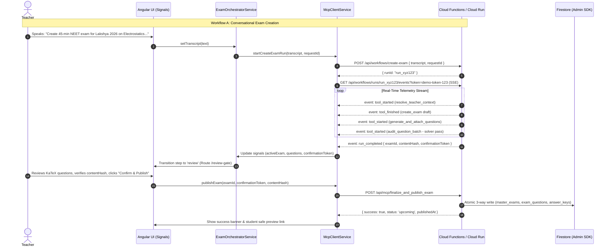

# AI Kaksha — Frontend & UI Integration Architecture Guide

> **Audience**: Senior Frontend Engineers, Angular Leads, Full-Stack Developers  
> **Target Version**: Angular 22 (Signals + Tailwind), Firebase Cloud Functions / Cloud Run Express API  
> **Status**: Ready for Integration Implementation

---

## 1. System Integration Overview

AI Kaksha orchestrates two core workflows between the Angular frontend and backend:

1. **Workflow A (Conversational Exam Creation & Publishing)**:
   - Voice audio / text intake $\rightarrow$ Parameter normalization $\rightarrow$ SSE background execution pipeline $\rightarrow$ Live telemetry $\rightarrow$ Exam Studio (KaTeX equations) $\rightarrow$ Review Gate approval $\rightarrow$ Atomic 3-way partition publishing.
2. **Workflow B (Subjective Answer-Sheet Evaluation & Red-Pen Overlays)**:
   - Handwritten PDF/Image upload $\rightarrow$ Immutable SHA-256 checksum $\rightarrow$ Gemini 2.5 Multimodal grading vs seeded rubric $\rightarrow$ Normalized `box_2d` coordinate mapping (0–1000 scale) $\rightarrow$ Angular non-destructive `<svg>` red-pen annotation overlay $\rightarrow$ Teacher score override.



---

## 2. API Contracts & Endpoint Mapping

All API calls from Angular use the base URL configured in `environment.mcp.serverUrl` (`http://localhost:5001/ai-kaksha-poc/us-central1/api/api` for emulator or Cloud Run URL in production).

### 2.1 Backend Endpoints Summary

| Endpoint | HTTP Method | Request Body / Query | Expected Response | UI Consumer Component |
| :--- | :--- | :--- | :--- | :--- |
| `/api/mcp/resolve_teacher_context` | `POST` | `{}` | `{ batches: IBatch[], subjects: string[] }` | `VoiceCopilotComponent` |
| `/api/workflows/create-exam` | `POST` | `{ transcript: string, requestId: string }` | `{ runId: string }` | `VoiceCopilotComponent` |
| `/api/workflows/runs/:runId/events` | `GET (SSE)` | `?token=demo-token-123` | Server-Sent Events stream (`RunEvent`) | `TranscriptFeedComponent` |
| `/api/mcp/get_exam` | `POST` | `{ examId: string }` | `{ exam: IExam, questions: IExamQuestion[] }` | `ExamStudioComponent` |
| `/api/mcp/finalize_and_publish_exam` | `POST` | `{ examId, confirmationToken, contentHash }` | `{ success: boolean, status: 'upcoming' }` | `PublishConfirmModalComponent` |
| `/api/evaluation/grade` | `POST (Multipart)` | `FormData: file, rubricId` | `IEvalResponse` (`steps`, `box_2d`, `checksum`) | `EvaluationCockpitComponent` |
| `/api/student/exams/:examId` | `GET` | None | `{ examId, questions: IExamQuestion[] }` (No answers!) | Student Test Preview Modal |

---

## 3. Angular Service Layer Architecture

To adhere strictly to Angular 22 best practices (Standalone, Signals, `inject()`, no constructor injection, `@Service()` singleton), we partition the responsibilities into two services:

### 3.1 `McpClientService` (HTTP & Transport Gateway)

Handles low-level REST communication, demo auth headers (`Authorization: Bearer <token>`), and SSE `EventSource` subscription.

```typescript
// src/app/core/services/mcp-client.service.ts
import { Injectable, inject } from '@angular/core';
import { HttpClient, HttpHeaders } from '@angular/common/http';
import { Observable, Subject } from 'rxjs';
import { environment } from 'src/environments/environment';
import { IBatch, IExam, IExamQuestion } from 'src/app/shared/models';

export interface RunEvent {
  type: 'tool_started' | 'tool_finished' | 'tool_failed' | 'run_completed';
  tool?: string;
  durationMs?: number;
  summary?: string;
  error?: string;
  examId?: string;
  contentHash?: string;
  confirmationToken?: string;
}

export interface IEvalResponse {
  submissionId: string;
  sha256Checksum: string;
  totalAwardedMarks: number;
  maxTotalMarks: number;
  ocrConfidence: number;
  needsReview: boolean;
  steps: Array<{
    stepId: string;
    stepTitle: string;
    awardedMarks: number;
    maxMarks: number;
    reasoning: string;
    confidence: number;
    pageNumber: number;
    box_2d: [number, number, number, number]; // [ymin, xmin, ymax, xmax] 0-1000
  }>;
}

@Injectable({ providedIn: 'root' })
export class McpClientService {
  private http = inject(HttpClient);
  private baseUrl = environment.mcp.serverUrl; // e.g. http://localhost:5001/.../api
  private token = (environment.mcp as any).demoToken || 'demo-token-123';

  private getHeaders(): HttpHeaders {
    return new HttpHeaders({
      'Authorization': `Bearer ${this.token}`,
      'Content-Type': 'application/json'
    });
  }

  // 1. Resolve Teacher Context
  resolveTeacherContext(): Observable<{ batches: IBatch[]; subjects: string[] }> {
    return this.http.post<{ batches: IBatch[]; subjects: string[] }>(
      `${this.baseUrl}/mcp/resolve_teacher_context`,
      {},
      { headers: this.getHeaders() }
    );
  }

  // 2. Start Workflow Background Run
  startCreateExamRun(transcript: string, requestId: string): Observable<{ runId: string }> {
    return this.http.post<{ runId: string }>(
      `${this.baseUrl}/workflows/create-exam`,
      { transcript, requestId },
      { headers: this.getHeaders() }
    );
  }

  // 3. Connect to Real-time SSE Stream
  streamRunEvents(runId: string): Observable<RunEvent> {
    const subject = new Subject<RunEvent>();
    const url = `${this.baseUrl}/workflows/runs/${runId}/events?token=${encodeURIComponent(this.token)}`;
    const eventSource = new EventSource(url);

    eventSource.onmessage = (event) => {
      try {
        const parsed: RunEvent = JSON.parse(event.data);
        subject.next(parsed);
        if (parsed.type === 'run_completed' || parsed.type === 'tool_failed') {
          eventSource.close();
          subject.complete();
        }
      } catch (err) {
        subject.error(err);
      }
    };

    eventSource.onerror = (err) => {
      eventSource.close();
      subject.error(err);
    };

    return subject.asObservable();
  }

  // 4. Publish Exam with Confirmation Token & Content Hash
  publishExam(examId: string, confirmationToken: string, contentHash: string): Observable<any> {
    return this.http.post(
      `${this.baseUrl}/mcp/finalize_and_publish_exam`,
      { examId, confirmationToken, contentHash },
      { headers: this.getHeaders() }
    );
  }

  // 5. Subjective Answer Sheet Evaluation
  gradeSheet(file: File, rubricId: string): Observable<IEvalResponse> {
    const formData = new FormData();
    formData.append('file', file);
    formData.append('rubricId', rubricId);

    const headers = new HttpHeaders({
      'Authorization': `Bearer ${this.token}`
    }); // Do NOT set Content-Type; browser sets multipart/form-data boundary

    return this.http.post<IEvalResponse>(
      `${this.baseUrl}/evaluation/grade`,
      formData,
      { headers }
    );
  }

  // 6. Verify Student Safe Stripped Exam View
  getStudentExamView(examId: string): Observable<{ examId: string; questions: IExamQuestion[] }> {
    return this.http.get<{ examId: string; questions: IExamQuestion[] }>(
      `${this.baseUrl}/student/exams/${examId}`
    );
  }
}
```

---

### 3.2 `ExamOrchestratorService` (Signal-Driven State Machine)

Maintains the reactive state of the session using Angular Signals. Components subscribe to pure computed views without managing complex local mutable states.

```typescript
// src/app/core/services/exam-orchestrator.service.ts
import { Injectable, inject, signal, computed } from '@angular/core';
import { McpClientService, RunEvent } from './mcp-client.service';
import { IExam, IExamQuestion } from 'src/app/shared/models';

export type OrchestrationStep = 
  | 'idle' 
  | 'listening' 
  | 'extracted' 
  | 'executing_pipeline' 
  | 'review' 
  | 'published' 
  | 'error';

@Injectable({ providedIn: 'root' })
export class ExamOrchestratorService {
  private client = inject(McpClientService);

  // Core Signals
  currentStep = signal<OrchestrationStep>('idle');
  activeRunId = signal<string | null>(null);
  activeExamId = signal<string | null>(null);
  
  // Credentials received from server audit
  confirmationToken = signal<string | null>(null);
  serverContentHash = signal<string | null>(null);

  // Telemetry logs
  telemetryLogs = signal<RunEvent[]>([]);
  activeToolName = signal<string | null>(null);

  // Derived state
  isBusy = computed(() => this.currentStep() === 'executing_pipeline');
  isReadyForReview = computed(() => this.currentStep() === 'review' && !!this.confirmationToken());

  startVoiceExamPipeline(transcript: string) {
    this.currentStep.set('executing_pipeline');
    this.telemetryLogs.set([]);
    const requestId = `req_${Date.now()}`;

    this.client.startCreateExamRun(transcript, requestId).subscribe({
      next: ({ runId }) => {
        this.activeRunId.set(runId);
        this.subscribeToEvents(runId);
      },
      error: (err) => {
        this.currentStep.set('error');
        console.error('Failed to start exam run:', err);
      }
    });
  }

  private subscribeToEvents(runId: string) {
    this.client.streamRunEvents(runId).subscribe({
      next: (event) => {
        this.telemetryLogs.update(logs => [...logs, event]);
        if (event.type === 'tool_started') {
          this.activeToolName.set(event.tool || null);
        } else if (event.type === 'tool_finished') {
          this.activeToolName.set(null);
        } else if (event.type === 'run_completed') {
          this.activeExamId.set(event.examId || null);
          this.serverContentHash.set(event.contentHash || null);
          this.confirmationToken.set(event.confirmationToken || null);
          this.currentStep.set('review');
        }
      },
      error: () => this.currentStep.set('error')
    });
  }

  confirmAndPublish() {
    const examId = this.activeExamId();
    const token = this.confirmationToken();
    const hash = this.serverContentHash();
    if (!examId || !token || !hash) return;

    this.client.publishExam(examId, token, hash).subscribe({
      next: () => this.currentStep.set('published'),
      error: () => this.currentStep.set('error')
    });
  }
}
```

---

## 4. UI Rendering: Angular Non-Destructive Red-Pen Overlays

In **Workflow B**, Gemini returns bounding boxes normalized to $0 \le \text{coordinate} \le 1000$:
$$\text{box\_2d}: [y_{\min}, x_{\min}, y_{\max}, x_{\max}]$$

### 4.1 SVG Coordinate Conversion Formula
To map the normalized `box_2d` to responsive canvas percentages:
- $\text{top} = \frac{y_{\min}}{10}\%$
- $\text{left} = \frac{x_{\min}}{10}\%$
- $\text{height} = \frac{y_{\max} - y_{\min}}{10}\%$
- $\text{width} = \frac{x_{\max} - x_{\min}}{10}\%$

### 4.2 Angular Component Template Pattern
```html
<!-- Inside features/evaluation/components/answer-sheet-viewer.component.html -->
<div class="relative inline-block w-full overflow-hidden border border-slate-700 rounded-xl bg-slate-900">
  <!-- Original Immutable Answer Sheet Image/Canvas -->
  

  <!-- Non-Destructive SVG Overlay Layer -->
  @if (showAnnotations()) {
    <svg class="absolute inset-0 w-full h-full pointer-events-none" viewBox="0 0 1000 1000" preserveAspectRatio="none">
      @for (step of evaluationResult().steps; track step.stepId) {
        <!-- Red Pen Bounding Box -->
        <rect 
          [attr.x]="step.box_2d[1]"
          [attr.y]="step.box_2d[0]"
          [attr.width]="step.box_2d[3] - step.box_2d[1]"
          [attr.height]="step.box_2d[2] - step.box_2d[0]"
          fill="rgba(239, 68, 68, 0.12)"
          stroke="#ef4444"
          stroke-width="3"
          stroke-dasharray="6,4"
          rx="8"
        />

        <!-- Step Marks Badge Overlay -->
        <g [attr.transform]="'translate(' + (step.box_2d[3] - 80) + ',' + (step.box_2d[0] + 25) + ')'">
          <rect width="75" height="26" rx="6" fill="#ef4444" />
          <text x="37" y="17" fill="#ffffff" font-size="12" font-weight="bold" text-anchor="middle">
            +{{ step.awardedMarks }}/{{ step.maxMarks }}
          </text>
        </g>
      }
    </svg>
  }
</div>
```

---

## 5. Step-by-Step Implementation Checklist for Engineers

### Phase 1: Environment & Mock Safeguard (30 mins)
- [ ] In `src/environments/environment.ts`:
  - Set `mcp.serverUrl = 'http://localhost:5001/ai-kaksha-poc/us-central1/api/api'`
  - Add `mcp.demoToken = 'demo-token-123'`
  - Ensure `mcp.mode` defaults to `'mock'` so the UI can run standalone without backend dependencies, and toggles to `'live'` seamlessly.

### Phase 2: Service Layer Wiring (45 mins)
- [ ] Create `McpClientService` in `src/app/core/services/mcp-client.service.ts`.
- [ ] Create `ExamOrchestratorService` in `src/app/core/services/exam-orchestrator.service.ts`.
- [ ] Verify `HttpClient` is provided in `app.config.ts` (`provideHttpClient(withFetch())`).

### Phase 3: Workflow A Feature Integration (1 hr)
- [ ] In `voice-copilot.component.ts`:
  - Hook microphone record toggle to Web Speech API `webkitSpeechRecognition`.
  - On final transcript, invoke `orchestrator.startVoiceExamPipeline(transcript)`.
- [ ] In `transcript-feed.component.ts`:
  - Bind log list to `orchestrator.telemetryLogs()`.
- [ ] In `review-gate.component.ts` & `publish-confirm-modal.component.ts`:
  - Bind `contentHash` and `confirmationToken` to `orchestrator.serverContentHash()` and `orchestrator.confirmationToken()`.
  - On confirm click, call `orchestrator.confirmAndPublish()`.

### Phase 4: Workflow B Feature Integration (45 mins)
- [ ] In `evaluation-cockpit.component.ts`:
  - Hook file dropzone to call `mcpClient.gradeSheet(file, 'capacitance-derivation')`.
  - Pass the received `IEvalResponse` to `AnswerSheetViewerComponent` and `RubricScorePanelComponent`.
  - Enable teacher manual override for awarded step marks.

### Phase 5: Verification & End-to-End Demo Script (30 mins)
- [ ] Run `npm run build` and ensure 0 compilation errors.
- [ ] Test the happy path demo script:
  1. Spoken voice intake: *"Create 45-min NEET exam for Lakshya 2026 on Electrostatics"*.
  2. Watch SSE telemetry display `resolve_teacher_context` $\rightarrow$ `create_exam` $\rightarrow$ `generate_and_attach_questions` $\rightarrow$ `audit_question_batch`.
  3. Inspect question cards with KaTeX equations.
  4. Complete Review Gate verification with server SHA-256 hash.
  5. Verify student view endpoint strips answer keys.
  6. Upload sample handwritten derivation, display red-pen SVG boxes, and sign off on marks.
